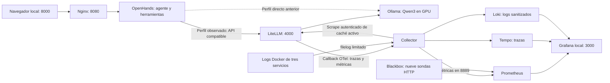

# Infraestructura del laboratorio, con código en mano

Fecha: 6 de octubre de 2026. Repositorio: `/home/alejandro/CloudDrive/Engineering/agent-platform`.

Esta guía explica los archivos reales inspeccionados. Separa el código preparado de su activación y de las pruebas registradas. Las revisiones anteriores a esta instantánea inicial no tenían commits; por tanto, la explicación retrospectiva no es un diff histórico exacto. En este turno se prepara el primer commit local, que establece una base para revisar las próximas modificaciones. El registro de cambios está en [CHANGELOG.md](CHANGELOG.md).

**1. Lo que hemos construido y su recorrido**

Un laboratorio local donde OpenHands ejecuta herramientas y consulta Qwen3 servido por Ollama. LiteLLM proporciona una frontera API para observar las llamadas que pasan por él. Collector, Prometheus, Tempo, Loki y Grafana recolectan y muestran telemetría. Las sondas HTTP comprueban disponibilidad. Esta es la base experimental de la plataforma agnóstica; los contratos propios de runtime, adapters, DecisionProvider, state store, MCP gateway y políticas aún están en el [plan](PLAN.md).



El perfil directo salta LiteLLM. No produce sus métricas de consumo. La ruta efectiva se elige en la configuración de la conversación OpenHands; añadir contenedores a Compose no cambia por sí solo todas las conversaciones.

**2. mise, Task y scripts: tres responsabilidades**

mise fija herramientas del entorno. Actualmente fija Task; no administra por sí mismo el daemon Docker ni el driver del kernel. El bootstrap de mise verifica hashes y su versión está en `infra/host/mise-version.json`. `mise.lock` conserva el artefacto y checksum de Task para cada plataforma.

Fuente: [mise.toml](../mise.toml), líneas 1–6. Fragmento literal del archivo actual.

```toml
# mise owns development tool versions and environment activation.
# Taskfile.yml owns task orchestration; scripts/ owns implementation.
# Host packages and image digests are pinned in infra/host/versions.json.

[tools]
task = "3.54.0"
```

Fuente: [Taskfile.yml](../Taskfile.yml), líneas 60–67. Fragmento literal del archivo actual.

```yaml
  llm:setup:
    desc: Start local Ollama, download model and test inference on GPU
    cmds:
      - task: repo:check
      - task: llm:plan
      - task: llm:up
      - task: llm:pull
      - task: llm:check
```

Task encadena pasos en orden. Las tareas llaman scripts en `scripts/bootstrap/`, `host/`, `llm/`, `openhands/`, `observability/` y `repo/`. Los bloques extensos viven en esos scripts. El shell coordina Docker y permisos; los helpers Python manejan JSON, API y comprobaciones estructuradas.

**3. Docker y acceso a la GPU**

`infra/host/versions.json` fija nueve paquetes de Docker/Compose/Buildx/containerd y NVIDIA Container Toolkit para Ubuntu 26.04 amd64. El instalador verifica el sistema y conflictos, hace backups de configuraciones existentes, instala desde repositorios APT firmados y verifica las versiones resultantes. Reutiliza el driver NVIDIA del host; no lo sustituye ni agrega automáticamente usuarios al grupo Docker.

Fuente: [scripts/host/install-docker-gpu.sh](../scripts/host/install-docker-gpu.sh), líneas 79–82. Fragmento literal del archivo actual.

```bash
    sudo apt-get install -y --no-install-recommends "${package_specs[@]}"
    sudo nvidia-ctk runtime configure --runtime=docker
    sudo systemctl enable --now docker
    sudo systemctl restart docker
```

`nvidia-ctk` registra el runtime NVIDIA en la configuración de Docker; la petición de GPU de Compose habilita el dispositivo para Ollama. Esto es distinto de fijar la imagen del servidor o descargar pesos. Los reportes iniciales verificaron driver, `hello-world` y `nvidia-smi` dentro de un contenedor. La inferencia se validó luego con el modelo real.

Las operaciones Docker usan explícitamente `--context default`. Desde esta sesión el socket exige sudo interactivo: los scripts solicitan autenticación en tu terminal. No hemos ejecutado Work como root.

**4. Ollama: servicio, modelo, límites y persistencia**

Ollama corre en un contenedor fijado por digest, no como instalación global de inferencia. Los pesos de `qwen3:8b` se descargan dentro del volumen `agent-platform-local_ollama-data`, montado en `/root/.ollama`. El volumen lo administra Docker y no se guarda en Git/CloudDrive. `infra/llm/versions.json` fija también el digest del modelo, porque el tag puede cambiar.

Fuente: [infra/llm/compose.yaml](../infra/llm/compose.yaml), líneas 7–27. Fragmento literal del archivo actual.

```yaml
    ports:
      - "127.0.0.1:11434:11434"
    environment:
      OLLAMA_HOST: "0.0.0.0:11434"
      OLLAMA_NO_CLOUD: "1"
      OLLAMA_CONTEXT_LENGTH: "32768"
      OLLAMA_NUM_PARALLEL: "1"
      OLLAMA_MAX_LOADED_MODELS: "1"
      OLLAMA_KEEP_ALIVE: "5m"
    volumes:
      - ollama-data:/root/.ollama
    deploy:
      resources:
        reservations:
          devices:
            - driver: nvidia
              device_ids: ["0"]
              capabilities: [gpu]
    mem_limit: 12g
    cpus: 8
    cap_drop: [ALL]
```

El binding `127.0.0.1` publica la API solo en loopback del host. `OLLAMA_HOST=0.0.0.0` permite que el servidor reciba conexiones dentro de su contenedor, incluidas las redes Compose. No abre el puerto del host a toda la LAN. `OLLAMA_NO_CLOUD` desactiva funcionalidades cloud de Ollama.

Se pasó de contexto 8192 a 32768 en el laboratorio. Se mantiene una petición paralela y un modelo cargado para limitar el consumo de memoria. La GPU se solicita por ID 0. Los límites de RAM/CPU del contenedor están separados de la VRAM de la GPU.

`pull-model.sh` revisa espacio, descarga y comprueba el digest; `check-inference.py` prueba generación, tool call sintético, API compatible y residencia en VRAM. No demuestra por sí solo que cualquier tarea de agente funcione. Se corrigió la medición de velocidad para dividir tokens por tiempo de generación, separando carga del modelo y procesamiento del prompt.

Fuente: [scripts/llm/check-inference.py](../scripts/llm/check-inference.py), líneas 34–37. Fragmento literal del archivo actual.

```python
    count, duration = data.get("eval_count", 0), data.get("eval_duration", 0)
    if count <= 0 or duration <= 0:
        raise ValueError("Missing generation token/timing metrics.")
    return round(count * 1e9 / duration, 2)
```

**5. OpenHands: agente, workspace y red**

El agente organiza pasos y ejecuta herramientas; el modelo genera texto y propuestas de tool calls. OpenHands aporta la UI, conversaciones y herramientas. Ollama sirve el modelo; no decide qué comando de terminal ejecutar.

`infra/openhands/compose.yaml` se combina con el Compose de Ollama, conservando el proyecto y su volumen. OpenHands está en `agent-link`, una red interna, sin Docker socket ni puertos publicados directamente. Nginx recibe el navegador por localhost:8000 y reenvía HTTP/WebSocket al servicio interno.

Fuente: [infra/openhands/compose.yaml](../infra/openhands/compose.yaml), líneas 9–29. Fragmento literal del archivo actual.

```yaml
    networks: [agent-link]
    group_add: ["${OH_HOST_GID:?Run scripts/openhands/up.sh}"]
    environment:
      OH_WORKSPACE_PATH: /projects/demo
      OH_MAX_CONCURRENT_RUNS: "1"
      OH_TELEMETRY_EXPORTER: none
      OH_TELEMETRY_CONSENT: "denied"
      DO_NOT_TRACK: "1"
      OH_ENABLE_VSCODE: "false"
    volumes:
      - openhands-state:/home/openhands/.openhands
      - type: bind
        source: ${OH_WORKSPACE:?Run scripts/openhands/up.sh}
        target: /projects
        bind:
          create_host_path: false
    mem_limit: 6g
    cpus: 4
    pids_limit: 512
    cap_drop: [ALL]
    security_opt: [no-new-privileges:true]
```

Fuente: [infra/openhands/nginx.conf](../infra/openhands/nginx.conf), líneas 19–26. Fragmento literal del archivo actual.

```nginx
        location / {
            proxy_pass http://openhands:8000;
            proxy_http_version 1.1;
            proxy_set_header Host $http_host;
            proxy_set_header Upgrade $http_upgrade;
            proxy_set_header Connection $connection_upgrade;
            proxy_buffering off;
            proxy_read_timeout 3600s;
```

`OH_WORKSPACE` es `artifacts/openhands/projects` en el repositorio; el bind lo monta como `/projects`. Por tanto, `artifacts/openhands/projects/demo` se ve en el agente como `/projects/demo`. Su estado persistente vive en `openhands-state`, separado de esos archivos.

`OH_WORKSPACE_PATH` expresa la ruta configurada, pero comprobamos que una conversación puede empezar en `/home/openhands/workspace/project/<id>`. Por eso se pidió ejecutar explícitamente `pwd` y trabajar en `/projects/demo`. No declaramos que esa variable imponga el directorio efectivo de cualquier conversación.

Se usa el grupo del host y permisos 2770 para dar acceso al usuario no root del contenedor. Una corrección importante fue preservar las dos variables al cruzar sudo: sin esto Compose fallaba por valores ausentes.

Fuente: [scripts/openhands/common.sh](../scripts/openhands/common.sh), líneas 4–17. Fragmento literal del archivo actual.

```bash
oh_root="$llm_repo_root"
export OH_HOST_GID="$(id -g)"
export OH_WORKSPACE="$oh_root/artifacts/openhands/projects"
oh_image() {
    python3 - "$oh_root/infra/openhands/versions.json" <<'PYCODE'
import json, sys
print(json.load(open(sys.argv[1]))['image'])
PYCODE
}
oh_compose() {
    # sudo filters exported variables; preserve only these two Compose inputs.
    if [[ "${llm_docker[0]}" == sudo ]]; then
        sudo --preserve-env=OH_HOST_GID,OH_WORKSPACE docker --context default compose \
            -f "$llm_compose_file" -f "$oh_root/infra/openhands/compose.yaml" "$@"
```

Los scripts comprueban que el usuario de la imagen no sea root y pueda escribir en demo y su estado. La UI se validó con una demo de suma y un bugfix Decimal; el agente necesitó guía tras herramientas inválidas. Subagentes y cambio automático de perfiles se mantienen desactivados en el perfil del laboratorio, configurado en la UI; no son garantías impuestas por Compose.

**6. LiteLLM: ruta observada y callbacks existentes**

El perfil observado de OpenHands debe usar modelo `openai/qwen3:8b`, base URL `http://litellm:4000/v1` y la clave privada del proxy. El prefijo `openai/` selecciona el protocolo compatible en esta integración; el destino configurado sigue siendo Ollama local. El perfil anterior usa `http://ollama:11434/v1` y accede directamente.

Fuente: [infra/observability/litellm.yaml](../infra/observability/litellm.yaml), líneas 1–34. Fragmento literal del archivo actual.

```yaml
model_list:
- model_name: qwen3:8b
  litellm_params:
    model: openai/qwen3:8b
    api_base: http://ollama:11434/v1
    api_key: local-only
    timeout: 180
litellm_settings:
  callbacks:
  - otel
  - prometheus
  # The native Prometheus callback handles OpenAI/Ollama cached_tokens.
  prometheus_metrics_config:
  - group: local_prompt_cache
    metrics:
    - litellm_input_cached_tokens_metric
    - litellm_input_cache_creation_tokens_metric
    include_labels:
    - model
  require_auth_for_metrics_endpoint: true
  turn_off_message_logging: true
  set_verbose: false
  json_logs: true
  num_retries: 0
  request_timeout: 180
general_settings:
  master_key: os.environ/LITELLM_MASTER_KEY
  disable_spend_logs: true
callback_settings:
  otel:
    attributes:
      include_list:
      - gen_ai.operation.name
      - gen_ai.request.model
```

El alias `qwen3:8b` se dirige al backend `openai/qwen3:8b` en `http://ollama:11434/v1`. `local-only` es el placeholder del tramo hacia Ollama; no es la clave que autoriza la entrada a LiteLLM. Se usa timeout de 180 s y cero reintentos del proxy para este laboratorio.

Los callbacks `otel` y `prometheus` ya se validaron en el host. La prueba de caché del 6 de octubre a las 09:57 Europe/Berlin cotejó 1.623 tokens reutilizados con un aumento idéntico del contador. No debe confundirse código en disco con configuración cargada en el proceso.

Fuente: [infra/observability/compose.yaml](../infra/observability/compose.yaml), líneas 164–175. Fragmento literal del archivo actual.

```yaml
      OTEL_SERVICE_NAME: litellm-proxy
      OTEL_METRICS_EXEMPLAR_FILTER: always_off
      OTEL_EXPORTER: otlp_http
      OTEL_ENDPOINT: http://collector:4318/v1/traces
      OTEL_EXPORTER_OTLP_ENDPOINT: http://collector:4318
      OTEL_EXPORTER_OTLP_PROTOCOL: http/protobuf
      LITELLM_OTEL_INTEGRATION_ENABLE_METRICS: 'true'
      LITELLM_OTEL_INTEGRATION_ENABLE_EVENTS: 'false'
      OTEL_INSTRUMENTATION_GENAI_CAPTURE_MESSAGE_CONTENT: NO_CONTENT
      USE_OTEL_LITELLM_REQUEST_SPAN: 'true'
      LITELLM_LOCAL_MODEL_COST_MAP: 'true'
      DO_NOT_TRACK: '1'
```

Estas variables envían OTel por HTTP/protobuf al Collector interno. Desactivan captura de mensajes y eventos, y los exemplars de métricas; habilitan métricas de uso y el span de entrada del proxy. El filtro de atributos de `litellm.yaml` limita etiquetas de las métricas. Se retiró `gen_ai.token.type` de ese filtro porque LiteLLM lo trata como discriminador estructural y rechazaba inicializar el callback.

Una conversación puede conservar su propia configuración después de editar los defaults. `openhands:profile:check` lee los defaults; `openhands:usage:check CONVERSATION_ID=...` lee la ruta actual y uso de la conversación concreta, sin imprimir mensajes o claves. La ruta actual no demuestra todas las rutas históricas.

**7. Seguridad y almacenamiento de credenciales**

LiteLLM rechazó arrancar sin una master key. Se corrigió con una clave fuerte persistente; no se activó su bypass de claves ausentes/débiles. Grafana requiere login y tiene acceso anónimo y signup desactivados. Las credenciales se crean fuera del repositorio y CloudDrive, en `${XDG_DATA_HOME:-$HOME/.local/share}/agent-platform/observability`.

`prepare-secrets.py` conserva las credenciales existentes, comprueba propiedad y formato y rechaza symlinks.

Fuente: [scripts/observability/prepare-secrets.py](../scripts/observability/prepare-secrets.py), líneas 15–24. Fragmento literal del archivo actual.

```python
    directory.mkdir(parents=True, exist_ok=True, mode=0o700)
    directory.chmod(0o700)
    for name, generate in [('admin-password', lambda: secrets.token_urlsafe(32)),
                           ('litellm-master-key', lambda: 'sk-'+secrets.token_hex(32))]:
        path = directory/name
        try:
            fd = os.open(path, os.O_WRONLY | os.O_CREAT | os.O_EXCL | os.O_NOFOLLOW, 0o600)
        except FileExistsError:
            pass
        else:
```

La carpeta queda con permisos 700 y los archivos 600. No mostramos valores en documentación, diffs ni reportes. `.gitignore` excluye `.env`, claves, pesos y `artifacts/`; los archivos Docker originales y el workspace pueden contener contenido sin redacción. Excluir de Git no excluye automáticamente de la sincronización CloudDrive.

Los servicios usan imágenes fijadas, límites de memoria/CPU, capacidades retiradas, `no-new-privileges`, configuraciones montadas read-only y logs rotados. El agente sigue pudiendo modificar su workspace y ejecutar herramientas. No hay todavía una capa propia completa de aprobación, políticas ni auditoría inmutable. El master key es administrativo y corresponde al laboratorio local, no a usuarios familiares independientes.

**8. Collector: recepción, privacidad y tres destinos**

`infra/observability/collector.json` recibe OTLP HTTP 4318 y gRPC 4317, aplica límites de memoria, filtros y procesamiento por lotes. Su pipeline de trazas entrega spans sanitizados a Tempo y a `spanmetrics`, un conector existente que produce métricas de número/duración de spans. Prometheus lee el exporter de métricas en 8889; también lee telemetría interna del Collector en 8888.

Fragmento estructural de `service.pipelines.traces`, extraído del JSON actual:

```json
{
  "receivers": [
    "otlp"
  ],
  "processors": [
    "memory_limiter",
    "filter/no_events",
    "transform/privacy",
    "batch"
  ],
  "exporters": [
    "otlphttp/tempo",
    "spanmetrics"
  ]
}
```

La privacidad usa listas permitidas: recurso `service.name`, modelo normalizado, números de uso y etiquetas operativas limitadas. Elimina nombres libres, texto de errores, eventos y spans con links. En logs conserva categorías, por ejemplo `tool_validation_error`, y reemplaza el cuerpo completo.

Expresiones OTTL literales de `transform/privacy`:

```text
keep_keys(attributes, ["gen_ai.request.model", "gen_ai.usage.input_tokens", "gen_ai.usage.output_tokens", "gen_ai.usage.total_tokens"])
set(status.message, "")
set(body, "operational record")
```

Esto sanitiza lo exportado, no los originales del host ni todo lo que pasa por memoria. Las canarias sintéticas verifican campos concretos. La correlación de una petición de prueba LiteLLM con su trace ID pasó; la traza completa del agente y el proxy aún necesita aceptación propia.

**9. Logs Docker sin conceder el socket al Collector**

`configure-logs.sh` consulta solo ID, LogPath y driver de OpenHands, Ollama y LiteLLM desde la terminal con permisos Docker. `configure-logs.py` genera mounts read-only de sus directorios específicos y receivers filelog, con offsets persistidos. El Collector usa UID 0 para poder leerlos, conserva capacidades retiradas y no recibe `docker.sock`.

Los archivos generados son `artifacts/observability/collector-with-logs.json` y `logs-compose.json`; el JSON de `infra/` es la fuente canónica. Se regeneran tras recrear contenedores para no seguir IDs/logpaths antiguos. `start_at: end` captura nuevos registros del archivo activo; no es una importación histórica completa.

**10. Prometheus, Tempo, Loki y Grafana**

Prometheus guarda métricas en su volumen, con retención de 7 días y tamaño máximo TSDB de 1 GB. Tempo guarda WAL y bloques de trazas en volumen local; su Compose fija retención objetivo 168 h. Loki guarda chunks/index y aplica retención 168 h. Grafana conserva su estado en volumen. Son límites del laboratorio, no almacenamiento enterprise de alta disponibilidad.

Los backends están en una red `data` interna y no publican puertos del host. Grafana publica `127.0.0.1:3000`; LiteLLM comparte `data` y `agent-link` para conectar agente y modelo. Loki/Tempo carecen de autenticación propia en esta configuración interna; esa frontera no permite exponerlos directamente a la familia.

Fuente: [infra/observability/grafana/provisioning/datasources/sources.yaml](../infra/observability/grafana/provisioning/datasources/sources.yaml), líneas 1–21. Fragmento literal del archivo actual.

```yaml
apiVersion: 1
datasources:
- name: Prometheus
  type: prometheus
  uid: prometheus
  url: http://prometheus:9090
  access: proxy
  isDefault: true
  editable: false
- name: Tempo
  type: tempo
  uid: tempo
  url: http://tempo:3200
  access: proxy
  editable: false
- name: Loki
  type: loki
  uid: loki
  url: http://loki:3100
  access: proxy
  editable: false
```

Fuente: [infra/observability/grafana/provisioning/dashboards/dashboards.yaml](../infra/observability/grafana/provisioning/dashboards/dashboards.yaml), líneas 1–10. Fragmento literal del archivo actual.

```yaml
apiVersion: 1
providers:
- name: Agent Platform
  orgId: 1
  folder: Agent Platform
  type: file
  disableDeletion: true
  allowUiUpdates: false
  options:
    path: /var/lib/grafana/dashboards
```

Grafana tiene UID estables de fuentes y dashboards JSON montados read-only. Provisioning hace que se carguen desde archivos y evita que una edición UI sea la fuente de verdad. Hay siete dashboards: overview, agent operations, LLM cost/routing, model quality, security, tools/MCP y workflow KPIs. Las áreas sin métricas se muestran como pendientes.

Blackbox hace GET sin claves a nueve endpoints con timeout 3 s. Prometheus evalúa dos alertas tras 2 minutos: endpoint no disponible y scrape no disponible. No se ha configurado Alertmanager ni notificaciones. Salud HTTP no prueba que una tarea de agente haya completado correctamente.

**11. Golden signals, totales y caché: qué consultas cambiamos**

Tráfico, errores y p95 usan el span SERVER `Received Proxy Server Request`, en vez de sumar los spans internos de la misma petición. Saturación visible actualmente es ocupación de colas del Collector; no es utilización ni cola de la GPU/Ollama.

Entrada/salida usan el histograma nativo de uso de tokens. Sus tarjetas acumuladas son consultas instantáneas, reducción `lastNotNull`, sin sumar muestras del contador. El período usa `increase` y las tasas `rate`. Un scrape repetido del contador no representa otra llamada.

Consulta literal — **Entrada · tokens acumulados**:

```promql
sum(gen_ai_client_token_usage_sum{job="otel-collector",exported_job="litellm-proxy",gen_ai_request_model=~"qwen3:8b|unknown",gen_ai_token_type="input"})
```

Consulta literal — **Entrada · tokens del período**:

```promql
sum(increase(gen_ai_client_token_usage_sum{job="otel-collector",exported_job="litellm-proxy",gen_ai_request_model=~"qwen3:8b|unknown",gen_ai_token_type="input"}[$__range]))
```

Consulta literal — **Cache Hit · tokens acumulados**:

```promql
sum(litellm_input_cached_tokens_metric_total{job="otel-collector",exported_job="litellm-proxy",gen_ai_request_model="qwen3:8b"})
```

La captura OpenHands acumulaba entrada 125.088, de los cuales 95.780 eran cache-read, y salida 4.838. Total = entrada + salida = 129.926. Los tokens cacheados ya están en entrada; no se suman otra vez. La prueba local de dos llamadas idénticas reportó entrada 1.624 en ambas y caché 1→1.623, confirmando reutilización real. El contador antiguo del proxy de 30/4 tenía otro alcance; no demuestra un fallo de suma de Grafana.

El callback OTel fijado no cubre correctamente el campo anidado de caché de Ollama. El callback Prometheus existente sí lo lee. Por eso se añadieron dos métricas permitidas, un scrape autenticado del Collector y paneles de lectura/escritura, acumulados, períodos, tasas, porcentaje y salud de ese scrape. No se escribió un adaptador nuevo de runtime.

Fragmento del receiver actual, con credencial referenciada y sin revelar su valor:

```json
{
  "config": {
    "scrape_configs": [
      {
        "job_name": "litellm-cache",
        "scrape_interval": "15s",
        "scrape_timeout": "5s",
        "metrics_path": "/metrics/",
        "follow_redirects": false,
        "authorization": {
          "type": "Bearer",
          "credentials": "${env:LITELLM_MASTER_KEY}"
        },
        "static_configs": [
          {
            "targets": [
              "litellm:4000"
            ]
          }
        ],
        "metric_relabel_configs": [
          {
            "source_labels": [
              "__name__"
            ],
            "regex": "litellm_input_(cached|cache_creation)_tokens_metric_total",
            "action": "keep"
          },
          {
            "source_labels": [
              "model"
            ],
            "regex": "(openai/)?qwen3:8b",
            "action": "keep"
          },
          {
            "source_labels": [
              "model"
            ],
            "regex": "(openai/)?qwen3:8b",
            "replacement": "qwen3:8b",
            "target_label": "gen_ai.request.model"
          },
          {
            "regex": "__name__|gen_ai.request.model",
            "action": "labelkeep"
          }
        ]
      }
    ]
  }
}
```

El Collector también recibe el master key en su entorno para esa lectura interna. El filtro acepta solo el modelo local y elimina etiquetas privadas. `transform/cache-monitor` renombra `up` como `litellm.cache.scrape.up`: si la lectura falla, el panel muestra fallo aunque un contador previo siga visible. El callback omite series de caché ausentes/cero; “Sin datos” no equivale a cero. No se importan los 95.780 de la captura como telemetría nueva.

**12. Arranque, correcciones y aceptación**

`observability:up` valida configuración, prepara credenciales persistentes, arranca servicios, comprueba procesos/readiness y regenera filelog. Fue necesario usar `--force-recreate`: cambiar el contenido de un archivo bind-mounted no garantiza que Compose reinicie el proceso que debe volver a leerlo.

Fuente: [scripts/observability/up.sh](../scripts/observability/up.sh), líneas 18–18. Fragmento literal del archivo actual.

```bash
obs_compose up -d --force-recreate
```

Otras correcciones documentadas: preservar variables al usar sudo; tratar tools null como defaults heredados en el diagnóstico; distinguir contenedor creado de proceso que sigue vivo; mantener health_check al añadir file_storage; corregir el nombre real del contador canario; quitar el discriminador reservado del filtro OTel; medir velocidad de generación sin carga/prefill; distinguir totales de rates e incrementos estimados.

| Parte | Evidencia registrada | Límite |
| --- | --- | --- |
| GPU y Docker/NVIDIA | Driver, contenedor y smoke checks pasaron | No prueba calidad de agente |
| Ollama/Qwen3 | Digest, generación, tool call y VRAM pasaron | Modelo pequeño puede fallar tareas complejas |
| OpenHands | Demo y bugfix pasaron tests y aceptación independiente | Requirió guía; no es autonomía general |
| Pila de observabilidad anterior | Chequeo del host pasó el 6 de octubre a las 00:09:47 Europe/Berlin | Llamada sintética; correlación completa del agente pendiente |
| Dashboards actuales | Provisioning y 59 consultas aceptadas | No hay datos de todas las áreas futuras |
| Nuevo scrape de caché | Binario Collector fijado: auth, redacción, acumulados, fallo HTTP y ausencia de cero inventado pasaron | Prueba integral del host aprobada el 6 de octubre a las 09:57 Europe/Berlin |
| Uso histórico de esa conversación | Captura y diagnóstico preparado | Perfil guardado apunta a LiteLLM; se volvió a seleccionar en la conversación. Falta observar una llamada nueva para confirmar la ruta efectiva |

Evidencia: [GPU](diagnostics/GPU-2026-10-04.md), [aceptación de observabilidad](diagnostics/OBSERVABILITY-2026-10-06.md), [tokens/caché](diagnostics/TOKENS-2026-10-06.md), [OpenHands](OPENHANDS.md).

Para validar la ampliación de caché, cuando el agente esté inactivo:

```bash
mise exec -- task observability:up
mise exec -- task observability:cache:check
mise exec -- task observability:check
```

`up` reinicia servicios y contadores actuales de LiteLLM, preservando volúmenes y conversaciones. No es necesario reinstalar Docker, GPU o el modelo. Estos comandos todavía requieren tu terminal por sudo; esta guía no afirma que ya se hayan ejecutado para la ampliación de caché.

**13. Dónde termina la fase actual**

LiteLLM tiene un destino local configurado; aún no hay decisión intercambiable ni escalado automático entre proveedores. El volumen OpenHands persiste su estado, pero no es el state store desacoplado futuro. Las herramientas de OpenHands funcionan dentro del contenedor; no equivalen a un gateway MCP/policy propio. Faltan métricas GPU/host, auditoría durable, aprobaciones, evaluación de calidad y resultados de workflow, además de identidad y despliegue multiusuario/Kubernetes. Jev sigue sin ser un requisito.

**14. Dónde encajarían LangChain y LangGraph**

LangChain proporciona componentes para crear el ciclo de un agente con modelos, instrucciones, herramientas y middleware. LangGraph aporta control de pasos, bifurcaciones y estado, incluida ejecución con intervención humana. Fuentes: [LangChain](https://docs.langchain.com/oss/python/langchain/overview) y [LangGraph](https://docs.langchain.com/oss/python/langgraph/overview).

En este laboratorio OpenHands ya desempeña la capa de agente. Un workflow propio con LangChain/LangGraph podría ser otro cliente de LiteLLM y reutilizar el mismo backend Ollama. Observar sus llamadas LLM no basta para observar sus decisiones: sus pasos necesitarían instrumentación propia. No se instaló LangChain ni se añadió un contenedor; es una ubicación posible para la fase de runtime desacoplado.

Ejemplo ilustrativo, **no instalado ni ejecutado**. La URL `litellm` se resuelve desde un cliente en su red Compose; no desde cualquier proceso del host. Las dependencias y credenciales deben prepararse antes de convertirlo en un ejercicio real. La interfaz [ChatOpenAI](https://docs.langchain.com/oss/python/integrations/chat/openai) permite configurar el endpoint compatible.

```python
import os
from langchain.agents import create_agent
from langchain_openai import ChatOpenAI


def sumar(a: int, b: int) -> int:
    """Suma dos enteros para el ejercicio pedagógico."""
    return a + b


modelo = ChatOpenAI(
    model="qwen3:8b",
    base_url="http://litellm:4000/v1",
    api_key=os.environ["LITELLM_MASTER_KEY"],
    temperature=0,
)
agente = create_agent(model=modelo, tools=[sumar])
resultado = agente.invoke({
    "messages": [{"role": "user", "content": "Calcula 2 + 3 usando sumar."}]
})
```

El código del workflow permanece separado de los pesos y el servidor de inferencia. La adopción del framework y el diseño de permisos, presupuestos, checkpoints y métricas se decidirán en esa fase.

**15. Cómo verás los próximos cambios**

Antes de editar mostraré archivos, propósito y alcance. Después mostraré diff real o fragmentos concretos, validaciones y lo que falta aplicar. Las decisiones de infraestructura seguirán en `infra/`, la operación en Task/scripts y la documentación en `docs/`. Nunca se incluirán claves o contenido de conversaciones en un diff. La regla queda guardada en el `AGENTS.md` del repositorio.
