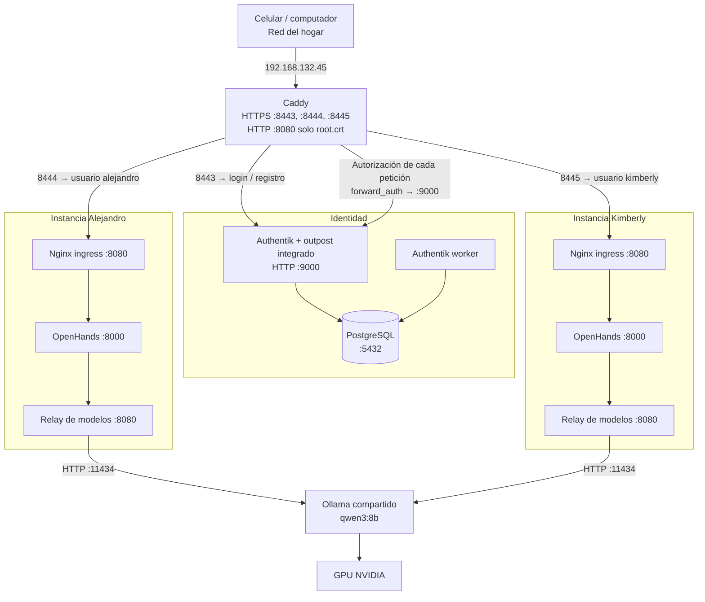
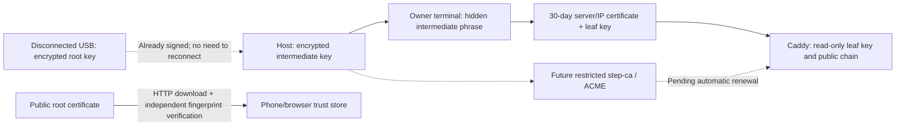
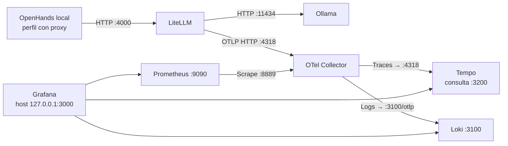

# Household architecture: named users through Caddy

The owner selected Caddy and clarified that the deliverable is **working
OpenHands access from a phone for alejandro and kimberly**, not an identity login
page alone. These two connection maps reproduce the diagrams approved in the
conversation on October 26, 2026, including their Spanish labels and the recorded
LAN address. The address is a snapshot, not a hard-coded deployment input; a
future address change must be reflected in this map after network/TLS review.
Owner reports show the household and identity services running. The latest login
routing fixes are prepared and tested; their application and real phone/MFA/agent
acceptance remain unconfirmed. Arrows describe configured connections, not a
claim of completed end-to-end acceptance.
Use [the complete installation sequence](../household_access.md).

## Browser, identity and agent paths

Each username has an Authentik account, non-admin group, proxy provider and
application policy binding. Dedicated TOTP enrollment/validation flows are added
for this IP-origin setup; no global administrator password or service-account
user is modified. The existing embedded outpost retains its prior providers.
Caddy rejects a different username even if an identity header is forged or an
application policy is accidentally broader. Host **and port** are forwarded so
the outpost selects the correct application's external URL.

Canvas pages, APIs and WebSocket handshakes all pass through authorization. The
authorized browser receives only that instance's native key, and each origin has
separate browser storage. No personal agent, ingress or relay has a published
host port. Caddy joins their separate frontends, not their agent backends. Agents
have private internal backend networks and can reach only their fixed model
relay; it forwards model listing/chat completion to Ollama, not arbitrary URLs.

These are fresh personal instances, not a migration of the prior demo or
synthetic pilots. Existing demo data/conversations remain untouched. Personal
storage uses a distinct purpose record and backing images, with verified mounts
so reboot cannot silently switch to an unmounted fallback directory.

## Published host ports

These mappings describe the reviewed Compose sources. They are not a new live
socket inventory. Caddy terminates client TLS; the HTTP connections shown between
containers do not use TLS.

| Host address | Destination | Reachability |
| --- | --- | --- |
| `192.168.132.45:8443` | Caddy → Authentik login/enrollment | Allowed home LAN |
| `192.168.132.45:8444` | Caddy → Alejandro OpenHands | LAN; authentication and own-user authorization required |
| `192.168.132.45:8445` | Caddy → Kimberly OpenHands | LAN; authentication and own-user authorization required |
| `192.168.132.45:8080/root.crt` | Public root certificate download | Allowed home LAN; no private signing key |
| `127.0.0.1:9000` | Authentik direct UI | Host loopback only |
| `127.0.0.1:11434` | Ollama direct API | Host loopback only |
| `127.0.0.1:3000` | Grafana | Host loopback only |

Personal OpenHands, ingress and model-relay containers publish no host ports.
The household renderer removes the synthetic template's ingress port mapping
with `ingress.pop('ports')`. Ingress listens on container port 8080 and proxies to
OpenHands port 8000. Each model relay listens on container port 8080 and forwards
only the configured model API routes to Ollama port 11434.

## Docker network membership

| Network | Connected components | `internal: true` |
| --- | --- | --- |
| `agent-platform-identity-local_frontend` | Caddy, Authentik server | No |
| `agent-platform-identity-local_database` | Authentik server, worker, PostgreSQL | Yes |
| `agent-platform-household-alejandro_frontend` | Caddy, Alejandro ingress | No |
| `agent-platform-household-alejandro_backend` | Alejandro ingress, OpenHands, model relay | Yes |
| `agent-platform-household-kimberly_frontend` | Caddy, Kimberly ingress | No |
| `agent-platform-household-kimberly_backend` | Kimberly ingress, OpenHands, model relay | Yes |
| `agent-platform-local_default` | Ollama, both model relays; other local services according to selected Compose files | No |

Compose `external: true` means reuse an existing Docker network; it does not mean
Internet exposure. Caddy connects the identity and personal frontend networks.
Each relay connects its owner's backend to the shared model network. The agents
have separate processes, networks and storage; Caddy, Ollama, GPU and host remain
shared. This does not establish VM isolation or certify resistance to host/kernel
compromise.

Source of truth:
[gateway Compose](../../infra/gateway/compose.yaml),
[Caddy routing](../../infra/gateway/Caddyfile),
[household renderer and relay](../../scripts/household/household.py),
[instance template](../../infra/openhands/instances/compose.yaml),
[internal ingress](../../infra/openhands/nginx.conf),
[identity Compose](../../infra/identity/local-compose.yaml), and
[Ollama Compose](../../infra/llm/compose.yaml).

## Certificate and secret ownership

Caddy never receives root/intermediate signing keys. Their phrases stay in the
owner's foreground process and anonymous descriptors. Invitation links travel through memory-backed IPC into private owner-only
files outside Git/CloudDrive; their values are excluded from task output and
CLI/environment values. User passwords are entered only through Authentik HTTPS. The shared host, owner and privileged Docker daemon
remain trusted boundaries. Filesystem/process restrictions are not a claim of
kernel escape resistance or unprivileged Docker.

Manually loaded certificates do not renew themselves. Initial renewal is the
supervised `gateway:tls:issue` / `gateway:up` operation. step-ca, restricted ACME
enrollment and renewal failure/expiry alerting remain pending.

## Observability and remaining platform work

The second approved diagram shows the local single-agent proxy path. Grafana
queries the backends; Prometheus scrapes Collector metrics. The observability
stack's current running state was not rechecked during this documentation edit:

The observability services share `agent-platform-observability_data`
(`internal: true`). LiteLLM and Blackbox also join
`agent-platform-local_agent-link`; Grafana also joins its Compose default network.
Collector OTLP listeners are 4317/4318; the diagram shows the configured HTTP
export on 4318. Tempo's 4318 ingest and 3200 query endpoints are different roles.
Prometheus 9090, Loki 3100, Tempo 3200 and Collector 8889 are container endpoints,
not additional published host ports. See
[observability Compose](../../infra/observability/compose.yaml),
[Collector pipelines](../../infra/observability/collector.yaml),
[Prometheus targets](../../infra/observability/prometheus.yaml), and
[Grafana data sources](../../infra/observability/grafana/provisioning/datasources/sources.yaml).

New personal usage currently takes the direct local Ollama route and is not
counted in LiteLLM dashboards. Per-user proxy credentials, fair inference/quotas,
logs/traces and workflow metrics must be integrated explicitly. Existing proxy
metrics do not prove personal-user telemetry. Existing WebSockets are bounded to
five minutes; logout/deactivation is not claimed instantaneous because outpost
caching also applies. Live cross-user browser/WebSocket tests and the deferred
full identity application restore rehearsal remain open.

## Decision and files

Caddy is the selected shared entry gateway; Nginx remains the internal per-user
ingress/model relay. Caddy offers a compact proxy configuration and a later ACME
client integration. Nginx could meet the same entry role and has an ACME module;
Kong's API-management facilities were not needed for this household browser goal.
No inherent security or performance superiority is assumed from the product.

| Source | Responsibility |
| --- | --- |
| `config/household/users.yaml` | Named users, fixed UID/GID, storage sizes and HTTPS origins |
| `scripts/household/` | Safe account provisioning, separate instances, local model defaults and runtime checks |
| `config/gateway/pilot.yaml` | Reviewed names, CA fingerprints and per-user gateway scope |
| `infra/gateway/` | Pinned Caddy image, exact source-IP binding, authorization and leaf-only mounts |
| `mise.toml` / `mise.lock` | Tool versions and environment/storage preparation |
| `Taskfile.yml` | Account, certificate, service operations and tests |

Primary sources: [Authentik Caddy integration](https://docs.goauthentik.io/add-secure-apps/providers/proxy/server_caddy/),
[Authentik proxy requirements](https://docs.goauthentik.io/install-config/reverse-proxy/),
[Caddy TLS](https://caddyserver.com/docs/caddyfile/directives/tls),
[Smallstep policies](https://smallstep.com/docs/step-ca/policies/).

## Invitation enrollment (October 26, 2026)

Household setup now creates application infrastructure and two native invitation
flows, without creating user passwords. The owner issues a 24-hour single-use
link for one reserved username; the recipient chooses a password and enrolls
TOTP through trusted LAN HTTPS. Separate writer stages assign only their own
non-admin group; prompt validation discards client identity/privilege fields.
The generation stored on the server enables revocation/replacement before
password submission. Existing accounts and administrator access are preserved.
See [invitation operations and partial-enrollment behavior](../household_access.md#invite-each-person-lan-only).
No public registration, Internet port exposure, SMTP delivery or new CA is added.
