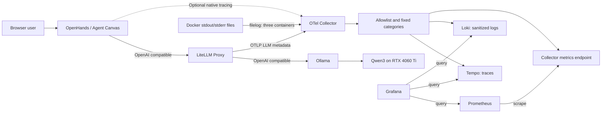
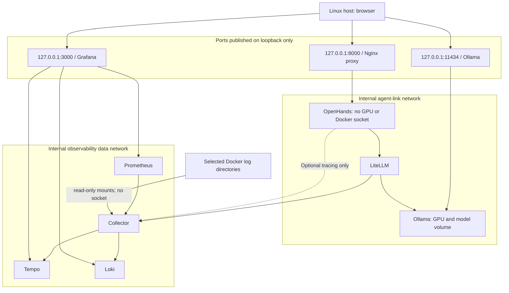
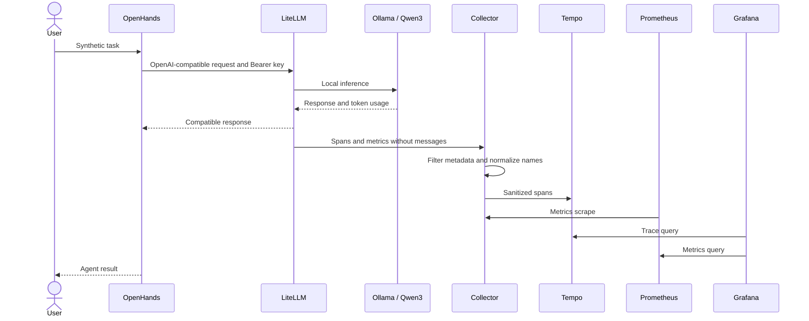
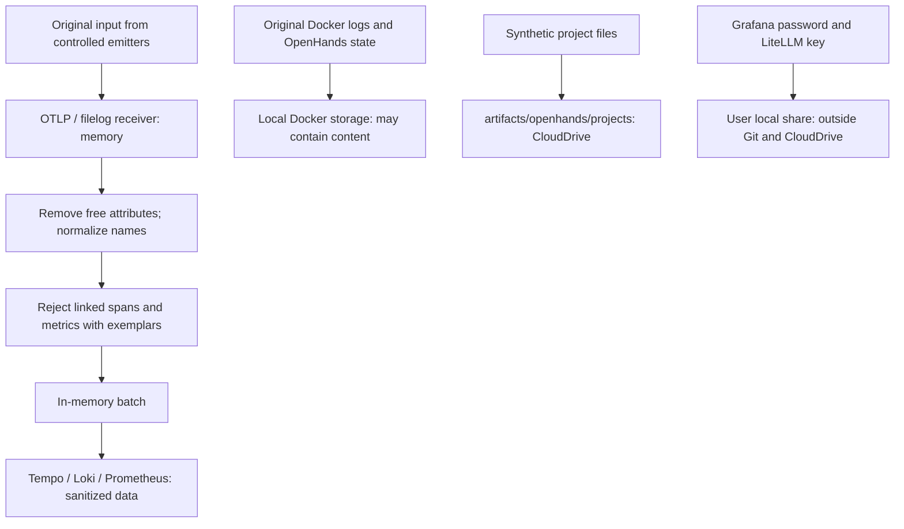
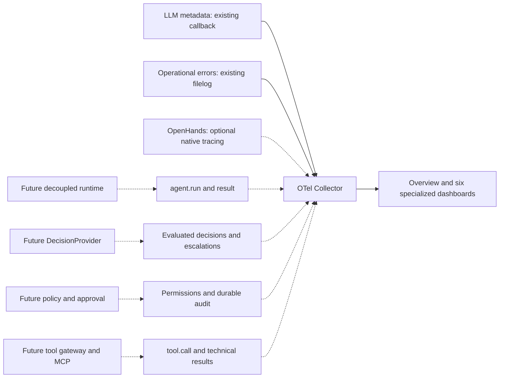
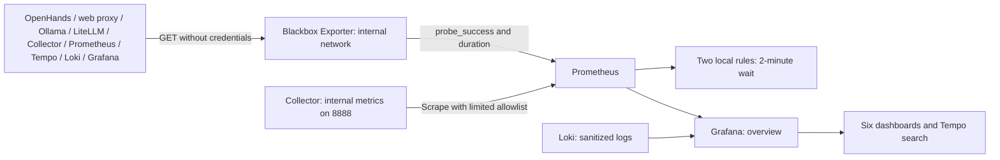
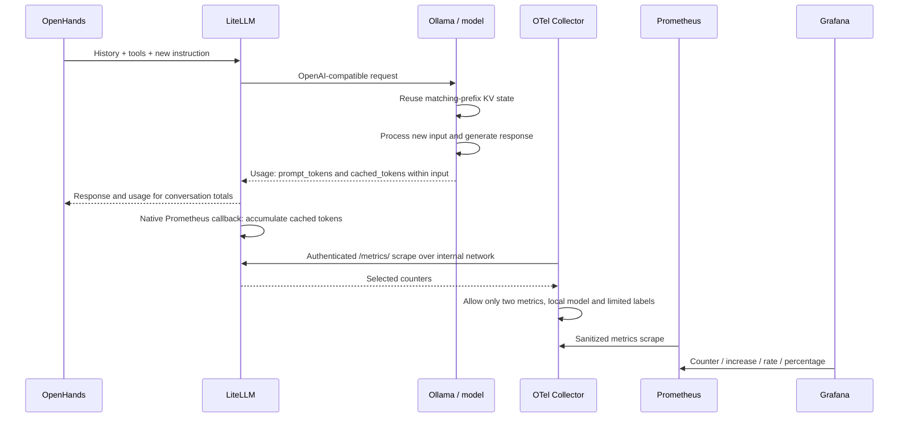
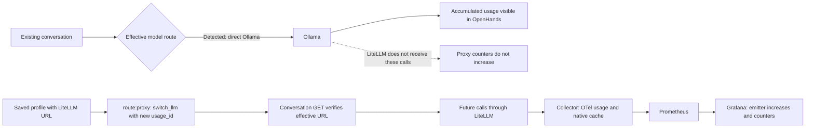

# Observability Diagrams

October 5, 2026. Mermaid versioned diagrams; visible in Markdown readers with Mermaid support, including GitHub. The host passed the synthetic acceptance of the stack. The diagnosed conversation was repaired to use LiteLLM and passed the SSE check; additional increments were observed in Grafana cards. Detailed correlation by conversation is still pending. Dashed lines indicate optional integration or future work.

## 1. Model Path and Telemetry

The model remains in the Ollama volume; LiteLLM does not execute or store its weights. The direct OpenHands → Ollama path remains the previous profile. Native tracing requires independent enablement.

## 2. Networks and Trust Boundaries

Grafana and the proxy UI also have a normal network for publishing their ports. Ollama retains the model download network. Files and the state of OpenHands are not an immutable audit. This internal network does not equate to an agent permission policy.

## 3. Observed Call Sequence

Logs travel through a separate pipeline. The belonging of OpenHands and LiteLLM spans to the same trace requires checking propagation of `traceparent`; this sequence does not assume it.

## 4. Storage and Privacy

LiteLLM excludes messages at source. Native OpenHands and Docker logs may introduce content before the filter; only use synthetic data in this phase. The canary test verifies specific fields, not a general anonymization certification.

## 5. Current Coverage and Runtime Evolution

KPIs require definitions and results emitted by those components. Business metrics are not invented from tokens, spans, or a correct HTTP response.

## 6. Availability and Transport Health

`up` indicates scrape health; `probe_success` indicates endpoint response. Neither substitutes the model call with native tracing, the canary of ingestion/redaction, or the acceptance of a real conversation. No external notifications were configured.

## 7. Real Cache and Counter Walkthrough

Input and output also arrive through the existing OTel callback. The cache is a subset of input; it is not summed again. Repeated readings of a counter do not equate to additional usage. `litellm_cache_scrape_up` indicates if the Collector can read the authenticated exporter. A conversation that accesses Ollama directly skips LiteLLM and remains outside these counters. The current conversation path is verified with `openhands:usage:check`; its previous history is not automatically imported.

## 8. Effective Path: Why Tokens Were Not Growing

The saved profile and the effective model of a conversation are different states. The repair uses the existing OpenHands API, not a new adapter. The 301,409 tokens of conversation life are not imported into Prometheus; this counter only reflects observed traffic. `observability:stream:check` passed with numeric usage and exact increment 23/8. After repairing the path, two additional proxy calls were observed, in addition to that test; the added query does not attribute each call to a conversation.
