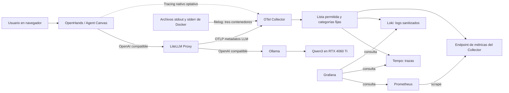
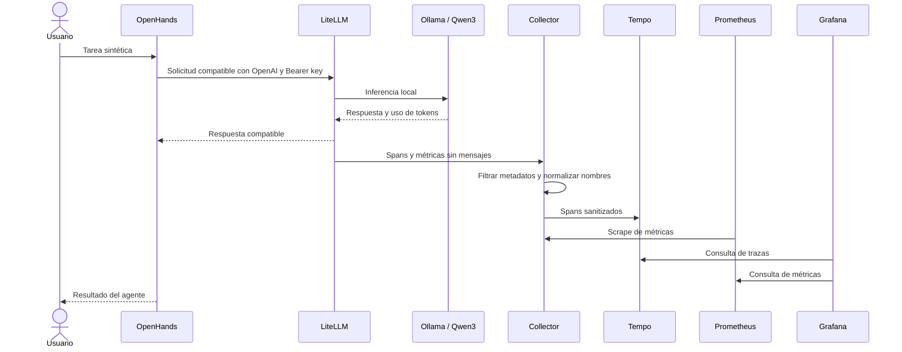
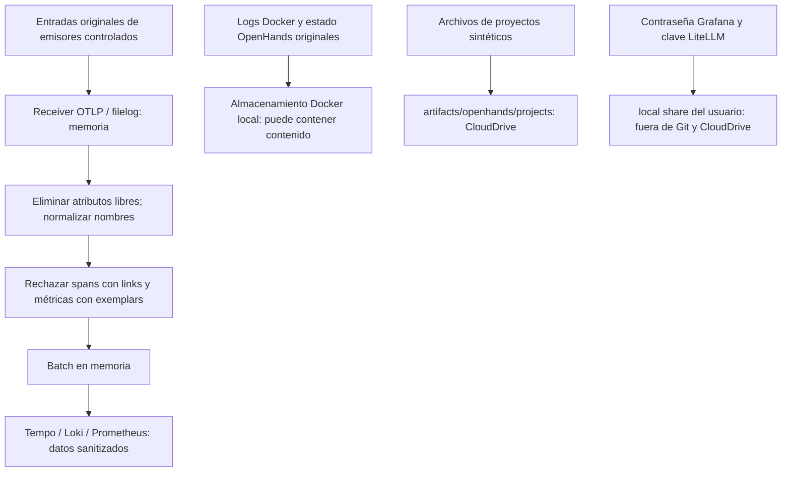
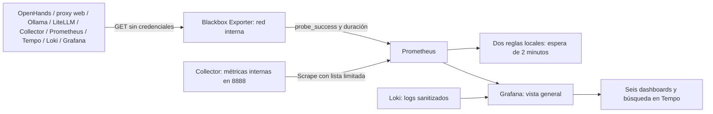
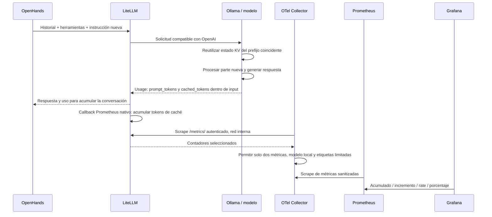
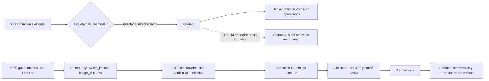

# Diagramas de observabilidad

5 de octubre de 2026. Diagramas Mermaid versionados; visibles en lectores Markdown con soporte Mermaid, incluido GitHub. El host pasó la aceptación sintética de la pila. La conversación diagnosticada fue reparada para usar LiteLLM y pasó la comprobación SSE; se observaron incrementos adicionales en las tarjetas Grafana. La correlación detallada por conversación sigue pendiente. Las líneas discontinuas indican integración optativa o trabajo futuro.

## 1. Ruta del modelo y telemetría

El modelo permanece en el volumen de Ollama; LiteLLM no ejecuta ni almacena sus pesos. La ruta directa OpenHands → Ollama sigue siendo el perfil anterior. El tracing nativo necesita habilitación independiente.

## 2. Redes y límites de confianza

Grafana y el proxy UI tienen también una red normal para publicar sus puertos. Ollama conserva la red de descarga de modelos. Los archivos y el estado de OpenHands no son una auditoría inmutable. Esta red interna no equivale a una política de permisos del agente.

## 3. Secuencia de una llamada observada

Los logs viajan por un pipeline separado. La pertenencia de spans OpenHands y LiteLLM a una misma traza requiere comprobar propagación de `traceparent`; esta secuencia no la presupone.

## 4. Almacenamiento y privacidad

LiteLLM excluye mensajes en origen. OpenHands nativo y logs Docker pueden introducir contenido antes del filtro; solo usar datos sintéticos en esta fase. La prueba canaria verifica campos concretos, no una certificación general de anonimización.

## 5. Cobertura actual y evolución del runtime

Los KPIs requieren definiciones y resultados emitidos por esos componentes. No se inventan métricas de negocio a partir de tokens, spans o una respuesta HTTP correcta.

## 6. Disponibilidad y salud del transporte

`up` indica salud del scrape; `probe_success` indica respuesta del endpoint. Ninguno sustituye la llamada al modelo con traza nativa, la canaria de ingestión/redacción o la aceptación de una conversación real. No se configuraron notificaciones externas.

## 7. Caché real y recorrido de sus contadores

La entrada y salida también llegan por el callback OTel existente. La caché es un subconjunto de entrada; no se suma otra vez. Lecturas repetidas de un contador no equivalen a uso adicional. `litellm_cache_scrape_up` indica si el Collector puede leer el exportador autenticado. Una conversación que accede directamente a Ollama salta LiteLLM y queda fuera de estos contadores. La ruta actual de la conversación se verifica con `openhands:usage:check`; su historial anterior no se importa automáticamente.

## 6. Ruta efectiva: por qué no crecían los tokens

El perfil guardado y el modelo efectivo de una conversación son estados diferentes. La reparación usa la API existente de OpenHands, no un adaptador nuevo. Los 301.409 tokens de vida de la conversación no se importan en Prometheus; este contador solo refleja tráfico observado. `observability:stream:check` pasó con uso numérico e incremento exacto 23/8. Tras reparar la ruta se observaron dos llamadas adicionales del proxy, además de esa prueba; la consulta agregada no atribuye cada llamada a una conversación.
