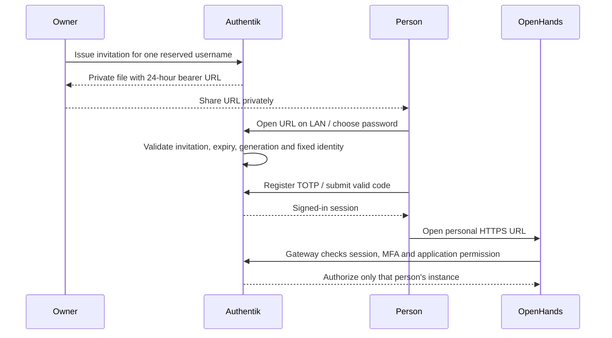
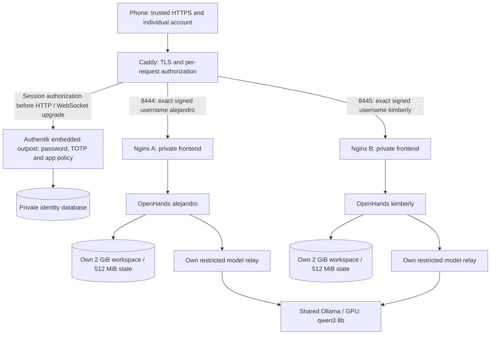

# Named users and OpenHands from a phone

The requested deliverable is individual **alejandro** and **kimberly** logins,
mandatory MFA, and their own working OpenHands instances from a home device.
A working Authentik welcome page alone does not satisfy it. Implementation is
prepared; actual enrollment/container deployment and browser acceptance must
be executed by the owner below. Existing administrator credentials and the old
single-agent/synthetic pilot data are preserved. These are new personal spaces;
old demo conversations are not automatically migrated.

See the [approved connection maps, published ports and Docker networks](architecture/household_gateway.md) for the browser-to-agent and observability paths.

## One installation sequence

Run from `/home/alejandro/CloudDrive/Engineering/agent-platform`:

```bash
mise run env:gateway:setup &&
mise run env:household:setup &&
mise exec -- task gateway:tls:issue &&
mise exec -- task household:setup
```

This completes the requested path in one sequence, with foreground prompts:

1. Cache/validate pinned Caddy and agent images. Environment preparation reserves
   separate fixed filesystems outside Git/CloudDrive: **2 GiB workspace + 512 MiB
   state per account**, with distinct UIDs 200101/200102. It does not repurpose
   synthetic pilot data, create users or start agent services. At least 20 GiB
   host reserve is retained. On reboot, rerun the environment task to remount
   verified existing images; never format or delete a missing mount's fallback.
2. Unlock the **existing intermediate CA phrase** to issue a server certificate.
   Keep the root USB removed. This updates a leaf/release, not the CA. If a leaf
   was already issued against the previous login-only sources, reissuing is
   necessary to select the expanded gateway configuration.
3. Resume Authentik and Ollama. Prepare invitation enrollment without asking
   for or setting user passwords. Existing managed accounts/passwords/factors
   are preserved; existing unmanaged/admin usernames fail rather than being
   adopted or reset. Each person chooses their own password in the browser.
4. Import a dedicated, native-validated family flow, two per-application proxy
   providers, two non-admin groups and individual application policy bindings in
   one database transaction. Add the new providers to the existing embedded
   outpost without replacing its other providers or service-account user. A
   non-default IP brand selects family TOTP login; the localhost administrator
   recovery/login is not replaced globally. Public signup/recovery flows are not added; each reserved account has its own invitation-only enrollment flow.
5. Start two personal agent projects and their ingress/model relays. Configure a
   working `local-qwen3-8b` profile only on first initialization, then preserve
   user settings. Verify native API availability, model discovery, distinct native
   keys, process restrictions, separate networks/mounts and bounded storage.
6. Start Caddy, verify HTTPS/IP certificate and runtime restrictions, then run
   `household:check`. The results still require browser/MFA and real-agent
   acceptance; they do not mark all household SEC controls complete.

The first image pull may take time. Commands emit progress/fixed errors without
printing passwords, native keys or configuration credentials. On failure, retain
all data and share the sanitized output; do not rerun CA creation or delete
personal state to bypass a guard.

## Invite each person (LAN only)

After `household:setup` succeeds, run:

```bash
mise exec -- task household:invite USERNAME=alejandro
mise exec -- task household:invite USERNAME=kimberly
```

Each operation creates a **24-hour, single-use native Authentik invitation** and
prints only its expiry, username and a private file path under
`~/.local/share/agent-platform/invitations/`. The directory is owner-only (0700),
the new file is 0600, and the bearer URL is excluded from task output/reports.
Open that exact file locally with your text editor, copy the HTTPS invitation
URL and send it privately to that person. No email is sent automatically and no
SMTP account is needed. Never paste the link or file contents into this chat,
Git, diagnostic reports or a public channel. An invitation proves possession
of the link, not a separately verified email address. Delete local invitation
files after use/expiry; deletion alone does not revoke an unused invitation.

The recipient must be on the home LAN, trust the verified public root certificate
as described below, and open the link in a signed-out/private browser. The link
names the intended account; username and application group are fixed server-side.
They choose/confirm a password of at least 16 characters that also passes native
password validation, register TOTP and submit a valid code. The flow then logs
them in. Open their application URL below (or select their OpenHands application
in Authentik). MFA may be requested again for application authorization.



**Pinned-version behavior:** Authentik 2026.8.4 deletes a single-use invitation
when its Invitation stage accepts the link, before password/TOTP completion.
Do not open a recipient's link to preview it or send it through automatic link
preview tools. If abandoned before creating the account, rerun the invite task
for that username; it replaces pending links and invalidates old password forms
using a server-side generation. The password policy rechecks expiry even when a
link was opened earlier. The native `always_create` writer refuses an existing
username rather than resetting its password. Native import/readback and synthetic policy evaluation are performed
inside the installed Authentik by setup without creating test users; actual browser replay/expiry/MFA acceptance remains an owner check.

After password submission the account exists. If TOTP setup was interrupted,
use its normal application login with the chosen password to resume mandatory
TOTP configuration. A new invitation deliberately refuses any existing account,
including a partially enrolled one. Use supervised native administrator recovery
if the password is lost; do not delete the user or personal data to bypass it.
Accounts are active after password creation, but OpenHands authorization denies
access until a TOTP device is configured and a factor is supplied.

Revoke a pending invitation without resetting/disabling an existing account:

```bash
mise exec -- task household:invite:revoke USERNAME=kimberly
```

Revocation invalidates unused links and forms still awaiting password validation.
It does not undo a completed account creation, kill an in-flight request or log
out an enrolled user. Disable an enrolled account in Authentik for that purpose;
existing outpost/session/WebSocket revocation limits still apply. This operation
is not an invitation to deactivate the embedded outpost service account.

## Phone access

Use the IP URLs printed by `mise exec -- task household:plan`:

| Account | URL |
| --- | --- |
| alejandro | `https://HOST_IP:8444/canvas` |
| kimberly | `https://HOST_IP:8445/canvas` |
| Identity dashboard | `https://HOST_IP:8443/` |

There is no router DNS dependency for these IP URLs. Keep the phone on the same
home IPv4 subnet, not guest Wi-Fi or mobile data. Each application uses a separate
browser origin/port, backend session key and private state/workspace.

Enroll the **public root only** on the phone using
`http://HOST_IP:8080/root.crt`; verify the accepted SHA-256 certificate fingerprint
before enabling trust. Detailed device enrollment and removal instructions are in
[the gateway guide](gateway_login.md#first-device-public-root-enrollment-then-https-login).
Do not bypass HTTPS certificate warnings and then type a password.

Open the account's URL. Authentik requests that account's password and enrolls
TOTP when absent. If the QR appears on the same phone, use the authenticator
app's manual setup key option, or enroll from a desktop while scanning with the
phone. Store the authenticator secret in the user's authenticator app;
do not share QR codes or recovery secrets in chat. The authorization flow may
request a fresh factor again when granting application access. Passkey enrollment
is deliberately not offered on this IP-only phase because it needs a suitable
DNS relying-party identifier. After MFA the browser returns to **Canvas**.

Canvas receives only its own instance's native session key, after the gateway's
account checks. There is no manual backend-key copy step. The base URL defaults
to the served origin, so the phone does not try to contact its own localhost.
Agent file actions run inside that account's container/workspace, not the phone
or the host repository. Terminal/file tools are available; embedded browser and
VS Code remain disabled in this hardened profile.

First real task from the phone:

```text
Use /projects as the working directory. Run pwd and list the directory.
Then create hello.txt containing one short greeting and read it back.
Do not install dependencies or access other directories.
```

Confirm alejandro's file is absent from kimberly's workspace, and test the other
account's URL from the signed-in browser: it must deny access. A private/incognito
window with no session must require authentication, even if a forged identity
header or a previously known native backend key is supplied. Do not share native
keys to conduct that test; the automated routing tests use synthetic values.

## Architecture actually implemented by these sources



Every application request first removes untrusted identity headers, asks the
outpost for authorization, then checks the authenticated username exactly before
proxying. Callback paths under `/outpost.goauthentik.io/` go to the outpost; they
never serve Canvas. HTTP APIs and WebSocket handshakes follow the same policy.
Existing WebSockets are bounded to five minutes, not instant logout revocation.
Outpost token caching also affects revocation latency; expiry/deactivation and
logout behavior still need explicit live acceptance.

The agents have **no published host ports**. Their native session-key injection
is enabled only for these dedicated instances behind authorization. That is an
explicit difference from the isolated synthetic pilots, which remain unchanged.
The baked key is accessible to the authorized owner of that instance; it is not
an independent family identity credential. Direct bypass, HTML caching and
cross-user authorization must remain blocked. Caddy shares each private frontend,
not agent backend networks. Each non-root agent sees only its own mounted files.

The per-agent relay allows only `GET /v1/models` and
`POST /v1/chat/completions`, with bounded request size and streaming support.
It cannot pull/delete models or forward arbitrary URLs. This first working family
route goes **directly to local Ollama**, not LiteLLM. Therefore family usage is
not yet included in the existing LiteLLM token dashboards. Per-user LiteLLM keys,
quotas/fair scheduling and telemetry integration are follow-up work, not silently
assumed implemented. The prior single-agent observability stack is retained.

Caddy receives only its own leaf key/chain and public root, never CA signing keys.
Source configuration is YAML/Caddyfile; generated SDK/identity payloads use native
JSON interfaces only in memory. User passwords are entered only in Authentik over trusted HTTPS, never in
setup prompts or owner files. Invitation URLs pass through anonymous in-memory
IPC into owner-only credential files; their values are not printed. No CLI
passwords, reusable API tokens or administrator credential copies are introduced. No cloud service or external model credential is required.

## Administration and maintenance

Keep the existing administrator account for administration on localhost. Named
accounts are ordinary users; do not add their groups to superuser/admin roles.
Use Authentik's administrator UI to disable users or reset their application
passwords. Do not deactivate the embedded outpost service-account user.
`household:setup` does not reset existing managed passwords or erase state.
Invitation enrollment sources and policy tests are included in
`mise exec -- task security:household:test`. Those isolated tests are not native
browser/MFA acceptance. Invitations use the existing CA/leaf and do not require
regenerating either CA or reconnecting the root USB.

`mise exec -- task household:check` checks applied runtime/storage and gateway
TLS. Stopping Caddy through `gateway:down` stops new LAN entry and preserves user
and identity data. It does not stop running agents. Leaf renewal remains
supervised through `gateway:tls:issue` followed by `gateway:up`; CA/root issuance
is not repeated. Do not run synthetic instance recovery/fill probes on personal
volumes; the real-user paths and purpose records are separate.

Security acceptance stays scoped: shared host/kernel, privileged Docker/host
administrators, application vulnerabilities, live cross-user browser/WebSocket
behavior, session revocation, GPU fairness, renewal automation, audit privacy and
full application disaster recovery are not certified by the source tests. The
owner deferred the full identity recovery rehearsal, which remains open.


## Setup failure at embedded_outpost

The owner encountered `household_identity_operation_failed_embedded_outpost`
on October 26. Authentik 2026.8.4 exposes `outpost.config` as an OutpostConfig
dataclass, not a dictionary. The helper now uses dataclasses.replace, preserves
unrelated options and provider membership, and reads back persisted values.
The identity update runs in an enclosing database transaction. Retry
`household:setup` after this source fix; issue invitations only after setup
succeeds. Do not delete identity data, reset passwords or regenerate certificates.


## Read-only identity diagnosis

If setup returns `household_operation_failed_details_withheld`, the original
output is insufficient to distinguish a native exec failure, timeout or malformed
response. Run `mise exec -- task household:diagnose` before retrying setup. The
task reads fixed process-state fields, public outpost/provider/enrollment flags
and aggregate blocked/idle database-session counts. It does not import a blueprint,
create invitations/users or restart services. Share only this sanitized output.
Updated setup preserves fixed transport/response categories and native outpost
substeps; it never serializes exception messages or raw Docker/native logs.
A healthy read-only diagnosis is not proof that the previous setup committed.


## First-start agent initialization

The owner identity diagnosis on October 26 confirmed committed family providers
and invitation flows with healthy services and no current blocked database
sessions. It does not certify personal agent startup or the cause of the earlier
generic error. The agent seed script now waits for its native key instead of
reading it before initialization; key and backend readiness share a deadline.
Model discovery, profile activation and settings readback report fixed stages.
The completion marker is written only after readback succeeds. Setup preserves
existing state and the usual repeatable identity import remains in place; a
read-only diagnosis alone is not used to bypass identity policy validation.
Retry `household:setup`; the invitation command runs only after it succeeds.


## Model relay discovery failures

A `household_agent_seed_failed_model_discovery` error identifies the agent's
restricted route to Ollama, not an Authentik login failure. The relay now places
all compiled HTTP module temporary paths under its bounded /tmp. Setup can
migrate only the exact reviewed old public relay configuration; unknown changes
remain blocked. It validates pinned Nginx under non-root/readonly restrictions
and recreates only model-relay to refresh the bind-file inode and upstream DNS.
Transient connection/502/503/504 discovery failures retry for at most 30 seconds;
invalid JSON/schema, authentication errors and an absent qwen3:8b report fixed
categories. No model content or credentials are returned. Run the usual
`household:setup` command after updating sources; no CA or user reset is needed.
The native Docker validation runs in the owner's terminal and is not implied by
isolated source/unit tests.


## Enrollment button does not advance

Run `mise exec -- task identity:logs:check` from the owner terminal, immediately
after reproducing the problem. It captures only fixed indicators from the last
15 minutes (at most 200 log lines per identity service), verifies container
labels before reading, and includes public enrollment state for the reserved
accounts: account existence/activity, confirmed TOTP presence and pending invite
presence. It returns no passwords, TOTP seeds/codes, invitation URLs or raw log
text. A quiet log scan does not prove the flow succeeded: an ordinary policy
rejection can happen without an error-level log. Leave the current flow open
while diagnosing and do not issue another invitation unless needed.


## Visible password feedback and light branding

The owner's read-only diagnosis confirmed the invitation had been consumed but
no Alejandro account or TOTP device existed, while identity/agent services were
healthy and recent error-level logs were quiet. That evidence locates the stall
before user creation; it does not establish which validation condition failed.
The original policy returned False without a message. Every rejection now uses
native ak_message with a fixed Spanish explanation (missing/expired/revoked
invitation, existing account, 16-character minimum, mismatched confirmation or
native password validation). Passwords and validator exception text are never
included. The length/identity/MFA requirements are unchanged.

The owner's selected light minimal style lives in
`infra/identity/household-light.css`: light gray background, white card, blue
accent, visible keyboard focus and no remote images/fonts. Native brand
attributes select `settings.theme.base: light`; only that theme property is
merged, preserving other settings. CSS applies to the non-default household IP
brand, preserving the localhost administrator brand and all native security
controls. Visual acceptance on desktop/mobile remains pending owner application.

Run `mise exec -- task household:identity:apply` to import/read back identity
policy and appearance without starting/recreating agent containers or issuing
invitations. Passwords, factors and existing account data are preserved. If the
registration tab is still open, try Continue there after applying the update and
share only its new error message if rejected. Do not close it or issue another
invite merely to apply styling. Revisit the normal login page to see the new
branding after completing registration. Browser/real MFA acceptance remains open.


## Approved side-panel login

On October 26 the owner selected **Panel lateral** from the interactive proposal.
Family authentication/authorization/enrollment/invalidation flows now declare
native `content_right`. The local brand CSS adapts the approved light palette,
right-hand form and left welcome text, falling back to the native single-column
layout on small/short screens. The left copy is decorative CSS content; no
security instruction, form control, error or factor is moved into generated
content. Native branding/components remain the base, so live visual acceptance
is still required rather than claiming pixel-identical mockup rendering.

Apply with `mise exec -- task household:identity:apply`. This updates native
identity configuration without resetting accounts/passwords, issuing invitations,
recreating agents, or changing TLS/network authorization. Revisit normal login
after completing any active enrollment; do not discard a consumed invitation's
in-progress tab just to refresh the appearance. Owner execution remains required
because privileged Docker access needs interactive authentication.


## Appearance readback rejection

The owner's apply returned a grouped brand appearance assertion on October 26.
That result alone does not identify CSS, theme or layout as the rejecting field.
The readback now distinguishes scope, CSS, theme write/readback and each reserved
flow's layout. Native CharField serialization can trim boundary whitespace; CSS
comparison now normalizes only those boundaries, preserving exact internal rule
comparison and refusing default administrator brands. The update remains inside
the identity transaction. Retry identity-only apply; no service recreation,
credential reset, CA operation or new invitation is required by this source fix.


## Exact host matching includes the port

Pinned Authentik brand matching compares request.get_host(), including a
non-default port. The family brand must match `HOST_IP:8443`, not bare HOST_IP.
Read-only live probes confirmed that bare-IP configuration selected the default
brand for normal browser requests despite correct stored CSS. Identity apply now
renames the verified family brand transactionally and rejects collisions or
administrator/unmanaged brands. It then checks the public current-brand API via
the normal trusted HTTPS URL. Success requires the exact host:port, light theme
and approved CSS; no password, TOTP or invitation link is used by this probe.


## Password prompt uses the active HTTP session plan

The pinned Prompt stage supplies prompt_data to its validation policy; it does
not supply the flow_plan context used by stage-binding policies. The original
policy and its synthetic/native probes incorrectly assumed that context existed.
The policy now reads the same HTTP-session SESSION_KEY_PLAN used by FlowExecutor,
verifies the current reserved flow_slug and matching invitation flow PK, and
retains all expiry/generation/identity/password controls. A consumed invitation
row may still continue in its existing session; it is never restored or made
reusable. Context-only injections without the HTTP session are rejected.
Apply identity-only configuration, then retry Continue in the existing tab.
Do not issue another invitation just to fix this validation boundary. Never
share the password, session cookie or invitation URL for diagnostics.


## Live appearance correction (October 26)

Inspection of the actual login page found native `::after` had a computed
`z-index: -1`, hiding the approved descriptive copy behind the light background.
The custom stylesheet now overrides that stacking level explicitly. Native
locale contrast filtering is disabled for the light background, product header
copy is added, and the provider logo and card padding are reduced. Provider
attribution remains visible; the native form, errors and MFA controls are retained.

These are source changes until `task household:identity:apply` completes.
An exact CSS readback is a deployment check, not visual acceptance: compare the
real desktop and mobile pages after a reload. Do not reload an active enrollment
solely to inspect appearance; use the separate normal-login tab.


## Invitation generation rejection diagnosis

`task household:diagnose` reports `identity.invitation_diagnostic` with fixed
booleans for the invitation generation, current group generation and equality.
It decodes at most 100 recent unexpired anonymous sessions inside the pinned
Authentik process. Unrelated flows are excluded. Session keys, tokens, generation
values, prompt/password contents and arbitrary attributes are never returned.
The operation is read-only and reports truncation and decode-error count.
Do not automatically reissue or weaken revocation based on the grouped UI error;
compare these indicators first. No native diagnosis has run until the owner
executes the task with their interactive Docker authentication.


## Replacement link must restart a stale same-flow plan

Pinned Authentik 2026.8.4 FlowExecutor continues an existing plan when its flow
identifier matches, even if a different `itoken` is supplied. Consequently a
new invitation can remain pending while the browser submits an older consumed
invitation and receives the expected generation-mismatch rejection.

Generated links now enter via native `/flows/-/cancel/?next=...`. CancelView
removes the current session's plan, then redirects to the encoded relative
`/if/flow/family-enroll-<reserved-user>/?itoken=<uuid>` target. The issuer only
accepts a private non-loopback IPv4 HTTPS origin on port 8443, reserved users and
a UUID token. Tokens and redirect values are never logged. All expiry, single-use,
generation and account/MFA restrictions remain in force. Opening this entry
restarts any unfinished flow in that browser; do not use it while completing an
otherwise valid enrollment. Existing direct-link emails are not rewritten.

Owner evidence showed two stale Alejandro session plans, valid but mismatching
generations and a pending invitation. This supports the same-flow continuation
diagnosis; browser password/TOTP completion still requires real acceptance.


## External users land in their personal application

Household accounts intentionally use Authentik's `external` user type. The generic
Authentik user interface is internal-only; its denial does not imply that a
personal OpenHands application is inaccessible. A direct enrollment without a
final destination previously fell back to that generic interface.

The successful invitation validation now places a server-configured `redirect`
in the active flow plan: the owner's personal OpenHands `/canvas` URL, compiled
from the reserved tenant port. Authentik consumes it only when the flow completes;
TOTP enrollment (40) and session login (50) remain mandatory. Submitted `next` or
`redirect` fields are discarded. No account type, administrator role, password or
application authorization is expanded. Native readback verifies the destination
for synthetic registrations.

Existing logged-in users can open their personal application directly without
a new invitation. Apply the policy update for future registrations with
`task household:identity:apply`; it does not reset existing accounts or factors.
Account creation/TOTP and real app access should be checked separately.


## Embedded outpost browser origin

Pinned proxyv2 `GetOIDCEndpoint` uses `outpost.config.authentik_host` as the
browser authorization/logout origin for **embedded** outposts. The separate
`authentik_host_browser` behavior belongs to non-embedded outposts. Therefore
both values are set to the public LAN HTTPS login origin in our embedded
configuration. The earlier localhost setting sent clients to port 9000 and
prevented mobile login; that earlier interpretation is superseded here.
Backchannel endpoint selection remains native to Authentik; Docker network
exposure, CA trust and permissions are unchanged.

`task household:identity:apply` now probes `/outpost.goauthentik.io/start` for
both personal origins without owner credentials or cookies. Each must redirect
to the public HTTPS `/application/o/authorize/` origin; wrong hosts, schemes,
ports, credentials and paths fail with a fixed diagnostic. It allows bounded
outpost configuration refresh retries. Query state values are never returned.
This proves routing, not authenticated application access or TOTP acceptance.


## Generic response error after TOTP

Owner evidence confirms the Alejandro account is active with confirmed TOTP.
A generic response error on `/if/flow/family-authorize/` must be investigated
separately from enrollment or generic internal-interface denial. Confirmed TOTP
configuration does not prove the latest authorization challenge succeeded.

`task identity:logs:check` additionally summarizes structured HTTP failures by
fixed route category, allowlisted HTTP status and count, plus a boolean for
structured error-level lines. It never returns original paths, URLs, queries,
user data or error bodies. TLS/OAuth/TOTP marker flags are clues, not diagnoses.
The existing 15-minute / 200-line / 1 MiB per-service bounds and identity checks
remain. Empty results do not prove success or complete log coverage. Reproduce
the failure once, run the check promptly, and share only its sanitized output.
Do not reset the user, reissue enrollment or disable MFA on this evidence alone.


## Preserve Authentik's native CSRF form header

Pinned Authentik sends `X-authentik-CSRF` and checks `HTTP_X_AUTHENTIK_CSRF`.
The gateway's broad `header_up -X-Authentik-*` rule stripped that proof along
with untrusted identity assertions. Anonymous login requests and GET challenges
can succeed while a subsequent authenticated authorization POST fails CSRF.
The real Caddy regression reproduced a missing-header 403 against a synthetic
protected upstream before the fix.

The identity route captures the browser CSRF header in a request variable before
`request_header -X-Authentik-*` removes untrusted identity assertions. Its
reverse proxy then forwards only `X-Authentik-CSRF` from that variable. Keeping
wildcard deletion and restoration in one upstream header operation does not work
because the deletion also removes the restored value; native tests cover this. It does not
invent a token or disable CSRF validation. Native TLS/proxy tests verify a valid
synthetic header arrives, missing/incorrect proof still fails, and forged identity
headers remain removed. Application ingress header stripping remains unchanged.

`task gateway:config:refresh` accepts only exact reviewed pre-SNI/pre-CSRF source
hash pairs and the corresponding complete old configuration, validates the new
configuration, then replaces only Caddyfile/manifest atomically. It retains all
CA/leaf/key material. Follow with `task gateway:up` to recreate Caddy; this briefly
interrupts gateway traffic but does not recreate identity/agent services. Real
authorization and phone access still require owner acceptance after deployment.

The identity services use `AUTHENTIK_LOG_LEVEL: error`; ordinary HTTP access
records may never reach Docker logs. Empty diagnostic counts do not prove that
a failed browser request did not occur. Do not repeatedly extend marker matching
or infer success from quiet logs.


## Per-browser onboarding and backend connection

See [the hardware-aware model catalogue and connection check](model_catalog.md).
A new browser session is separate from the user's persistent personal instance.
The local Canvas onboarding wizard can appear despite an existing Qwen profile;
its presence alone is not proof of a missing model or agent reference.
`task household:models:check` separates native API, Canvas proxy, model discovery
and profile wiring from browser-cookie/health-cache failures. It is read-only.


## Requested owner Internet switch

The owner requested Internet access with a visible on/off switch, preferably in
OpenHands. See [the enforcement design and acceptance matrix](internet_access.md).
This is pending implementation; internal agent networks and disabled browser
tools remain unchanged. The switch will require external network enforcement,
owner authorization and active-session cutoff; hiding tools is insufficient.

### Post-login authorization diagnostic

`task household:diagnose` also reads at most 100 unexpired authenticated household sessions.
It reports only fixed flow names and booleans for pending MFA, OAuth parameters, OAuth
completion, application context and current browser-session status. It does not return
OTP values, session keys, cookies or OAuth parameters. A pending challenge alone does
not prove rejection; compare it with the browser attempt and HTTP diagnostics.
This diagnostic performs no account, session, MFA or service changes.

The enrollment readback includes confirmed TOTP device counts, devices successfully
used within ten minutes, and devices currently throttled. It defers the TOTP secret
field and never generates or verifies tokens. Recent success is not proof that a
particular browser request succeeded; correlate with the pending authorization plan.

Native failed-login events are summarized for each household user over fifteen
minutes, bounded to 100 recent events. Only TOTP rejection counts, the age of the
latest rejection and a truncation flag are returned. Password failures and arbitrary
event context are excluded. This distinguishes a recorded MFA rejection from stale
browser text; no recent event alone does not prove the POST reached the server.
