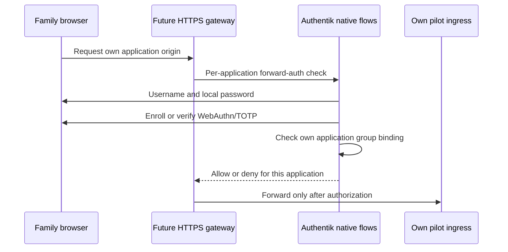

# Household identity configuration candidate

Prepared October 18, 2026. Owner-run disposable native validation passed;
persistent identity deployment and browser/gateway acceptance remain pending.
No household accounts, factor seeds or CA certificates have been provisioned.
Temporary probe credentials and containers were cleaned up. Existing pilot
instances stay offline with respect to inference. See the
[latest native acceptance](#owner-run-native-acceptance--october-18-2026), which
supersedes the earlier pending-native-run notes below.

A persistent localhost bootstrap is now prepared separately; see
[local UI setup](identity_local.md). It has not yet been deployed or accepted.

## What is prepared

`infra/identity/household-blueprint.yaml` is a native Authentik v1 blueprint,
not an authentication adapter. It uses native flow stages and per-application
forward-auth providers. Automatic blueprint instantiation is disabled.
Use only in a new dedicated identity stack after native version validation.
Do not apply it to an existing identity database: the brand and embedded-outpost
configuration intentionally describe this candidate alone.

| Origin | Purpose | Initial access |
| --- | --- | --- |
| `portal.home.arpa` | Agreed household launcher; gateway route still pending | No published route |
| `login.home.arpa` | Proposed identity origin and brand | No published route |
| `probe-a.home.arpa` | Synthetic application A | Only its dedicated group, initially empty in a fresh database |
| `probe-b.home.arpa` | Synthetic application B | Only its dedicated group, initially empty in a fresh database |

These names are configuration proposals, not DNS entries. The blueprint does not
configure portal redirects, upstream routing or install browser trust.
Real family bindings/names are not inferred from the pilot identities.



The diagram is the intended deployment contract; only the blueprint/source guard
exists today. No browser request is currently routed through this candidate.

## Authentication and assignment rules

- Login follows identification, local password, mandatory MFA and session creation.
  Identification has no enrollment, recovery, external-source or passwordless link.
- The login MFA stage forces setup when no compatible factor exists. Authorization
  has a second native validation stage that denies users with no compatible factor.
  Both set a zero recent-factor reuse threshold and require WebAuthn user verification.
- WebAuthn or TOTP is accepted; both are not required simultaneously. TOTP is the
  compatibility option, not phishing-resistant authentication. Test actual device/
  browser combinations before promising passkey support or synchronized operation.
- The requested client fleet is mixed Apple, Android and Windows/Linux. Validate
  trusted HTTPS and root-certificate removal on representative devices. WebAuthn
  enrollment must use the final stable identity origin; changing it can require
  factor re-enrollment. Never bootstrap by ignoring certificate warnings.
- The blueprint creates no users and assigns no memberships. Fresh groups start
  empty. It also does not reset memberships when reapplied. Before activation,
  verify no inherited/admin membership grants unintended access; assign each family
  account to exactly one application group through a supervised operation.
- Family groups grant no superuser role. Maintain a distinct administrative account
  with MFA and a separately tested recovery procedure; no recovery bypass is shipped.
- Each app has exactly its own group binding, provider and HTTPS origin. No shared
  domain provider, unauthenticated path regex or Basic/header-auth shortcut is used.
- Identity session duration is one hour; provider token durations are configured
  separately. These fields do not prove logout/revocation latency or terminate an
  already-open WebSocket. An absolute connection lifetime and revocation probes
  remain required before LAN exposure.

## Local validation

```bash
mise run env:identity:check
mise exec -- task security:identity:test
```

The source guard permits only the reviewed graph, explicit `!KeyOf` references
and fixed security fields. It rejects duplicate keys/IDs, unexpected entries,
conditions, YAML aliases and executable/environment/file tags. It neither
executes blueprint tags nor evaluates Authentik policy decisions. Its fixed
summary reports native validation and household readiness as pending.

The normal security test discovery includes the new tests. Mutations remove each
required graph entry, swap cross-user bindings/providers, weaken MFA, reorder
password/session creation, permit alternate flows, extend sessions, add credentials
or fail-open policy behavior, and check that the guard rejects those changes.
These are configuration regression tests, not simulated proof of real login.
No new Python dependency is needed; uv/PyYAML pins stay unchanged.

## Remaining deployment sequence

1. Authentik/PostgreSQL images are now pinned and the disposable native check below
   is prepared. Run it and resolve model/schema differences before selecting a
   gateway release or importing into a persistent IdP. Source tests are not a
   substitute for this execution. Do not mount the Docker socket into Authentik.
2. Prepare separate persistent identity storage and file-delivered secrets outside
   Git/CloudDrive. Keep CA custody separate as described in [LAN access](lan_access.md).
3. Complete the offline-root/intermediate ceremony and verify public root
   fingerprints before supervised client trust installation. No key is generated
   or copied into this repository by the blueprint.
4. Prepare a candidate gateway with external certificates, explicit per-origin
   upstreams, native forward-auth on HTTP/API/WebSocket handshakes, trusted-header
   replacement, restricted outpost routes and no direct LAN application bypass.
   Keep routes loopback-only until negative tests pass. The current pilot networks
   must not be joined to identity/database networks merely to simplify routing.
5. Import into the dedicated test IdP, create two synthetic accounts interactively,
   verify group readback, factor enrollment, wrong-factor rejection, per-user API/WS
   separation, disabled-user/logout behavior and spoofed-header denial. Check
   alternative/default flows as well as the advertised login URL.
6. Record SEC evidence, recovery/renewal tests and remaining inference/egress limits
   before creating family accounts or publishing the portal on the LAN.

## Primary references

- [Native blueprints and instantiation](https://docs.goauthentik.io/customize/blueprints/v1/structure/).
- [MFA validation and enrollment behavior](https://docs.goauthentik.io/add-secure-apps/flows-stages/stages/authenticator_validate/).
- [Application policy bindings](https://docs.goauthentik.io/add-secure-apps/bindings-overview/).
- [Native nginx forward-auth integration](https://docs.goauthentik.io/add-secure-apps/providers/proxy/server_nginx).
- [Identity hardening and alternate-flow review](https://docs.goauthentik.io/security/security-hardening/).


## Recorded local validation — October 18, 2026

Both registered mise/Task entry points passed. The full repository suite passed
281 tests, including 17 identity source tests; repository structure, shell syntax
and whitespace checks passed. Gitleaks 8.30.1 checked 215 candidate files, staged
content and all local refs without findings and passed its detection/redaction
canary. Report basename: `secrets-e9g9sb_b.json` under ignored artifacts.
No live native Authentik import, browser flow or gateway test ran.


## Disposable native validation candidate

`infra/identity/versions.yaml` pins Authentik 2026.8.4 and PostgreSQL 18.6-alpine
by registry index digest, with selected linux/amd64 manifest digests and compressed
layer sizes recorded. The registry metadata was resolved on October 18; no mutable
tag is used when pulling/running. The first check downloads about 479.3 MiB of
compressed images; image cache remains after the test. It is not a security audit
or a claim that these versions will stay supported indefinitely.

```bash
mise run env:identity:check
mise exec -- task security:identity:test
mise exec -- task identity:native:plan
mise exec -- task identity:native:check
```

The last task requires interactive host sudo. No user passwords or CA material
are requested. It requires at least 4 GiB currently available memory and creates
only a unique `agent-platform-identity-check-<random>` Compose project. It never
attaches to an existing IdP DB, agent, model, identity or observability network.

The committed Compose template has one internal bridge, no published ports,
read-only roots, dropped capabilities, no-new-privileges, AppArmor, resource limits
and no Docker logging. PostgreSQL data lives in a bounded 256 MiB tmpfs overriding
the image's declared data volume. Other writable paths use bounded tmpfs too.
Database and checker process limits total 2.75 GiB; memory availability is a snapshot,
not a reservation. tmpfs contents may reach host swap: temporary is not guaranteed
RAM-only confidentiality or secure erasure. These are generated probe credentials,
never family data or production signing material.

The privileged runner creates a mode-0700 directory under `/var/tmp`, outside
Git/CloudDrive. Separate mode-0400 password files are owned by each container's
numeric UID (70 and 1000); the generated Authentik secret is owned by UID 1000.
Only the matching files are bind-mounted read-only. Values are not placed in
command arguments, Compose environment values, terminal output or reports.
The environment contains `file://` references, supported natively by Authentik.
DB TLS is explicitly disabled only inside this isolated one-shot test; this is
not the intended production transport policy.

The checker uses the pinned release's Authentik bootstrap and lifecycle migrations,
then the default realm in the fresh disposable database.
It rejects blueprint fields absent from that release's serializers, then runs the
native importer validation and import. ORM readback checks MFA, flow order, empty
non-admin groups, per-app providers/bindings, narrow proxy options and outpost
assignment. A second validation/import/readback tests repeatability. This is
configuration/model compatibility, not browser MFA, authorization-runtime or
WebSocket acceptance. Those remain pending even after native success.

Progress appears at most every 15 seconds during Docker operations. Pulls are
bounded at 20 minutes per image, DB startup at 90 seconds, and native execution
at 10 minutes. Raw library/Docker logs are not printed. Fixed failure stages
identify initialization, migrations, field validation, import or readback; a known
public blueprint entry ID may accompany a schema error without field values.

Finally the runner removes only its unique checker/project and temporary files.
The native check fails if cleanup cannot be completed; it retains the root-private
directory and reports the generated project name for owner recovery. It never
reports a clean success while its cleanup is pending. The wrapper saves only the
fixed summary/source fingerprints in a mode-0600 `artifacts/security/identity-native-*.json`
report, including failed runs. No persistent identity service is installed.

The native command has not run from the assistant session: Docker requires owner
sudo authentication. Do not mark native acceptance passed until its real report
shows all stages and cleanup completed with the matching source fingerprints.

Native implementation references:
[2026.8.4 importer](https://github.com/goauthentik/authentik/blob/version/2026.8.4/authentik/blueprints/v1/importer.py),
[file-based configuration](https://docs.goauthentik.io/install-config/configuration/),
[official PostgreSQL image](https://hub.docker.com/_/postgres).


### Recorded preparation checks

On October 18 the source environment task and Task identity suite passed: 29
identity tests (12 new orchestration regressions) and 293 total repository tests.
The installed Docker Compose parsed the rendered candidate with `config --quiet`
without contacting the daemon or creating resources. Repository shell syntax,
structure and whitespace checks passed. The pinned Gitleaks scan checked 221
candidate files, staged content and local refs with no findings and passed its
canary; private report basename `secrets-ie61qlmx.json`.
These results validate source/orchestration only. Native container execution
remains pending owner interactive sudo; no real IdP service was started.


### Native startup correction — October 18, 2026

The owner-run check reached the checker after image pulls and PostgreSQL startup,
then reported `native_failed_django_setup` in `identity-native-6qPZo4fT.json`.
It did not validate/import the blueprint. The original exception text was discarded,
so that report alone cannot identify the precise initialization exception.

The candidate now declares `PYTHONPATH=/` for scripts mounted under `/candidate`
and calls the pinned release's `authentik.root.setup.setup()` before Django setup.
It uses `lifecycle.migrate.run_migrations()` rather than a shared-only migration,
then verifies the candidate flow is absent in the new database's default realm
before importing. No additional tenant or production database is created/reused.
See the release's [management bootstrap](https://github.com/goauthentik/authentik/blob/version/2026.8.4/manage.py)
and [migration lifecycle](https://github.com/goauthentik/authentik/blob/version/2026.8.4/lifecycle/migrate.py).

Fixed diagnostic categories distinguish missing imports, permissions, configuration,
registry and database failures without exception text/module names/paths. Failures
handled after successful temporary-resource cleanup now explicitly report
`cleanup: completed`; cleanup failure reports `pending` and still fails the task.

Validation: all 297 repository tests passed, including 33 identity tests. New
regressions reproduce mounted-script imports with/without a source path, require
bootstrap before Django, require official lifecycle migrations, and check diagnostic
redaction/allowlisting and explicit cleanup state. Source/shell/whitespace checks
passed. These local tests do not establish native runtime acceptance. Repeat only
`mise exec -- task identity:native:check` from the host terminal and retain its new
source fingerprints/result; image digests and the blueprint itself are unchanged.


### Native blueprint rejection follow-up — October 18, 2026

Owner report `identity-native-KBQw2y5k.json` reached native blueprint validation
and failed with `native_failed_native_validation_assertion_failed`; cleanup was
explicitly completed. Startup, migration and the serializer-field presence check
had progressed, but this is not successful blueprint import or browser acceptance.
The earlier diagnostic discarded the typed rejection and did not identify its entry.

The pinned Outpost serializer explicitly requires `type` on creation. The candidate
now declares `type: proxy` and `service_connection: null`, including a source guard
and ORM readback for both. This fixes a concrete schema omission; the report alone
does not establish it was the only rejection.

Validation now calls `Importer.validate(raise_validation_errors=True)` and reads
`EntryInvalidError.entry_id` and `validation_error.get_codes()`, rather than
recovering objects from sanitized log attributes. Only a known public blueprint
entry, known field names and a bounded allowlist of machine codes are returned.
Exception text, error values, serialized entries and logs remain suppressed. The
host independently checks the same metadata before reporting `native_issues`.
This behavior also applies to repeat-import validation; false/non-boolean native
validation results cannot count as success.

All 302 repository tests passed (38 identity tests), including typed error
propagation under suppressed logging, redaction of private canaries, hostile
metadata rejection, strict boolean validation and mandatory proxy/no-service-
connection source rules. Source/shell/whitespace checks passed. Owner native rerun
remains required: `mise exec -- task identity:native:check`.

Reference: [pinned outpost serializer](https://github.com/goauthentik/authentik/blob/version/2026.8.4/authentik/outposts/api/outposts.py).


## Owner-run native acceptance — October 18, 2026

Owner-supplied report `identity-native-QLUmr7yU.json` completed successfully.
All five recorded source fingerprints match the current files. The report is
private and remains under ignored `artifacts/security/`; no credentials or raw
library logs are copied into the documentation.

| Check | Recorded result |
| --- | --- |
| Native Authentik blueprint validation | Passed |
| Import and ORM readback of configured rules | Passed |
| Repeat import and readback | Passed |
| Disposable project/private-file cleanup | Completed |
| Browser MFA acceptance | Pending |
| Gateway authorization acceptance | Pending |
| Household readiness | Pending |

Versions remain Authentik 2026.8.4 and PostgreSQL 18.6-alpine pinned by digest.
Accepted blueprint SHA-256:
`104f2207d3f597edba28404c98d664e2a797629ca0e6e63531a86390d4b7dc02`.
Native checker helper SHA-256:
`b585d553c6cf3e91bda0c500fd0f288cf0d787ae9e8e921ae4507ea0e59041d2`.
Orchestrator SHA-256:
`ca3785c37f402781a724fcf252655d005c4d9b4c49302bb8ccbdc100efaf0fc6`.

This closes the disposable native compatibility/import check, not the household
identity deployment. It establishes neither successful factor enrollment/challenge
in real browsers nor gateway HTTP/WebSocket authorization, revocation latency,
certificate trust/renewal, persistent identity recovery or LAN access controls.
The next implementation stage is the persistent loopback identity candidate and
external-certificate gateway/CA integration, followed by two synthetic browser
accounts and negative authorization tests. Family accounts and LAN publication
remain gated on that evidence.
