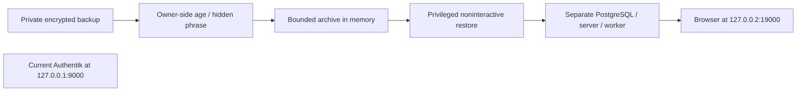

# Full identity restore rehearsal

Prepared October 24, 2026. Source and synthetic tests are separate from actual
Docker/native/browser acceptance. No rehearsal was deployed by the assistant.
The accepted encrypted SQL restore remains recorded in [the backup guide](identity_backup.md).

## Boundary and data flow



The separate loopback address avoids sharing host-scoped cookies with the current
instance; changing only the port would not isolate cookies. The clone retains
snapshot users/passwords/TOTP devices, loads its restored signing secret and
starts the same pinned Authentik/PostgreSQL versions. It never executes Compose
from the archive: the reviewed base is derived using
`infra/identity/rehearsal-profile.yaml`. The resulting YAML is kept in protected
runtime control files, not another manually maintained duplicate of the base.

The fixed rehearsal project is `agent-platform-identity-rehearsal`. Its only
published endpoint is **http://127.0.0.2:19000/**. Both bridges are internal and
separate from current identity, agents, inference and observability networks.
The worker may process restored tasks, so keep external connectivity restricted
and do not launch applications or configure external sources in the clone.
Internal bridges are not comprehensive host/LAN/IPv6/DNS egress certification.

Containers retain non-root users, read-only roots, no-new-privileges, Docker
AppArmor, dropped capabilities, private namespaces and explicit resource/tmpfs
limits. Logging is disabled for this rehearsal to avoid durable application-log
copies. No Docker socket, user HOME, live state, archive-provided executable or
CA root key is mounted.

Private runtime files live under `/var/lib/agent-platform/identity-rehearsal/`.
`state/` is a **768 MiB tmpfs** containing the clone's database, data/cert files
and file-based credentials; `control/` contains guarded Compose/probe/marker and
numeric browser baseline only. File payloads are restored as regular files owned
by the native application UID with restrictive modes; original file modes and
empty directory entries are not preserved by this backup format. Secrets use
read-only, per-UID file mounts. The snapshot's plaintext archive is not staged to
a named disk file. RAM-backed state can be swapped; host swap/core policy and
trusted administrators remain part of this boundary.

Startup requires a 6 GiB available-memory snapshot, free loopback port and no
existing rehearsal state/project. It does not download images; the pinned images
must already be cached from the accepted local stack. On failure, cleanup is
attempted only after verifying the rehearsal's controls/runtime. An unsafe or
failed cleanup preserves the state and reports that review is required.

## Owner execution

Validate source through mise and preview the operational boundary:

```bash
mise run env:identity:check
mise exec -- task identity:rehearsal:plan
```

Start using the existing accepted backup and the rewrapped identity:

```bash
mise exec -- task identity:rehearsal:up \
  BACKUP=/var/lib/agent-platform/identity-backups/identity-93fa270c09324a1c8354888f12c5c256.age \
  IDENTITY="$HOME/.config/agent-platform/recovery/identity.age"
```

The wrapper authenticates sudo first. Recovery prompts and decryption run as the
desktop user using the accepted no-echo/private-PTY path. A noninteractive root
helper receives the bounded archive through stdin and revalidates it before
mounting/starting the clone. Starting PostgreSQL and restored server/worker can
take several minutes; there are no further phrase prompts after decryption.

Successful startup reports native health, matching restored signing-secret
configuration, a signing roundtrip and readable confirmed TOTP material. The
native baseline invalidates sessions **only in the restored database**, requiring
a fresh browser login, and stores only numeric login/TOTP counters. It does not
reset passwords, remove MFA, create users or alter the live instance.

After startup passes, use a fresh private browser window at
**http://127.0.0.2:19000/**. Verify the address before entering credentials.

1. Use the administrator credentials valid when this snapshot was taken.
2. Require a TOTP challenge, reject an incorrect code, then accept a valid code
   from the already registered authenticator. Do not enroll a new device merely
   to make the rehearsal pass.
3. Confirm you reached the restored administration interface. Do not launch
   copied applications or use source integrations.
4. If the initial-setup page appears, or a fresh MFA registration is requested
   instead of the expected challenge, stop and report the mismatch; do not create
   a replacement administrator.

Do not share passwords, seeds, codes, recovery phrases or browser cookies in chat.
The recovery-key phrase is not the Authentik login password. HTTP here is only a
temporary loopback rehearsal; this is not the household TLS or LAN portal.

Then run:

```bash
mise exec -- task identity:rehearsal:check
mise exec -- task identity:rehearsal:accept
```

`check` verifies controls, health and readback without accepting browser evidence.
`accept` additionally requires a new successful-login event and an increased TOTP
step compared with the restored baseline. These are aggregate observations and
do **not** correlate one selected user, browser, session or MFA event. Record the
owner's manual login/TOTP result together with them. They cannot certify every
factor, alternate flow, encrypted field, WebAuthn relying party or gateway path.
No secret values, event contents, usernames or native logs are returned. If a
just-completed login is not yet visible to the event reader, wait briefly and
repeat `check`/`accept`; do not restart or replace the snapshot to force a pass.

## Cleanup and restart

After recording browser and native results, remove the rehearsal:

```bash
mise exec -- task identity:rehearsal:down
```

This verifies the exact rehearsal project/images/restrictions and protected
control files, removes its containers/networks, normally unmounts its tmpfs and
removes its temporary control files. It does not stop the live project or remove
the encrypted backup/recovery identity. An absent rehearsal is a no-op only when
no matching containers remain. There is no force/lazy unmount, Docker prune or
unbounded recursive host deletion.

A host reboot loses RAM state. Preserved control files allow guarded `down` when
the unmounted state directory is empty; a nonempty fallback directory or foreign
mount stops cleanup for review. Clean up before repeating `up`: it never overwrites
existing rehearsal data. This is a disposable exercise, not a restored production
service, host-boot startup setup or complete host disaster-recovery procedure.

## Verification and limitations

Code is in `scripts/identity/rehearsal.py` and its native probe, with categorized
Task operations and mise source checks. Synthetic tests cover profile mutations,
real runtime-verifier rejection of wildcard ports/external bridges, state/project
collisions, malformed archives and baselines, restored file boundaries, native
probe failures, incomplete browser evidence and cleanup. Local tests mock Docker,
mounting and the native application; no full application was executed by those
tests. The installed Docker Compose parser is checked separately without a daemon.

TOTP readback checks the native restored device material and signing checks the
restored Authentik cookie-signing key. They do not demonstrate decryption of all
provider/source secrets. Browser login with existing TOTP is a required manual
gate. Household readiness stays pending for TLS/gateway, per-user application
routing, wider egress/fairness/backup coverage and other outstanding SEC controls.

References: [Authentik backup components](https://docs.goauthentik.io/sys-mgmt/ops/backup-restore/),
[pinned TOTP model](https://github.com/goauthentik/authentik/blob/version/2026.8.4/authentik/stages/authenticator_totp/models.py),
[pinned session settings](https://github.com/goauthentik/authentik/blob/version/2026.8.4/authentik/root/settings.py),
[native session store](https://github.com/goauthentik/authentik/blob/version/2026.8.4/authentik/core/sessions.py),
[Docker internal networking](https://docs.docker.com/compose/how-tos/networking/).

Preparation evidence: all 382 repository tests passed, including 118 identity
tests (23 new rehearsal/dispatch/session regressions). The installed Docker
Compose parser accepted the derived profile without deployment; Python/shell,
whitespace, documentation links and the registered Task plan passed. Source
checks run through mise include the rehearsal plan. No real mount, restored
application startup or browser login was executed by the assistant. Owner
execution, native acceptance, manual account/TOTP verification and cleanup
remain pending.
