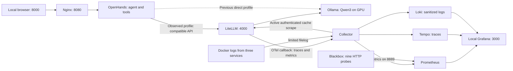

# Local platform infrastructure, with code in hand

Date: October 6, 2026. Repository: `/home/alejandro/CloudDrive/Engineering/agent-platform`.

This guide explains the actual files inspected. It separates the prepared code from its activation and from the recorded tests. Previous reviews to this initial snapshot had no commits; therefore, the retrospective explanation is not an exact historical diff. In this turn, the first local commit is prepared, which establishes a base for reviewing the next modifications. The change log is in [changelog.md](changelog.md).

**1. What we have built and its journey**

A local platform where OpenHands executes tools and queries Qwen3 served by Ollama. LiteLLM provides an API boundary to observe the calls passing through it. Collector, Prometheus, Tempo, Loki, and Grafana collect and display telemetry. HTTP probes check availability. This is the experimental base of the platform agnostic; the runtime-specific contracts, adapters, DecisionProvider, state store, MCP gateway, and policies are still in the [plan](plan.md).



The direct profile bypasses LiteLLM. It does not produce its consumption metrics. The effective path is chosen in the OpenHands conversation settings; adding containers to Compose does not by itself change all conversations.

**2. mise, Task, and scripts: three responsibilities**

mise fixes the environment tools. Currently, it fixes Task, Python, and uv, and activates `.venv`; it does not manage the Docker daemon itself or the kernel driver. The mise bootstrap verifies hashes and its version is in `infra/host/mise-version.json`. `mise.lock` preserves the tool artifact and checksums; Python points to the target Linux x86_64.

Source: [mise.toml](../mise.toml). Literal fragment of the current file.

```toml
# mise owns environment versions, preparation and validation.
# Taskfile.yml owns service operations and code tests; scripts/ owns implementation.
# Host packages and image digests are pinned in infra/host/versions.yaml.

[tools]
task = "3.54.0"
python = "3.14.4"
uv = "0.12.23"

[env]
_.python.venv = { path = ".venv", create = true }
```

Source: [Taskfile.yml](../Taskfile.yml). Literal fragment of the current file.

```yaml
  llm:setup:
    desc: Start local Ollama, download model and test inference on GPU
    cmds:
      - mise run repo:check
      - task: llm:plan
      - task: llm:up
      - task: llm:pull
      - task: llm:check
```

Task chains steps in order. The tasks call scripts in `scripts/bootstrap/`, `host/`, `llm/`, `openhands/`, `observability/`, and `repo/`. The extended blocks live in those scripts. The shell coordinates Docker and permissions; the Python helpers read YAML configuration, handle JSON API, and perform structured checks.

**3. Docker and GPU access**

`infra/host/versions.yaml` fixes nine Docker/Compose/Buildx/containerd and NVIDIA Container Toolkit packages for Ubuntu 26.04 amd64. The installer verifies the system and conflicts, makes backups of existing configurations, installs from signed APT repositories, and verifies the resulting versions. It reuses the host NVIDIA driver; it does not replace it or automatically add users to the Docker group.

Source: [scripts/host/install-docker-gpu.sh](../scripts/host/install-docker-gpu.sh). Literal fragment of the current file.

```bash
    sudo apt-get install -y --no-install-recommends "${package_specs[@]}"
    sudo nvidia-ctk runtime configure --runtime=docker
    sudo systemctl enable --now docker
    sudo systemctl restart docker
```

`nvidia-ctk` registers the NVIDIA runtime in Docker configuration; the GPU request in Compose enables the device for Ollama. This is different from fixing the server image or downloading weights. The initial reports verified the driver, `hello-world`, and `nvidia-smi` within a container. The inference was validated later with the real model.

Docker operations use explicitly `--context default`. From this session, the socket requires interactive sudo: the scripts request authentication in your terminal. We have not executed Work as root.

**4. Ollama: service, model, limits, and persistence**

Ollama runs in a container pinned by digest, not as a global inference installation. The weights of `qwen3:8b` are downloaded within the volume `agent-platform-local_ollama-data`, mounted in `/root/.ollama`. The volume is managed by Docker and is not saved in Git/CloudDrive. `infra/llm/versions.yaml` also fixes the model digest, because the tag can change.

Source: [infra/llm/compose.yaml](../infra/llm/compose.yaml). Literal fragment of the current file.

```yaml
    ports:
      - "127.0.0.1:11434:11434"
    environment:
      OLLAMA_HOST: "0.0.0.0:11434"
      OLLAMA_NO_CLOUD: "1"
      OLLAMA_CONTEXT_LENGTH: "32768"
      OLLAMA_NUM_PARALLEL: "1"
      OLLAMA_MAX_LOADED_MODELS: "1"
      OLLAMA_KEEP_ALIVE: "5m"
    volumes:
      - ollama-data:/root/.ollama
    deploy:
      resources:
        reservations:
          devices:
            - driver: nvidia
              device_ids: ["0"]
              capabilities: [gpu]
    mem_limit: 12g
    cpus: 8
    cap_drop: [ALL]
```

The binding `127.0.0.1` publishes the API only on the host's loopback. `OLLAMA_HOST=0.0.0.0` allows the server to receive connections within its container, including Compose networks. It does not open the host port to the entire LAN. `OLLAMA_NO_CLOUD` disables Ollama's cloud features.

We moved from context 8192 to 32768 in the local platform. A parallel request and a loaded model are maintained to limit memory consumption. The GPU is requested by ID 0. The container's RAM/CPU limits are separate from the GPU's VRAM.

`pull-model.sh` checks space, downloads, and verifies the digest; `check-inference.py` tests generation, synthetic tool call, API compatibility, and residency in VRAM. It does not by itself demonstrate that any agent task works. The speed measurement was corrected to divide tokens by generation time, separating model loading and prompt processing.

Source: [scripts/llm/check-inference.py](../scripts/llm/check-inference.py). Literal fragment of the current file.

```python
    count, duration = data.get("eval_count", 0), data.get("eval_duration", 0)
    if count <= 0 or duration <= 0:
        raise ValueError("Missing generation token/timing metrics.")
    return round(count * 1e9 / duration, 2)
```

**5. OpenHands: agent, workspace and network**

The agent organizes steps and executes tools; the model generates text and tool call proposals. OpenHands provides the UI, conversations and tools. Ollama serves the model; it does not decide which terminal command to execute.

`infra/openhands/compose.yaml` combines with Ollama's Compose, preserving the project and its volume. OpenHands is in `agent-link`, an internal network, without Docker socket or directly published ports. Nginx receives the browser via localhost:8000 and forwards HTTP/WebSocket to the internal service.

Source: [infra/openhands/compose.yaml](../infra/openhands/compose.yaml). Literal fragment of the current file.

```yaml
    networks: [agent-link]
    group_add: ["${OH_HOST_GID:?Run scripts/openhands/up.sh}"]
    environment:
      OH_WORKSPACE_PATH: /projects/demo
      OH_MAX_CONCURRENT_RUNS: "1"
      OH_TELEMETRY_EXPORTER: none
      OH_TELEMETRY_CONSENT: "denied"
      DO_NOT_TRACK: "1"
      OH_ENABLE_VSCODE: "false"
    volumes:
      - openhands-state:/home/openhands/.openhands
      - type: bind
        source: ${OH_WORKSPACE:?Run scripts/openhands/up.sh}
        target: /projects
        bind:
          create_host_path: false
    mem_limit: 6g
    cpus: 4
    pids_limit: 512
    cap_drop: [ALL]
    security_opt: [no-new-privileges:true]
```

Source: [infra/openhands/nginx.conf](../infra/openhands/nginx.conf). Literal fragment of the current file.

```nginx
        location / {
            proxy_pass http://openhands:8000;
            proxy_http_version 1.1;
            proxy_set_header Host $http_host;
            proxy_set_header Upgrade $http_upgrade;
            proxy_set_header Connection $connection_upgrade;
            proxy_buffering off;
            proxy_read_timeout 3600s;
```

`OH_WORKSPACE` is `artifacts/openhands/projects` in the repository; the bind mounts it as `/projects`. Therefore, `artifacts/openhands/projects/demo` is visible to the agent as `/projects/demo`. Its persistent state lives in `openhands-state`, separate from those files.

`OH_WORKSPACE_PATH` expresses the configured path, but we check that a conversation can start in `/home/openhands/workspace/project/<id>`. That is why we explicitly requested to execute `pwd` and work in `/projects/demo`. We did not declare that this variable imposes the effective directory of any conversation.

The host group and permissions 2770 are used to grant access to the non-root user in the container. An important fix was preserving the two variables when crossing sudo: without this, Compose failed due to missing values.

Source: [scripts/openhands/common.sh](../scripts/openhands/common.sh). Literal fragment of the current file.

```bash
oh_root="$llm_repo_root"
export OH_HOST_GID="$(id -g)"
export OH_WORKSPACE="$oh_root/artifacts/openhands/projects"
oh_image() {
    python3 - "$oh_root/infra/openhands/versions.yaml" <<'PYCODE'
import json, sys
import yaml
print(yaml.safe_load(open(sys.argv[1]))['image'])
PYCODE
}
oh_compose() {
    # sudo filters exported variables; preserve only these two Compose inputs.
    if [[ "${llm_docker[0]}" == sudo ]]; then
        sudo --preserve-env=OH_HOST_GID,OH_WORKSPACE docker --context default compose \
            -f "$llm_compose_file" -f "$oh_root/infra/openhands/compose.yaml" "$@"
```

The scripts check that the image user is not root and can write to demo and its state. The UI was validated with a sum demo and a Decimal bugfix; the agent needed guidance after invalid tools. Subagents and automatic profile switching are kept disabled in the local platform profile, configured in the UI; they are not guarantees imposed by Compose.

**6. LiteLLM: observed path and existing callbacks**

The observed profile of OpenHands must use model `openai/qwen3:8b`, base URL `http://litellm:4000/v1` and the private key of the proxy. The prefix `openai/` selects the compatible protocol in this integration; the configured destination remains local Ollama. The previous profile used `http://ollama:11434/v1` and accessed directly.

Source: [infra/observability/litellm.yaml](../infra/observability/litellm.yaml). Literal fragment of the current file.

```yaml
model_list:
- model_name: qwen3:8b
  litellm_params:
    model: openai/qwen3:8b
    api_base: http://ollama:11434/v1
    api_key: local-only
    timeout: 180
litellm_settings:
  callbacks:
  - otel
  - prometheus
  # The native Prometheus callback handles OpenAI/Ollama cached_tokens.
  prometheus_metrics_config:
  - group: local_prompt_cache
    metrics:
    - litellm_input_cached_tokens_metric
    - litellm_input_cache_creation_tokens_metric
    include_labels:
    - model
  require_auth_for_metrics_endpoint: true
  turn_off_message_logging: true
  set_verbose: false
  json_logs: true
  num_retries: 0
  request_timeout: 180
general_settings:
  master_key: os.environ/LITELLM_MASTER_KEY
  disable_spend_logs: true
callback_settings:
  otel:
    attributes:
      include_list:
      - gen_ai.operation.name
      - gen_ai.request.model
```

The alias `qwen3:8b` directs to the backend `openai/qwen3:8b` in `http://ollama:11434/v1`. `local-only` is the placeholder for the segment towards Ollama; it is not the key that authorizes entry to LiteLLM. A timeout of 180 seconds and zero proxy retries are used for this local platform.

The callbacks `otel` and `prometheus` have already been validated on the host. The cache test of October 6 at 09:57 Europe/Berlin checked 1,623 tokens reused with an identical increase in the counter. Disk code should not be confused with configuration loaded into the process.

Source: [infra/observability/compose.yaml](../infra/observability/compose.yaml). Literal fragment of the current file.

```yaml
      OTEL_SERVICE_NAME: litellm-proxy
      OTEL_METRICS_EXEMPLAR_FILTER: always_off
      OTEL_EXPORTER: otlp_http
      OTEL_ENDPOINT: http://collector:4318/v1/traces
      OTEL_EXPORTER_OTLP_ENDPOINT: http://collector:4318
      OTEL_EXPORTER_OTLP_PROTOCOL: http/protobuf
      LITELLM_OTEL_INTEGRATION_ENABLE_METRICS: 'true'
      LITELLM_OTEL_INTEGRATION_ENABLE_EVENTS: 'false'
      OTEL_INSTRUMENTATION_GENAI_CAPTURE_MESSAGE_CONTENT: NO_CONTENT
      USE_OTEL_LITELLM_REQUEST_SPAN: 'true'
      LITELLM_LOCAL_MODEL_COST_MAP: 'true'
      DO_NOT_TRACK: '1'
```

These variables send OTel via HTTP/protobuf to the internal Collector. They disable message and event capture, and metric exemplars; they enable usage metrics and the proxy's incoming span. The attribute filter of `litellm.yaml` limits metric labels. `gen_ai.token.type` was removed from that filter because LiteLLM treats it as a structural discriminator and rejected initializing the callback.

A conversation can retain its own configuration after editing the defaults. `openhands:profile:check` reads the defaults; `openhands:usage:check CONVERSATION_ID=...` reads the current path and usage of the specific conversation, without printing messages or keys. The current path does not show all historical paths.

**7. Security and credential storage**

LiteLLM rejected starting without a master key. This was fixed with a strong persistent key; its absence/weakness bypass was not activated. Grafana requires login and has anonymous access and signup disabled. Credentials are created outside the repository and CloudDrive, in `${XDG_DATA_HOME:-$HOME/.local/share}/agent-platform/observability`.

`prepare-secrets.py` preserves existing credentials, checks ownership and format, and rejects symlinks.

Source: [scripts/observability/prepare-secrets.py](../scripts/observability/prepare-secrets.py). Literal fragment of the current file.

```python
    directory.mkdir(parents=True, exist_ok=True, mode=0o700)
    directory.chmod(0o700)
    for name, generate in [('admin-password', lambda: secrets.token_urlsafe(32)),
                           ('litellm-master-key', lambda: 'sk-'+secrets.token_hex(32))]:
        path = directory/name
        try:
            fd = os.open(path, os.O_WRONLY | os.O_CREAT | os.O_EXCL | os.O_NOFOLLOW, 0o600)
        except FileExistsError:
            pass
        else:
```

The folder remains with permissions 700 and the files 600. We do not show values in documentation, diffs or reports. `.gitignore` excludes `.env`, keys, weights and `artifacts/`; the original Docker files and the workspace may contain unredacted content. Excluding from Git does not automatically exclude from CloudDrive synchronization.

The services use pinned images, memory/CPU limits, dropped capabilities, `no-new-privileges`, mounted read-only configurations and rotated logs. The agent can still modify its workspace and execute tools. There is no yet a complete layer of approval, policies or immutable audit. The master key is administrative and corresponds to the local platform, not to independent family users.

**8. Collector: reception, privacy and three destinations**

`infra/observability/collector.yaml` receives OTLP HTTP 4318 and gRPC 4317, applies memory limits, filters and batch processing. Its trace pipeline delivers sanitized spans to Tempo and to `spanmetrics`, an existing connector that produces span count/duration metrics. Prometheus reads the metrics exporter in 8889; it also reads internal telemetry from the Collector in 8888.

Structural fragment of `service.pipelines.traces`, extracted from the current YAML:

```yaml
receivers:
- otlp
processors:
- memory_limiter
- filter/no_events
- transform/privacy
- batch
exporters:
- otlphttp/tempo
- spanmetrics
```

Privacy uses allowed lists: resource `service.name`, normalized model, usage numbers and limited operational labels. It removes free names, error text, events and spans with links. In logs it preserves categories, for example `tool_validation_error`, and replaces the full body.

OTTL literal expressions of `transform/privacy`:

```text
keep_keys(attributes, ["gen_ai.request.model", "gen_ai.usage.input_tokens", "gen_ai.usage.output_tokens", "gen_ai.usage.total_tokens"])
set(status.message, "")
set(body, "operational record")
```

This sanitizes what is exported, not the originals from the host or everything that passes through memory. Synthetic canaries verify specific fields. The correlation of a LiteLLM test request with its trace ID passed; the full trace of the agent and the proxy still needs its own acceptance.

**9. Docker logs without granting the socket to the Collector**

`configure-logs.sh` queries only ID, LogPath and driver of OpenHands, Ollama and LiteLLM from the terminal with Docker permissions. `configure-logs.py` generates read-only mounts of its specific directories and filelog receivers, with persisted offsets. The Collector uses UID 0 to be able to read them, preserves dropped capabilities and does not receive `docker.sock`.

The generated files are `artifacts/observability/collector-with-logs.json` and `logs-compose.json`; the YAML of `infra/` is the canonical source. They are regenerated after recreating containers to not follow old IDs/logpaths. `start_at: end` captures new records from the active file; it is not a complete historical import.

**10. Prometheus, Tempo, Loki and Grafana**

Prometheus stores metrics in its volume, with retention of 7 days and maximum TSDB size of 1 GB. Tempo stores WAL and trace blocks in local volume; its Compose fixes retention target 168 h. Loki stores chunks/index and applies retention 168 h. Grafana preserves its state in volume. They are limits of the local platform, not enterprise storage of high availability.

The backends are in a `data` internal network and do not publish host ports. Grafana publishes `127.0.0.1:3000`; LiteLLM shares `data` and `agent-link` to connect agent and model. Loki/Tempo lack their own authentication in this internal setup; that boundary does not allow exposing them directly to the family.

Source: [infra/observability/grafana/provisioning/datasources/sources.yaml](../infra/observability/grafana/provisioning/datasources/sources.yaml). Literal fragment of the current file.

```yaml
apiVersion: 1
datasources:
- name: Prometheus
  type: prometheus
  uid: prometheus
  url: http://prometheus:9090
  access: proxy
  isDefault: true
  editable: false
- name: Tempo
  type: tempo
  uid: tempo
  url: http://tempo:3200
  access: proxy
  editable: false
- name: Loki
  type: loki
  uid: loki
  url: http://loki:3100
  access: proxy
  editable: false
```

Source: [infra/observability/grafana/provisioning/dashboards/dashboards.yaml](../infra/observability/grafana/provisioning/dashboards/dashboards.yaml). Literal fragment of the current file.

```yaml
apiVersion: 1
providers:
- name: Agent Platform
  orgId: 1
  folder: Agent Platform
  type: file
  disableDeletion: true
  allowUiUpdates: false
  options:
    path: /var/lib/grafana/dashboards
```

Grafana has stable UID of data sources and JSON dashboards mounted read-only. Provisioning makes them load from files and prevents UI edits from being the source of truth. There are seven dashboards: overview, agent operations, LLM cost/routing, model quality, security, tools/MCP and workflow KPIs. Areas without metrics are shown as pending.

Blackbox makes GET without keys to nine endpoints with timeout 3 s. Prometheus evaluates two alerts after 2 minutes: endpoint not available and scrape not available. Alertmanager and notifications have not been configured. HTTP health does not test that an agent task has completed correctly.

**11. Golden signals, totals and cache: what queries we change**

Traffic, errors and p95 use the span SERVER `Received Proxy Server Request`, instead of summing the internal spans of the same request. Visible saturation is currently collector queue occupancy; it is not usage nor queue of the GPU/Ollama.

Input/output uses the native histogram of token usage. Their accumulated cards are instant queries, reduction `lastNotNull`, without summing counter samples. The period uses `increase` and the rates `rate`. A repeated scrape of the counter does not represent another call.

Literal query — **Input · accumulated tokens**:

```promql
sum(gen_ai_client_token_usage_sum{job="otel-collector",exported_job="litellm-proxy",gen_ai_request_model=~"qwen3:8b|unknown",gen_ai_token_type="input"})
```

Literal query — **Input · tokens of the period**:

```promql
sum(increase(gen_ai_client_token_usage_sum{job="otel-collector",exported_job="litellm-proxy",gen_ai_request_model=~"qwen3:8b|unknown",gen_ai_token_type="input"}[$__range]))
```

Literal query — **Cache Hit · accumulated tokens**:

```promql
sum(litellm_input_cached_tokens_metric_total{job="otel-collector",exported_job="litellm-proxy",gen_ai_request_model="qwen3:8b"})
```

The OpenHands capture accumulated input 125,088, of which 95,780 were cache-read, and output 4,838. Total = input + output = 129,926. The cached tokens are already in input; they are not summed again. The local test of two identical calls reported input 1,624 in both and cache 1→1,623, confirming real reuse. The old proxy counter of 30/4 had a different scope; it does not demonstrate a failure in Grafana summation.

The pinned OTel callback does not correctly cover the nested cache field of Ollama. The existing Prometheus callback does read it. That is why two allowed metrics were added, an authenticated scrape of the Collector, and read/write panels, accumulated, periods, rates, percentage, and health of that scrape. A new runtime adapter was not written.

Fragment of the current receiver, with referenced credential and without revealing its value:

```yaml
config:
  scrape_configs:
  - job_name: litellm-cache
    scrape_interval: 15s
    scrape_timeout: 5s
    metrics_path: /metrics/
    follow_redirects: false
    authorization:
      type: Bearer
      credentials: ${env:LITELLM_MASTER_KEY}
    static_configs:
    - targets:
      - litellm:4000
    metric_relabel_configs:
    - source_labels:
      - __name__
      regex: litellm_input_(cached|cache_creation)_tokens_metric_total
      action: keep
    - source_labels:
      - model
      regex: (openai/)?qwen3:8b
      action: keep
    - source_labels:
      - model
      regex: (openai/)?qwen3:8b
      replacement: qwen3:8b
      target_label: gen_ai.request.model
    - regex: __name__|gen_ai.request.model
      action: labelkeep
```

The Collector also receives the master key in its environment for that internal reading. The filter accepts only the local model and removes private labels. `transform/cache-monitor` renames `up` as `litellm.cache.scrape.up`: if the reading fails, the panel shows failure although a previous counter remains visible. The callback omits cache series that are missing/zero; "No data" does not equate to zero. The 95,780 from the capture are not imported as new telemetry.

**12. Startup, corrections, and acceptance**

`observability:up` validates configuration, prepares persistent credentials, starts services, checks processes/readiness, and regenerates filelog. It was necessary to use `--force-recreate`: changing the content of a bind-mounted file does not guarantee that Compose restarts the process that must re-read it.

Source: [scripts/observability/up.sh](../scripts/observability/up.sh). Literal fragment of the current file.

```bash
obs_compose up -d --force-recreate
```

Other documented corrections: preserving variables when using sudo; treating tools null as inherited defaults in diagnostics; distinguishing created container from a process that continues to run; maintaining health_check when adding file_storage; correcting the real name of the canary counter; removing the reserved discriminator from the OTel filter; measuring generation speed without load/prefill; distinguishing totals of rates and estimated increments.

| Part | Registered Evidence | Limit |
| --- | --- | --- |
| GPU and Docker/NVIDIA | Driver, container, and smoke checks passed | Does not test agent quality |
| Ollama/Qwen3 | Digest, generation, tool call, and VRAM passed | Small model may fail complex tasks |
| OpenHands | Demo and bugfix passed tests and independent acceptance | Required guidance; not general autonomy |
| Previous observability stack | Host check passed October 6 at 00:09:47 Europe/Berlin | Synthetic call; full agent correlation pending |
| Current dashboards | Provisioning and 59 accepted queries | No data from all future areas |
| New cache scrape | Fixed Collector binary: auth, redaction, accumulated, HTTP failure, and invented zero absence passed | Full host test approved on October 6 at 09:57 Europe/Berlin |
| Historical use of this conversation | Capture and diagnosis prepared | Saved profile points to LiteLLM; it was reselected in the conversation. Observing a new call is needed to confirm the effective path |

Evidence: [GPU](diagnostics/gpu-2026-10-04.md), [observability acceptance](diagnostics/observability-2026-10-06.md), [tokens/cache](diagnostics/tokens-2026-10-06.md), [OpenHands](openhands.md).

To validate the cache expansion, when the agent is inactive:

```bash
mise exec -- task observability:up
mise exec -- task observability:cache:check
mise exec -- task observability:check
```

`up` restarts current LiteLLM services and counters, preserving volumes and conversations. Reinstalling Docker, GPU, or the model is not necessary. These commands still require your terminal via sudo; this guide does not claim that they have already been executed for the cache expansion.

**13. Where the current phase ends**

LiteLLM has a local destination configured; there is still no interchangeable decision or automatic escalation between providers. The OpenHands volume persists its state, but it is not the future decoupled state store. OpenHands tools function within the container; they do not equate to a native MCP/gateway policy. Missing metrics for GPU/host, durable auditing, approvals, quality evaluation, and workflow results, as well as identity and multi-user/Kubernetes deployment, remain. Jev is still not a requirement.

**14. Where LangChain and LangGraph would fit**

LangChain provides components to create the cycle of an agent with models, instructions, tools, and middleware. LangGraph contributes step control, branching, and state, including execution with human intervention. Sources: [LangChain](https://docs.langchain.com/oss/python/langchain/overview) and [LangGraph](https://docs.langchain.com/oss/python/langgraph/overview).

In this local OpenHands platform, OpenHands already performs the agent layer. A native workflow with LangChain/LangGraph could be another client of LiteLLM and reuse the same Ollama backend. Observing their LLM calls is not enough to observe their decisions: their steps would require custom instrumentation. LangChain was not installed, and no container was added; it is a possible location for the decoupled runtime phase.

Illustrative example, **not installed or executed**. The URL `litellm` resolves from a client in its Compose network; not from any process on the host. Dependencies and credentials must be prepared before converting it into a real exercise. The interface [ChatOpenAI](https://docs.langchain.com/oss/python/integrations/chat/openai) allows configuring the compatible endpoint.

```python
import os
from langchain.agents import create_agent
from langchain_openai import ChatOpenAI


def add(a: int, b: int) -> int:
    """Add two integers for the example workflow."""
    return a + b


model = ChatOpenAI(
    model="qwen3:8b",
    base_url="http://litellm:4000/v1",
    api_key=os.environ["LITELLM_MASTER_KEY"],
    temperature=0,
)
agent = create_agent(model=model, tools=[add])
result = agent.invoke({
    "messages": [{"role": "user", "content": "Calculate 2 + 3 using add."}]
})
```

The workflow code remains separate from the weights and inference server. The adoption of the framework and design of permissions, budgets, checkpoints, and metrics will be decided in that phase.

**15. How to see upcoming changes**

Before editing, I will show files, purpose, and scope. Then I will show real diff or specific fragments, validations, and what remains to be applied. Infrastructure decisions will continue in `infra/`, operations in Task/scripts, and documentation in `docs/`. Keys or conversation content will never be included in a diff. The rule is saved in the `AGENTS.md` of the repository.


### Task Separation — October 7, 2026

The preparation/validation of the environment uses `mise run env:plan`, `mise run env:setup`, `mise run env:check`, and individual GPU/Docker/Python/repository checks. mise declares brief calls; `scripts/environment/` preserves the sequence and `scripts/host/` implements the host actions. Task preserves deployments, status, logs, inference, and observability tests. A preflight of the repository within a deployment invokes `mise run repo:check`, with a single public definition of that validation.

```toml
[tasks."env:check"]
description = "Validate Python/uv/lock, repository structure, GPU driver and Docker/GPU in the host terminal."
run = "bash scripts/environment/check.sh"
```


Python dependencies are declared in `pyproject.toml`, with resolution/hashes in `uv.lock`. `scripts/environment/setup-python.sh` runs `uv sync --locked --no-dev --python "$repo_root/.venv/bin/python3"`; the check uses `uv sync --locked --check` and does not modify the environment. uv manages Python packages; mise fixes Python/uv/Task binaries. No duplicated requirements are preserved in infrastructure.
