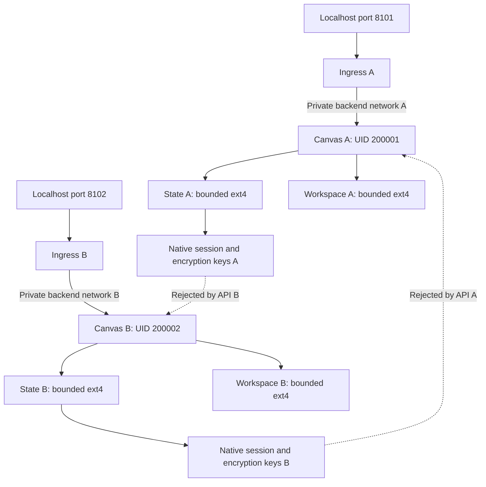

# Separate synthetic OpenHands instances

## Status and purpose

Prepared October 12, 2026 for the initial 2–3-person household. This step reuses
the two-UID storage pilot accepted by the owner on October 11. The Compose source,
regression tests and local configuration parsing are checked separately from
real Docker deployment. On October 12 the owner completed recovery, startup,
running-runtime checks and synthetic API isolation acceptance for both instances.
Owner-run checks passed selected peer IPv4 TCP denial, native session
WebSocket isolation and synthetic record recovery on October 18.
Household login/MFA, broader egress controls, inference fairness and
full encrypted backup/restore remain pending.

Create two **synthetic offline instances**, not family accounts or a shared
multi-user server. Existing OpenHands on localhost:8000, its conversations and
credentials, Ollama and observability configuration are unchanged. Neither new
agent can join their network or call a model in this pilot. Authentication/MFA,
user-to-instance routing and household LAN exposure are later stages.

## Boundaries and diagram

| Pilot | UID/GID | Independent Compose project | Local entry point |
| --- | --- | --- | --- |
| probe-a | 200001:200001 | agent-platform-probe-a | http://127.0.0.1:8101/canvas |
| probe-b | 200002:200002 | agent-platform-probe-b | http://127.0.0.1:8102/canvas |



The ingress gets its own frontend bridge and its own internal backend bridge.
Only that tenant's agent and ingress join the backend; agents have no frontend,
shared model or observability network. Port separation helps distinguish browser
origins but is not household identity authorization. Selected peer IPv4 TCP and native session WebSocket denial passed owner-run
negative tests on October 18. Host/LAN/internet/IPv6 routing, browser Origin
policy and other socket routes remain outside that acceptance.

Each agent runs with a read-only root, no capabilities, no-new-privileges,
Docker AppArmor, two CPUs, 2 GiB memory and 256 PIDs. Each ingress uses UID 101,
64 MiB memory, half a CPU and 64 PIDs. Rotated logs cap each container at two
2 MiB files; they remain Docker-managed and outside the pilot data images.
Cache/config/local directories are bounded noexec tmpfs, as is `/tmp`.
Plan/up require at least 6 GiB available host memory: 4 GiB for the two declared
agent limits plus a 2 GiB point-in-time buffer, not reserved RAM or inference fairness.

## State, workspace and key custody

Each existing 128 MiB state filesystem is mounted at `/home/openhands`; its own
`.openhands` subdirectory is explicitly mounted again at
`/home/openhands/.openhands`. This overrides the image's `VOLUME` declaration,
preventing an anonymous, unbounded state volume. The tenant's 128 MiB workspace
filesystem is mounted at `/projects` and `/home/openhands/workspace`; these are
two aliases of the same bounded filesystem, not extra capacity.

`create_host_path: false` prevents Compose from creating a missing source.
The operations verify the four actual mounts, loop backing files, identity,
capacity and restrictions before starting. The storage lock prevents concurrent
script-driven mount changes while an operation runs. Stop the instance projects
before deliberately unmounting their backing filesystems. No fstab/boot activation
is added; after reboot, verified remount is required before starting again.

The native pinned Canvas entrypoint generates session and encryption keys per
instance, under `.openhands/agent-canvas/`, using the new instance's state.
The wrapper sets umask 077. Keys are never copied from the current demo, printed,
passed as Compose variables or embedded in frontend HTML. The checker requires
mode 0600, the correct UID, distinct session/encryption values across instances,
and safe directories; descriptor-based reads reject directory/file symlinks.

The same tenant's agent can access its own state, including its own keys. This
is a boundary between tenants, not secret isolation from an agent running with
its tenant's UID. Host root/Docker administrators remain trusted. Data images
are not encrypted by this pilot. Use synthetic data only and do not add personal
provider credentials, email connectors or real family material.

The image's public passwd/group files are read in an isolated preflight, then
only the `openhands` entries are remapped to each synthetic UID/GID. Read-only
copies are mounted into the corresponding container; host account databases are
not changed. This preserves native home/user lookup while separating filesystem
identity. A collision or unexpected image layout blocks startup.

Root-controlled public configuration lives in
`/var/lib/agent-platform/instances-pilot/probe-a/` and `probe-b/`:
`passwd`, `group`, `compose.yaml`. Directories are private, files mode 0644 behind
root-controlled ancestors. They contain no credentials. Existing control files
are verified, not silently overwritten; drift requires review.

## Operations through Task

Environment tools and dependencies remain managed by mise/uv; no versions or
Python dependencies changed. All instance operations are service tasks, with
implementation in `scripts/instances/`.

```bash
cd /home/alejandro/CloudDrive/Engineering/agent-platform
mise exec -- task openhands:instances:plan
mise exec -- task openhands:instances:up
mise exec -- task openhands:instances:check
mise exec -- task openhands:instances:accept
```

These operations require sudo in the host terminal. The wrapper clears the
privileged environment. Fixed public progress lines accompany native startup;
raw Docker logs, settings, credentials and API bodies are withheld. Reports use
mode 0600 under ignored `artifacts/security/instances-*.json`.

- **Plan:** check required mounts, RAM, cached immutable Canvas/nginx images,
  pinned native entrypoint and installed SDK compatibility. An isolated ephemeral
  Python container checks the native conversation request schema, without mounting
  existing state or running an agent. No persistent controls/state are written.
- **Up:** check both port/container-name collisions before state preparation;
  create safe native directories/control files and start only the two new
  projects. No pulls, updates or existing-service recreation. On failure, stop
  only attempted pilot projects and preserve data for diagnosis/recovery.
- **Check:** inspect applied image/UID/mount/network/resource/filter/log declarations,
  distinct private native keys and authenticated settings API through each ingress.
  HTML success alone cannot count as backend readiness.
- **Accept:** test filesystem markers, unauthenticated rejection and rejection of
  the other instance's session key. Create a random synthetic secret through the
  native API, verify own retrieval and peer 404, then delete it. Create a random
  idle conversation with no initial message, verify own retrieval and peer 404,
  then delete it. The LLM URL points to an unused local port; no run/message request
  is sent. Synthetic marker/secret/conversation cleanup is attempted on failure.

API acceptance is narrower than execution isolation: it does not run arbitrary
agent tools, test WebSocket authorization, reboot/restore, authenticated family
routing, network egress or inference access/fairness. `household_readiness` remains
pending even after this step passes. No report is imported as signed SEC authority.
The bundled automation service starts with Canvas but is not independently
accepted by these checks; keep scheduled tasks and real connectors unused.

Ports are localhost-only, the frontend has no injected session key, and no real
login is provisioned. Automated tests obtain keys privately on the host; there is
no key-print command or completed family login flow in this step.

## Stopping and recovery

For a process-inspector failure, first run the read-only diagnostic:

```bash
mise exec -- task openhands:instances:diagnose
```

It reports fixed process check names and `running`/`not_running`/`missing` for
the two pilot projects, without credentials or raw inspect/log output. Exit 0
means collection succeeded, not that runtime restrictions or family access pass.
It works on stopped containers and does not require loading their keys.
Normal runtime failures now include tenant, service and failed control identifiers.
Security option syntax `:` and `=` is normalized for the required AppArmor/NNP
settings; Docker's actual AppArmor profile must still be `docker-default`.
Disabled, duplicate or additional security options are rejected. Failed startup
reports include per-project `stop_completed`/`stop_failed`; the original cause is
preserved. After diagnosis and correction, down/up/check/accept is the recovery
sequence, preserving existing state and keys.


```bash
mise exec -- task openhands:instances:down
```

This validates the selected project/image/mount identities and removes only the
pilot containers/networks. It accepts matching stopped/partially created pilot
projects and preserves all bind-mounted filesystems, controls and native keys.
It never uses `--volumes` or removes existing OpenHands/LLM/observability projects.
After a failed startup, run down before another up; inspect the fixed report
category locally rather than exposing raw logs/keys in chat. Control-file drift
or missing storage still blocks operations and needs local review.

The tiny accepted storage budget is for this prototype, not normal family use.
State saturation can break startup or APIs. Do not rerun the earlier empty-volume
`storage:accept` fill test after these applications have populated the pilot;
that operation correctly rejects unexpected existing data.

## Source checks and next milestone

```bash
mise exec -- task openhands:instances:config
mise exec -- task security:instances:test
mise exec -- task repo:commit:check
```

Source-only config validation is now part of normal commit validation. Regression
coverage rejects shared/root identities, missing state binds, anonymous volumes,
foreign mounts, wildcard ports, shared networks/keys, missing filters and relaxed
resource limits; it checks startup failure recovery, safe key reads and cleanup.
Code tests use controlled substitutes, not the owner's Docker state.

After live acceptance, add effective cross-network and WebSocket probes plus
restart/restore acceptance. Agree on larger family storage budgets and backups
before migrating data. Then wire a narrow authenticated model gateway per tenant
and household Authentik/MFA routing. A login subject must map server-side to its
instance; a client-supplied tenant ID or upstream URL cannot choose the route.
The gateway must protect every API/socket path, not only the initial HTML page.

Related: [storage pilot](storage_isolation.md), [container restrictions](container_isolation.md),
[household plan](plan.md), [LAN design](lan_access.md).
Primary source reviewed: [pinned native Canvas entrypoint](https://github.com/OpenHands/OpenHands/blob/3500d9e5c7cbdfb5a2cbfe9499ce4448eb10c0a2/docker/entrypoint.sh),
[pinned conversation request schema](https://github.com/OpenHands/software-agent-sdk/blob/v1.53.0/openhands-sdk/openhands/sdk/conversation/request.py),
[pinned secret-store routes](https://github.com/OpenHands/software-agent-sdk/blob/v1.53.0/openhands-agent-server/openhands/agent_server/settings_router.py).


## Recorded preparation validation — October 12, 2026

The complete repository gate passed 231 tests, including 27 new instance
regressions. Gitleaks reviewed 203 candidate files, staged content and local
history without findings and passed its detection/redaction canary. Both rendered
Compose documents passed the installed Docker Compose parser without daemon
mutation. All 103 local documentation links and whitespace checks passed.
Instance checker SHA-256: `df9b16a409ad8a261063d6af12960f099fffc7df3961596c46cb1cee5d98cb71`.

A read-only `sudo -n` Docker availability check failed because this session
requires interactive sudo authentication. No persistent pilot controls or
application containers were created here. The owner must run plan/up/check/accept
from their authenticated host terminal. Live native schema/startup and API
isolation remain pending; no credentials were requested or exposed in chat.


## Owner startup finding — October 12, 2026

At 22:27 Europe/Berlin the owner passed mounted storage checks and native image/
SDK/schema preflight with 16.21 GiB available memory. Both projects were started;
authenticated backend readiness passed before the process inspector raised
`runtime_process_drift`. Live startup/isolation acceptance is not complete.
Saved plan/failure reports use mode 0600 and match the then-current checker
`df9b16a409ad8a261063d6af12960f099fffc7df3961596c46cb1cee5d98cb71`.

Source review found a false-rejection defect: the template uses
`apparmor:docker-default`, while the inspector required literal
`apparmor=docker-default`. Official Compose preserves the supplied option string.
The checker now accepts equivalent syntax, verifies the actual AppArmor profile,
and reports fixed failed-check names. This source defect is established; the
owner's container diagnosis is still needed to confirm its effective failing
conditions and recovery state. No images, ports, mounts or control files changed.

Reference: [Compose security option parser](https://github.com/docker/compose/blob/main/pkg/compose/create.go).


Correction validation: the full repository gate passed 236 tests (32 instance
regressions), Gitleaks checked 203 candidate files/staged content/local history
without findings and passed its canary, 104 local documentation links and
whitespace checks passed. The read-only diagnostic distinguishes stopped state
from process declarations; it never labels a stopped container as running.
Actual owner diagnostic/recovery remains pending. No services were restarted.


## Owner stopped-container diagnosis — October 12, 2026

At 22:39 Europe/Berlin the owner ran `openhands:instances:diagnose`.
Four pilot containers are stopped; all 60 process-declaration checks passed.
Running-runtime and API isolation acceptance remain pending.

The saved report `artifacts/security/instances-pmm01asR.json` has mode 0600 and
matches current checker SHA-256
`fcdcdd1e6ae3b7e211a14a63afca66857d6a7189764e1c91de29cb6903535a84`.
It includes both OpenHands and ingress for both synthetic identities, with no
failed declarations. The stopped state confirms recovery reached stopped pilot
containers; it does not establish the original stop cause, running mount/network
acceptance or secret/conversation isolation. The corrected inspector accepts the
current declarations; the earlier source-format defect remains documented above.

Recover using the guarded existing tasks:

```bash
mise exec -- task openhands:instances:down &&
mise exec -- task openhands:instances:up &&
mise exec -- task openhands:instances:check &&
mise exec -- task openhands:instances:accept
```

Down removes only verified pilot containers/networks and retains the state and
workspace backing files, native keys and root-controlled configuration. The
subsequent up reuses those files; it does not reformat storage, pull images,
copy current-demo credentials or recreate existing platform services. Each
command stops the sequence on failure. If another guard fails, use its fixed
category/failed-check identifiers before repeating deployment.


## Owner applied recovery and API acceptance — October 12, 2026

Between 22:56 and 22:57 Europe/Berlin the owner ran down/up/check/accept.
All four operations succeeded. Down reported preserved state; up started the two
pilot projects; check passed applied runtime restrictions and authenticated API
health; accept passed all six reported categories for each identity:

- Own synthetic state/workspace filesystem access.
- Own session-key authentication.
- Rejection of unauthenticated requests.
- Rejection of the other identity's session key.
- Own synthetic secret retrieval, peer 404 and cleanup.
- Own idle synthetic conversation retrieval, peer 404 and cleanup.

Saved reports independently reviewed for expected result, mode 0600 and matching
checker SHA-256 `fcdcdd1e6ae3b7e211a14a63afca66857d6a7189764e1c91de29cb6903535a84`:

| Operation | Local report | Result |
| --- | --- | --- |
| down | `artifacts/security/instances-X7fpTCyt.json` | stopped; state preserved |
| up | `artifacts/security/instances-ZwVQzUio.json` | two instances started |
| check | `artifacts/security/instances-nKwasS4F.json` | running-runtime/API checks passed |
| accept | `artifacts/security/instances-3UiBDXNR.json` | both identities passed all six categories |

This closes the pilot startup failure and the selected synthetic filesystem/
HTTP secret-and-idle-conversation isolation exercise. It does not establish real
family tenancy, arbitrary-agent behavior, effective host/peer egress denial,
WebSocket authorization or backup restore/reboot acceptance. No LLM run was sent,
no household login/CA was created and the current demo/model/observability service
configuration was not changed by these operations. Native keys and pilot state
remain in the bounded private per-UID filesystems; reports are not signed SEC
approval. `household_readiness` intentionally remains pending.

Next: effective cross-network/WebSocket negative probes and restart/restore
acceptance, before model gateway and Authentik/MFA integration or LAN exposure.


## Extended synthetic checks — prepared October 18, 2026

The October 12 owner acceptance remains the evidence for basic runtime/HTTP
isolation. The following additional checks are **prepared, not applied or
accepted**. They add no dependencies, images, networks, ports or firewall rules.
Implementation is in `scripts/instances/isolation.py`, `network_probe.py`,
`websocket_probe.py` and `recovery.py`; Task contains only short script calls.
The existing global storage lock serializes these operations with other pilot
operations and scripted mount changes. The current demo/model/telemetry stack
is not changed. Native source/image versions remain pinned.

```bash
cd /home/alejandro/CloudDrive/Engineering/agent-platform
mise run env:storage:check &&
mise exec -- task openhands:instances:check &&
mise exec -- task openhands:instances:network:check &&
mise exec -- task openhands:instances:websocket:check &&
mise exec -- task openhands:instances:recovery:check
```

These commands require host sudo. Run them only against the two synthetic pilot
spaces, while nobody uses their UI or schedules automation. The recovery task
restarts the pilot processes; the first two new checks do not restart them.
If reboot unmounted the images, use `mise run env:storage:setup` to verify/remount
completed storage, then recover the pilot using its guarded down/up/check tasks.
Do not rerun the earlier empty-filesystem fill test on populated application state.

### Live selected peer-network checks

Resolve only the two verified pilot projects' Docker-assigned private IPv4
addresses, not arbitrary LAN hosts. Targets are the peer Canvas port 8000 and
peer ingress port 8080 on its backend and frontend bridges. The host must be
able to connect to every selected target before **and after** the test. Each
actual agent network namespace must reach its own ingress and fail TCP connects
to all three peer targets. The probe uses `docker exec`, not a replacement
container with a potentially different routing table.

Only selected connection refusal/routing/permission/timeout failures count as
negative TCP results. Unexpected I/O errors fail the check. A downed target, a
broken own positive control, missing/malformed results or string-valued fake
success cannot pass. Reports show fixed control/target identifiers; raw addresses
and Docker inspect output are withheld.

This is a bounded IPv4 peer-endpoint exercise. It does not prove host gateway,
LAN, internet, DNS, IPv6 or egress from a compromised ingress is denied. In
particular Docker `internal: true` is not by itself a complete host-access policy.
No host listener, network scan, firewall change or outside internet request is
created by the probe. Those remaining boundaries still gate family access.

### Native session WebSocket authentication

A successful HTTP 101 upgrade does not establish authentication: the pinned
native server accepts the socket before validating its first authentication
frame. The new test requires an authenticated `type: sync` reply for an own idle
conversation, and exact native close codes for the negative cases:

| Session probe | Required result |
| --- | --- |
| Own key and own conversation | Native `sync` frame |
| No valid credential | Close 4001 |
| Other pilot's session key | Close 4001 |
| Own key and other pilot's conversation ID | Close 4004 |

Both idle conversations are uniquely generated through the existing native REST
API, have no initial message or agent run, and are deleted afterward. Cleanup is
attempted on failure; a primary probe failure retains its identity when cleanup
also fails. A timeout, reset, HTTP error, unexpected frame or server failure is
not silently classified as authentication denial.

An ephemeral non-root client uses the existing pinned Canvas image's installed
`websockets` dependency and joins only that pilot's frontend network. It contacts
`ws://ingress:8080/sockets/session/...`, traversing the same nginx/Canvas proxy
route without granting host networking. There are no state mounts, model calls,
GPU, Docker socket or new published ports. Memory/CPU/PIDs are bounded. Proxy
variables are cleared. Keys are sent in first frames; private client input stays
on stdin/in memory, never URLs, Docker arguments, Env, logs or reports. The unique
probe container is removed even if its bounded run fails.

Coverage is the native session route. Legacy event/bash sockets, actual browser
Origin handling, future OIDC/session-cookie behavior and LAN-client paths remain
pending. Do not interpret this check alone as complete WebSocket authorization.

### Synthetic restart and application-level restore

Before changing data or stopping processes, the recovery task requires a bounded
conversation inventory of idle/finished entries for both pilots. Active, paused,
unknown or paginated inventories fail closed. The task cannot prevent an outside
UI client from starting work after this snapshot; keep the pilots unused for the
whole operation. Automated jobs/connectors remain outside this pilot's accepted
scope and must not be scheduled during it.

The task creates unique synthetic files in each own state/workspace, a synthetic
native secret and an idle conversation. It verifies own retrieval and peer 404,
then writes a private mode-0600 manifest under the root-controlled
`/var/lib/agent-platform/instances-pilot/` directory. The manifest is at most
8 KiB and contains only the newly generated IDs/names/values. **Native session
and encryption keys, real secrets, prompts and existing conversations are never
exported.** There is no tar archive, database copy or generic extract operation.

```mermaid
sequenceDiagram
    participant Test as Recovery task
    participant A as Pilot A / B, one at a time
    participant Manifest as Private synthetic manifest
    Test->>A: Require idle; create own generated canaries
    Test->>Manifest: Export only generated records
    Test->>A: Stop then start existing pilot
    Test->>A: Check unchanged native keys and canary persistence
    Test->>Manifest: Validate schema, ownership, permissions and hash
    Test->>A: Delete only generated canaries; confirm absent
    Test->>A: Recreate canaries from validated manifest
    Test->>A: Verify data and peer denial; clean canaries
    Test->>Manifest: Remove on success
```

Each pilot is stopped/started independently. On restart failure, the script
attempts to resume only that pilot, including a partial stop failure; it never
switches state or touches the current demo. It compares native keys in memory,
checks authenticated readiness/runtime declarations and verifies the synthetic
records survived restart, including native secret decryption.

Before deleting canaries for import, the manifest must match its in-memory hash,
strict schema, expected root ownership, single-link regular file and mode 0600.
IDs/names are restricted to this test's generated syntax. It cannot name an
arbitrary filesystem path or a pre-existing production secret. Marker opens are
exclusive/no-follow; changed or linked markers are not blindly removed. API
collisions block upserts. Import recreates only those own records; it does not
replace native state files, databases or other application records.

Successful import is verified again for own values, peer namespace denial and
filesystem contents. Generated records/files and the manifest are removed on
success. On failure the task reports a fixed stage and cleanup state; if a
manifest exists it retains that private synthetic-only file for local review and
prints its generated location without contents. Do not paste the manifest into
chat. Unknown/changed markers are preserved for review rather than deleted.

This checks process-restart persistence and selected application-level
export/import. It is **not full OpenHands restoration, an encrypted backup,
SQLite consistency validation, source-filesystem recovery, host reboot testing
or SEC-14 acceptance**. Real backup scope, encryption/key custody, restore into
fresh bounded storage and family retention rules still need implementation.

### Regression and evidence rules

```bash
mise exec -- task security:instances:test
mise exec -- task repo:commit:check
```

Regression tests exercise protocol frames/close codes, refusal/error distinctions,
positive controls, safe generated manifests/markers, preserved unrelated data,
partial-stop recovery, active-work blocking and corrupted-manifest rejection.
Their controlled substitutes cannot replace live owner acceptance. The normal
commit gate discovers these tests without Docker, mounting or restarting pilots.

Extended reports include hashes of the public helper scripts/template as well
as the main checker. They keep `household_readiness: pending` and an explicit
scope. No local result becomes signed household SEC approval.

Native primary references:
[session authentication](https://github.com/OpenHands/software-agent-sdk/blob/v1.53.0/openhands-agent-server/openhands/agent_server/sockets.py),
[session route](https://github.com/OpenHands/software-agent-sdk/blob/v1.53.0/openhands-agent-server/openhands/agent_server/session_socket.py),
[sync protocol](https://github.com/OpenHands/software-agent-sdk/blob/v1.53.0/openhands-agent-server/openhands/agent_server/session_protocol.py),
[bounded conversation inventory](https://github.com/OpenHands/software-agent-sdk/blob/v1.53.0/openhands-agent-server/openhands/agent_server/conversation_router.py).


### Recorded extended preparation validation — October 18, 2026

The full repository commit gate passed 257 tests, including 21 new extended
regressions (53 combined instance tests). Gitleaks found no findings in 208
candidate files, staged content or local history and passed its detection/
redaction canary. All 108 local documentation links and whitespace checks passed.
These tests used controlled protocol/process substitutes and temporary synthetic
files; no live Docker network/WebSocket/restart/restore exercise ran in this session.
Read-only Docker access requires interactive sudo, so owner execution is pending.
No dependency, service configuration, image or existing credential changed.

| Prepared source | SHA-256 |
| --- | --- |
| `scripts/instances/instances.py` | `2caeb7fe415b310a6c70b351f9b24c16b910bfe61f32a1dfcc1a67866d5ca7c8` |
| `scripts/instances/isolation.py` | `04c9c4127b66bce2fc03f85ceca1259128ee3e5d5466f74debe905e54ac2595c` |
| `scripts/instances/recovery.py` | `046edc86312ad76ae42c087357ca7b50fc72e7fb2020efa036e2085f8546842b` |
| `scripts/instances/network_probe.py` | `47a5c15f830886d0dce515603e4391d31d5e106ea73325828303e41c8219677e` |
| `scripts/instances/websocket_probe.py` | `10f59ef7170ebdc5de6011b045877692a58fe2262d55429b45dc36123c295296` |


### Owner-run extended acceptance — October 18, 2026

The owner supplied the complete successful Task chain, ending at 11:31 Europe/Berlin.
All six source fingerprints in the extended reports match the current public
scripts/template. This supersedes the earlier pending owner-execution status
for the specific checks below; earlier preparation fingerprints remain historical.

| Check | Result for both pilots | Private local report basename |
| --- | --- | --- |
| Guarded down/up | Recreated; bind-mounted state preserved | `instances-7ArFt45J.json`, `instances-AUh4IJKy.json` |
| Applied runtime and authenticated health | Passed | `instances-1XEG4zIw.json` |
| Filesystem and HTTP isolation | Own access passed; anonymous/foreign keys and peer secret/conversation access denied | `instances-FqOmOLvk.json` |
| Selected peer IPv4 TCP endpoints | Own ingress reachable; peer agent/backend/frontend endpoints denied | `instances-5MJARLAB.json` |
| Native session WebSocket | Own sync passed; anonymous/foreign keys and foreign conversation rejected | `instances-pdA1PTuN.json` |
| Process restart and synthetic record import | Keys preserved, own files/API records restored, peer access denied, cleanup completed and manifest removed | `instances-29cDDF9M.json` |

Reports remain under ignored `artifacts/security/`. This records owner-provided
execution evidence, not a new run by the assistant. Main checker SHA-256:
`785b67b15136fbd585213c2af89f2dc4546080af5f25bfc09e2927c4623c39ae`;
recovery helper: `332fe763c42ca8fded83daf7a18ae403cf6f4ed6781915a5e7e41ed68dd5d7d0`.

Household readiness remains pending. These results do not establish household
login/MFA, browser Origin policy, legacy event/bash socket protection, host/LAN/
internet/IPv6 egress isolation, inference fairness, full-state/SQLite recovery,
encrypted disaster recovery or host-reboot persistence.


### Owner-run repeat acceptance — October 24, 2026

Following a missing-mount failure, the owner supplied a successful guarded
recreation and complete acceptance chain. The reports run from October 23
22:47:36 to 22:49:16 UTC (October 24 00:47–00:49 Europe/Berlin). All six source
fingerprints in each of the network, WebSocket and recovery reports match the
current files. This is owner-run evidence, not an assistant-run Docker exercise.

| Operation | Result | Private report basename |
| --- | --- | --- |
| Down | State preserved | `instances-a95L9qMG.json` |
| Up | Both instances started | `instances-nRT1VWAY.json` |
| Check | Runtime and authenticated health passed | `instances-rOETz2Rj.json` |
| Accept | Own filesystem/auth passed; anonymous/foreign access rejected | `instances-fBkF962E.json` |
| Network | Own ingress reachable; selected peer IPv4 TCP endpoints denied | `instances-5lKqNkPs.json` |
| WebSocket | Own session sync passed; anonymous, foreign-key and peer-conversation access rejected | `instances-qILm9jxr.json` |
| Recovery | Restart persistence, retained keys, synthetic API/file restore and peer denial passed; cleanup complete | `instances-WRcNr7xs.json` |

Required pilot mounts are not automatically restored after host reboot. Before
repeating this chain, use `mise run env:storage:setup` and
`mise run env:storage:check`. The setup validates and remounts completed images;
it does not reformat them. Do not clear a nonempty unmounted target to bypass its
guard. The reported missing mount alone does not establish why it was unmounted.

The scope limitations of the October 18 extended acceptance still apply. This
repeat does not validate the separate encrypted Authentik backup, native
application recovery, household gateway authorization or readiness for LAN use.
Continue with the [identity backup acceptance](identity_backup.md).
