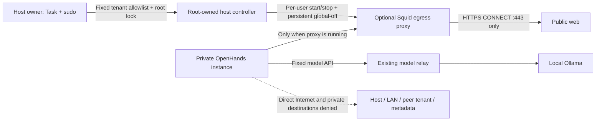

# Owner-controlled Internet access for household agents

Status: implementation is in the repository; it has not been deployed or accepted
with live traffic. Internet egress and browser tools remain off until the owner
runs the explicit preparation, apply, and per-user enable tasks.

## Requested behavior

The model generates instructions; agent tools perform network operations. The
owner requested a visible Internet switch, preferably in OpenHands, alongside
fast/balanced/reasoning model profiles. The switch must control actual outbound
traffic, not only hide a browser tool or set a prompt instruction.

- Default off, per tenant, with an owner-only global off override.
- Initial on scope: public HTTPS access through an enforced proxy; plain HTTP is denied.
  Other protocols such as SSH are outside the initial grant.
- Off blocks new public traffic and terminates active HTTP/CONNECT sessions.
- Local Ollama inference continues when Internet is off.
- The agent cannot enable access through terminal, model output, MCP or a tool.
- Unknown state, proxy/control failures and startup/restart remain fail-closed.
- Display confirmed effective state, including enabling/disabling/error states;
  do not show off merely because a UI request was submitted.

## Implemented enforcement path

OpenHands remains on its internal tenant backend. Each household Compose project
has an optional `egress-proxy` service on that backend and a separate external
egress network. The agent is not attached to the egress network. Proxy variables
configure ordinary HTTP clients and Browser Use; the internal-only agent network
is the direct-route boundary. The proxy is on a Compose profile and has no host
port, read-only root, a non-root UID, dropped capabilities, bounded resources,
and no restart policy. Do not mount Docker sockets or give agents NET_ADMIN or
privileged host access.

Deny loopback, private/host/LAN, link-local/cloud metadata, multicast, registered
special-use IPv4 ranges, and all IPv6 destinations in the proxy ACL. Review the
explicit special-use list against the [IANA IPv4 registry](https://www.iana.org/assignments/iana-ipv4-special-registry)
when updating this policy. The Squid ACL evaluates
resolved destinations before allowing a request; its parser is checked against
the pinned image. Live DNS forwarding, rebinding, DNS exfiltration, and address
mapping behavior still require native acceptance. Docker's internal network by
itself is not evidence that DNS cannot leak. Turning a proxy off uses an immediate
container stop to terminate active CONNECT tunnels; the task reports failure if
it cannot verify the container stopped.

The fixed model relay and authenticated ingress remain separate paths. Turning
web egress off must leave Ollama inference and the owner UI available. Host image
pulls and external model APIs are not part of this switch. Permitted web tools
can send workspace content to public servers while on; the current policy is not
a domain allowlist or a content-loss prevention system. Only CONNECT to port 443
is allowed; Squid does not decrypt the tunnel, so it cannot prove that a client
inside it is speaking TLS rather than another protocol on that port.

## Owner controls and OpenHands integration

Enforcement runs outside the agent container. Only the host owner who completes
sudo authentication can change policy. The CLI accepts only the fixed household
tenant names, uses the existing root-owned operation lock, and appends a
root-private audit event with UTC time, action, tenant, requesting UID, and
result. It records no credentials, prompts, response bodies, or URLs. Global-off
is written before proxies are stopped and persists across host restarts. Clearing
the global override never starts a per-user proxy.

The current implementation exposes owner controls through Task, not through the
OpenHands Canvas UI. Browser tools are disabled by default. `internet:apply`
enables them for both household instances only after an explicit idle
confirmation; it recreates only OpenHands containers, preserves bind-mounted
state, and leaves both proxies stopped. A native or Authentik-protected UI switch
is future work. Do not inject an unreviewed script or expose the switch as an
agent-callable MCP tool. Family credentials and agent API keys cannot change the
owner policy.

## Delivery order

1. Run `task household:internet:prepare` to cache the pinned proxy and validate
   Squid and Compose configuration; this starts no services.
2. Stop active agent work, then run
   `task household:internet:apply CONFIRM_IDLE=YES`; this exposes browser tools
   but does not start a proxy.
3. Run `task household:internet:on USERNAME=alejandro` or `kimberly` to enable
   one tenant, or `task household:internet:off USERNAME=...` to cut it off.
4. Use `task household:internet:global-off` for a persistent emergency cutoff;
   `global-on` removes the override but leaves every tenant proxy stopped.
5. Use `task household:internet:status` to read confirmed proxy and browser-tool
   state. The status command does not test public web access.
6. Complete native DNS, raw-socket, public-web, private-destination, tenant,
   restart, and active-tunnel acceptance before calling the platform ready.
7. Add an Authentik-protected owner switch and observability after the CLI
   enforcement has passed those live checks.

### Browser-tool readiness is separate from Internet egress

The task household:internet:status reports whether the per-user proxy and browser
environment flags are enabled. The task household:models:check also reports the
Agent Server's browser_tool_set capability from /server_info; usable means the
server reports the tool set as available, not_usable means it omitted the tool,
and not_reported means the server did not return a valid tool list. This does not
prove a specific conversation received or successfully used the tools.

After enabling browser tools, verify them in a new Canvas conversation. A
successful browser acceptance must show actual browser_navigate and
browser_get_content tool events for a harmless public page. A model's claim that
it can use curl/wget, proxy status, or an empty tab list before navigation is
not evidence of browser navigation.

## Backlog: owner admin panel

- Add a separate HTTPS admin app behind Caddy and Authentik, restricted to an
  owner-only group with MFA.
- Show each user's effective proxy state and agent activity as busy, idle or
  unknown. Determine activity from the Agent Server; do not infer idle from a
  running container. Treat unknown as requiring owner confirmation.
- Provide per-user Internet on/off and a global emergency cutoff, with
  authenticated state readback, CSRF protection and a secret-free audit trail.
- Route changes through a narrow host controller with fixed actions. Do not
  mount the Docker socket, expose a shell, or make the controls available as
  agent tools or MCP actions.
- Test owner authorization, denial for family users, CSRF rejection, active
  cutoff, audit records and behavior when agent activity cannot be determined.

Environment and image preparation belong in mise; service operations belong in
Task; implementation belongs under categorized scripts/ and infra/ directories.

## Required automatic acceptance

| Scenario | Required evidence |
| --- | --- |
| Off: HTTP, HTTPS and raw sockets | Public connections fail; a known control target proves the probe works |
| On: public web | Bounded HTTPS requests succeed through Squid; plain HTTP is denied |
| Private, host, peer, and metadata destinations | Denied while on and while off |
| Proxy bypass | Unset proxy variables, raw IP, custom resolver, and alternate browser settings cannot escape |
| Active CONNECT tunnel | Immediate stop closes the tunnel and reports verified off |
| DNS and address families | DNS exfiltration, rebinding, IPv6, mapped/NAT64 destinations are tested |
| Tenant and global scope | One tenant switch does not enable the other; global-off dominates both |
| Agent self-enable | Terminal, MCP, and model output cannot change owner policy |
| Failure and restart | Proxy failure and host restart do not restore an unapproved on state |
| Local usability | Ollama inference and authenticated UI work while web is off |
| Audit | Actions are recorded without secrets or destination URLs |

Passing unit configuration checks is insufficient. Native traffic and browser
acceptance remain pending. The repository implementation does not claim the
household network is ready or that live DNS behavior has been certified.
