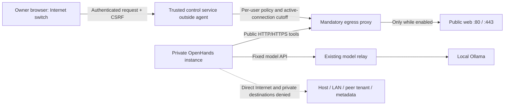

# Owner-controlled Internet access for household agents

Status: requested design and acceptance criteria, not implemented or deployed.
The existing agent backend networks remain internal, browser tools remain off,
and no Internet access has been enabled by this document. Current native backend
connection acceptance remains the immediate prerequisite for UI work.

## Requested behavior

The model generates instructions; agent tools perform network operations. The
owner requested a visible Internet switch, preferably in OpenHands, alongside
fast/balanced/reasoning model profiles. The switch must control actual outbound
traffic, not only hide a browser tool or set a prompt instruction.

- Default off, per tenant, with an owner-only global off override.
- Initial on scope: public HTTP/HTTPS web access through an enforced proxy.
  Other protocols such as SSH are outside the initial grant.
- Off blocks new public traffic and terminates active HTTP/CONNECT sessions.
- Local Ollama inference continues when Internet is off.
- The agent cannot enable access through terminal, model output, MCP or a tool.
- Unknown state, proxy/control failures and startup/restart remain fail-closed.
- Display confirmed effective state, including enabling/disabling/error states;
  do not show off merely because a UI request was submitted.

## Proposed enforcement path

Keep OpenHands on its internal tenant backend. A maintained forward proxy bridges
that backend to a separate egress network; it must enforce destination policy.
Proxy environment variables help cooperating tools but are not enforcement:
unsetting them, raw sockets or a separately configured browser must not bypass
the boundary. Do not attach agents directly to a network with unrestricted egress.
Do not mount Docker sockets or give agents NET_ADMIN/privileged host access.

Deny loopback, private/host/LAN, link-local/cloud metadata, multicast and other
special-use destinations. Check IPv4, IPv6 and mapped/NAT64 forms. Resolve and
validate destination addresses without a DNS-rebinding/re-resolution bypass.
Test the DNS path separately: Docker internal networks alone are not evidence
that external DNS or DNS-based exfiltration is blocked. Proxy redirects and
CONNECT tunnels must not bypass destination checks. On off, existing tunnels
must be closed, not left alive until the next request.

The existing fixed model relay and internal ingress remain separate exceptions;
turning web access off must not remove local inference or the owner's UI access.
Host updates/image downloads and future external model-provider APIs are separate
administrative policies; the tool switch must not silently enable cloud models.
When on, permitted web tools can send workspace content to permitted public
servers; domain restrictions and tool approvals remain separate controls.

## Control and OpenHands integration

Enforcement runs outside the agent container. Only the trusted owner control
plane can alter policy. The owner UI authenticates through Authentik and a narrow
operator authorization; an agent API key alone must not authorize changes.
Control mutations need same-origin/CSRF validation, a fixed tenant allowlist and
audit events with actor, tenant, requested/effective state and timestamp. Exclude
credentials, prompts, response bodies and full URLs/query strings from audits.

Prefer a supported Canvas UI extension. The pinned Canvas source/configuration
currently exposes tool choices and browser-enable flags, not an implemented
network kill switch in this deployment. If no supported extension exists, first
provide the owner panel through the authenticated portal, then add a pinned,
reviewed Canvas frontend integration. Do not inject an unreviewed script or
expose enable/disable as an agent-callable MCP tool. An ordinary family user
must not gain permission to change the global switch or another tenant's policy.

## Delivery order

1. Complete native/browser backend and model-profile connection acceptance.
2. Select and pin a maintained egress proxy; implement per-tenant public-web
   policy, DNS restrictions and connection cutoff outside the agent.
3. Provide owner Task operations for status/on/off with audited effective state.
4. Implement the authenticated control endpoint and visible owner switch; use
   the portal if native Canvas extension support is insufficient.
5. Run negative/positive native acceptance before enabling Internet for real work.
6. Add observability for effective state, denied traffic categories and toggles.

Operational actions belong in Task; tools/environment setup belongs in mise.
Implementation belongs under categorized scripts/ and infra/ directories. This
proposal creates no operation or environment command until its implementation
can be tested; there are no placeholder commands pretending to provide a switch.

## Required automatic acceptance

| Scenario | Required evidence |
| --- | --- |
| Off: HTTP, HTTPS and raw socket attempts | Public connections fail; a working control target proves the test is meaningful |
| On: permitted public web | Successful bounded request through the proxy |
| Private/host/peer/metadata destinations | Denied with on as well as off |
| Proxy bypass | Unset proxy variables, raw IP, custom resolver and alternate browser settings cannot escape |
| Existing HTTP/CONNECT stream | Turning off cuts the active stream within a defined tested bound |
| DNS and address families | External DNS/exfiltration, rebinding, IPv6 and address-mapping bypass tests |
| Tenant scope | Switching Alejandro does not enable Kimberly; global off dominates both |
| Agent self-enable | Terminal/MCP/model actions cannot mutate owner policy |
| Control authentication and CSRF | Anonymous, wrong-user, cross-origin and forged identity requests are rejected |
| Failure/restart | Proxy/control failure and container/host restart do not restore an unapproved on state |
| Local usability | Ollama inference and authenticated UI still work while web is off |
| Audit/UI consistency | Actor/tenant/state recorded without secrets; UI confirms enforcement rather than intent |

Passing unit configuration checks is insufficient. Native traffic and live UI
acceptance must be recorded separately before claiming the switch is available.
