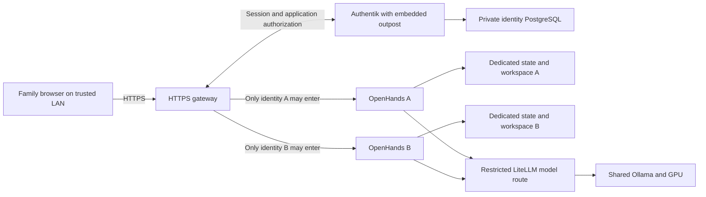
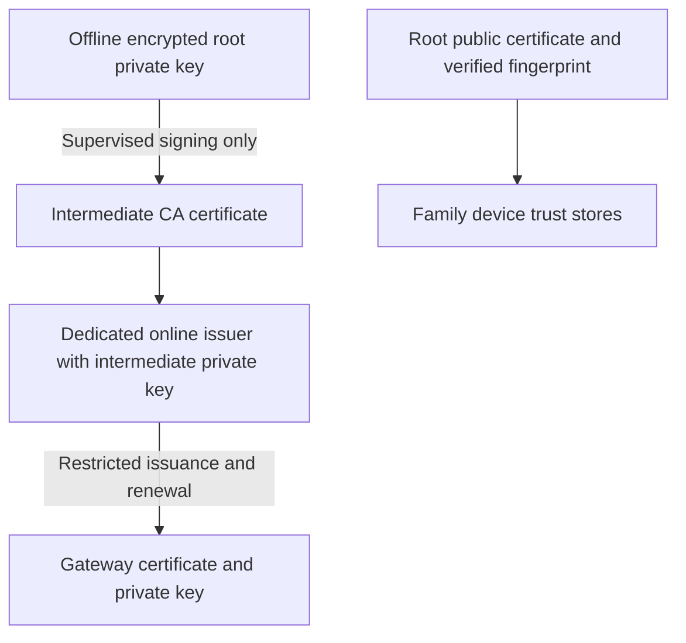

# Household LAN access and private-key custody

Date: October 8, 2026
Status: synthetic instance checks accepted; identity source candidate prepared;
household identity/gateway/CA services not deployed or accepted.

[ADR 003](architecture/adr-003-household-isolation.md) records actual host inventory,
proposed isolation, Wi-Fi/network constraints and remaining owner inputs.
Repeat inspection with `mise run env:lan:inventory`; it does not alter the host.

The native MFA/application blueprint and its explicit deployment prerequisites are
in [identity candidate](identity_access.md). Mixed Apple/Android/Windows/Linux
clients are the initial compatibility target; device acceptance remains pending.

## Agreed scope

- Entry point: `https://portal.home.arpa`.
- Access stays inside the household LAN, with individual local Authentik accounts
  and mandatory MFA. Google login, public tunnels and Internet exposure are not
  required for this stage.
- One persistent OpenHands instance, state volume and workspace per approved user.
  Repeated logins return to the same instance; creating an Authentik account does
  not automatically provision a container.
- Share the existing model backend and GPU through restricted LiteLLM routes.
  Do not expose the proxy's master key to browsers or give family users model administration.
- The portal is a proposed Authentik application launcher. Separate internal names
  identify OpenHands instances; exact names and per-user bindings will be configured
  with the user. A launcher showing only permitted apps is not itself authorization.
- `home.arpa` is reserved for household DNS. Naming is not an access-control boundary.
  Configure a local resolver and stable host address; check device/browser DNS behavior.

The mandatory controls and acceptance evidence are [SEC-01 through SEC-15](security.md).
Do not claim a control passed until its result is recorded on the real host/client.

## Access architecture

Use per-application forward-auth policies to protect the complete origin, including
API and WebSocket handshakes. Strip client-supplied identity headers and trust only
responses from the configured authentication service. Internal upstreams must have
no alternate LAN entry point. Bound the lifetime of long-lived connections so that
account/session revocation does not leave indefinite access.

Keep CA/identity/admin networks separate from agent networks. Agent A and B must
not directly reach each other's instances or identity storage. Sharing a model
service does not imply sharing browser sessions, workspaces or encryption keys.
The desktop remains a shared host. The owner selected restricted host containers;
[effective controls and residual risks](container_isolation.md) must be accepted
before family execution. KVM is optional; the shared kernel remains a boundary limit.

## Identity and MFA

Provision only approved users; disable public enrollment. Use a separate admin
account and require MFA for it and all family accounts. Prefer phishing-resistant
WebAuthn with user verification where devices support it; password plus TOTP is
an alternative. Force factor enrollment before access instead of skipping MFA.
Keep enrollment QR seeds and individual recovery codes out of screenshots, Git
and logs. A local TOTP check does not need Google or SMS; clocks must be synchronized.
Recovery is an administrative/security workflow, not an unrestricted MFA bypass.

## Three different private keys

| Material | Role | Planned custody |
| --- | --- | --- |
| Root CA private key | Signs the intermediate CA; anchors the trust installed on devices. | Encrypted, offline, with two controlled copies in separate physical locations. Never mounted into a running service. |
| Intermediate CA private key | Issues/renews only permitted internal server certificates. | Dedicated CA service, isolated from agents and identity apps; encrypted at rest, with a separately protected unlock secret. |
| HTTPS server private key | Proves the gateway owns its server certificate. | Gateway-only access; read-only delivery and restrictive ownership/mode. Not mounted into OpenHands or the browser. |

The root **public certificate** is the only root material distributed to family
clients. It cannot sign certificates or grant an OpenHands login. Trusting it
usually grants broader certificate trust than just home.arpa; do not promise that
client trust is automatically limited to the household names.

### Root creation, use and storage

1. Generate the encrypted root in a controlled offline environment, preferably a
   separate device or trusted live system. Record only its public certificate,
   SHA-256 fingerprint, purpose, validity and custodian in the inventory.
2. Use a long, unique passphrase retained in an owner-controlled password manager
   or separate protected recovery record. Do not store it on the same removable
   medium as the encrypted root, or in shell history, process arguments or environment.
3. Keep two encrypted removable copies in separate secure locations; restrict
   physical custody. Ordinary agents/services never mount these media.
4. Create the intermediate's key/CSR separately. Inspect its CA constraints,
   lifetime and intended purpose; sign it in the offline environment. Protect
   decrypted temporary data and verify no unencrypted root copy remains; deleting
   a file alone is not reliable erasure on an SSD.
5. Disconnect the root media after signing. Root use is a supervised ceremony for
   intermediate renewal/replacement or trust rotation, not routine portal startup.
6. Test recovery using an offline environment. Record success and public metadata
   without copying private materials into artifacts or CloudDrive.

### Single-computer custody choice — October 25, 2026

The owner has one current computer and one removable storage stick, not a second
Linux computer or an already prepared live boot environment. Preserve the stick's
existing contents: no formatting, boot-image installation, mounting changes or
private-key generation is authorized by merely identifying it.

For this setup, prepare a supervised session on the current computer with network
connections disabled and agent/container workloads stopped before generating the
root and signing the intermediate. This is not equivalent to a dedicated clean
live system or hardware-backed isolation: disconnection cannot undo an existing
host compromise. The procedure, host-state checks and actual custody acceptance
remain pending; no root was generated by this decision record.

The preferred separation is:

- Root private key: encrypted file on the removable stick, disconnected after
  signing; no routine agent/identity/gateway access.
- Root-key passphrase: separately retained in the owner's password manager;
  never recorded in source, arguments, environment, chat or the removable media.
- Optional additional recovery copy: the already encrypted key file in a private
  password-manager attachment, if supported. This is online recovery storage,
  not an offline copy. Keeping both that attachment and its decrypting phrase in
  the same vault removes their independence against compromise of that vault.
- Online issuer: a separately protected intermediate key only. Gateway: its
  own leaf key/certificate only. Public root certificate/fingerprint: distributable
  after verification; it does not contain the private signing key.

Two physically separate offline copies remain the stronger custody target above;
one stick plus cloud storage does not satisfy that target. Record the actual
choice and remaining limitations rather than marking the corresponding SEC
acceptance passed. No password-manager upload or USB write has been performed.

### Online intermediate and server keys

- Use an open local CA supporting an external offline root; evaluate and pin
  step-ca during implementation. Configure issuance to allow only an explicit
  inventory of household service names and necessary server authentication usages.
  Test rejection of unrelated names; do not assume issuer policy limits all abuse
  if an attacker steals the signing key itself.
- Use separate root/intermediate/provisioner passwords. Deliver unlock secrets as
  narrowly readable files, not environment values or command-line arguments.
  Encryption at rest does not protect an unlocked key from compromise of its service/host.
- Place online secret storage outside Git and CloudDrive, under a dedicated
  host/volume location. Directories should be mode 0700 and private files 0600,
  owned by the minimum service UID; only the gateway receives its own TLS key.
  Verify container UID mapping and real read access rather than assuming modes suffice.
- A read-only mount prevents writes, not key theft. Keep issuer and root material
  out of the gateway, OpenHands, Authentik and observability containers.
- Protect encrypted backups independently; restrict access to the Docker daemon
  and host administrators, who can otherwise read container secrets. TPM/HSM key
  custody is a possible later enhancement, not a currently available control.
- Target server certificates with at most 30 days validity and automated renewal;
  alert before expiry and rehearse renewal failure. Intermediate/root lifetimes
  and the offline maintenance schedule must be chosen before issuing the CA.

Caddy's default local HTTPS keeps its own root private key in persistent storage.
That default does **not** implement our offline-root design. If Caddy is selected,
use the external CA/certificate flow and verify the root key is absent from its
storage. The gateway/issuer implementation is not selected or installed yet.

### Distribution and incident handling

Distribute only the public root certificate through a known channel; compare its
SHA-256 fingerprint through an independent trusted channel before installation.
A QR/download link is transport, not proof of authenticity. Enroll devices
explicitly and document uninstall instructions; no automatic full-device trust
change without the owner reviewing the certificate.

If only a gateway key is stolen, stop the affected service, replace the key and
certificate, assess intercepted sessions and invalidate them as needed. Replacing
a server certificate does not invalidate a stolen certificate that is still valid.
Prove client revocation enforcement or replace the trust chain on affected clients
if continued impersonation cannot otherwise be excluded.
If root or intermediate signing material is stolen, isolate the issuer/gateway,
restore on a trusted environment, replace the CA trust chain and remove the old
root from every enrolled device. Do not rely on local browser CRL/OCSP behavior
unless it was proved on all supported clients. Removing old client trust is part
of acceptance, not something a server-side certificate renewal can guarantee.
Host compromise requires host investigation/recovery as well as key rotation.

## Delivery and acceptance sequence

1. Inventory the host address, LAN/guest networks, router DNS support, family devices,
   number of users and memory; implement the selected host-container boundary.
2. Prepare pinned identity/gateway/CA definitions and per-user volumes/networks;
   keep existing loopback services intact while configuring a separate candidate.
3. Perform the controlled offline root ceremony and enroll the first test device.
4. Provision two test identities/instances; verify mandatory MFA, default-deny
   access, forged-header rejection, API/WebSockets and cross-user canaries.
5. Verify reachability/firewall restrictions, secret access, backup/restore,
   certificate renewal, logout/revocation and security event privacy.
6. Record SEC-01 through SEC-15 results and remaining limitations before family use.

mise will own environment installation/validation and tool pins. Task will own
service operations, enrollment/renewal/backup procedures and acceptance tests,
with implementation in categorized scripts. [Automated SEC checks](security_checks.md)
now exist for the current source baseline, secret scanning and opt-in portal TLS.
Enrollment, deployment, renewal and backup tasks are not implemented yet; the
checks do not generate keys, expose services or certify family access.

## Primary sources

- [Authentik architecture](https://docs.goauthentik.io/core/architecture/)
- [Authentik per-application proxy authorization](https://docs.goauthentik.io/add-secure-apps/providers/proxy/)
- [Authentik MFA enrollment and validation](https://docs.goauthentik.io/add-secure-apps/flows-stages/stages/authenticator_validate/)
- [Smallstep root/intermediate custody and CA operations](https://smallstep.com/docs/step-ca/certificate-authority-server-production/)
- [Caddy local CA storage and client trust](https://caddyserver.com/docs/automatic-https#local-https)
- [Docker firewall behavior](https://docs.docker.com/engine/network/packet-filtering-firewalls/)
- [Docker host and container security](https://docs.docker.com/engine/security/)
- [RFC 8375: household DNS names](https://www.rfc-editor.org/rfc/rfc8375.html)

## Owner-run CA ceremony toolkit

[The single-computer offline procedure](pki_ceremony.md) now has mise tool
setup/checks and guarded Task operations. The root is written encrypted only to
verified removable storage; the intermediate uses a separate phrase and a private
host directory. Synthetic native crypto acceptance does not mean a real CA or
gateway exists. Host integrity, safe USB removal, client trust and restricted
issuer/authorization acceptance remain owner-run or pending.

Owner-approved initial creation exception (October 25): the owner selected a
connected ceremony on the single host. Explicit online operations preserve
encrypted removable custody and other creation guards while reporting network
exposure. This does not satisfy the stronger offline-generation target above;
normal root storage still requires physically disconnected media. See the
[connected owner procedure](pki_ceremony.md#owner-approved-connected-ceremony--october-25-2026).

## First LAN login delivery — October 25, 2026

Owner confirmed root USB removal and selected Caddy as shared gateway. The
[prepared login pilot](gateway_login.md) uses a 30-day IP/DNS server certificate
issued under the existing intermediate, one exact private IPv4 binding and a
public-root download endpoint. Agent access stays closed. First browser HTTPS
login does not require DNS; renewal is initially supervised. step-ca/ACME and
complete per-user authorization remain pending. See the [architecture](architecture/household_gateway.md).
