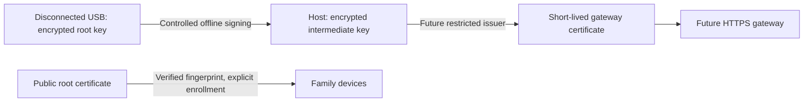

# CA ceremony on one computer

Status (October 25, 2026): the owner completed connected root/intermediate
creation. Both encrypted keys were reported created; public certificate SHA-256
fingerprints were independently matched against the host's public certificate
copies. The owner confirmed safe USB removal. Issuer deployment, client trust and
household readiness remain pending. Full identity recovery rehearsal stays deferred.

## Accepted creation evidence

Owner terminal reported `status: created`, `ceremony_mode: online`, encrypted
root and intermediate keys, and zero default-context running containers during
the operation. This is connected creation acceptance, not offline generation or
clean-host certification. Only public certificates were read for independent
fingerprint verification; private keys and phrases were not read.

| Certificate | SHA-256 fingerprint | Valid until (UTC) | CA path length |
| --- | --- | --- | --- |
| Root | `e08db0333e0e5efee452e90a56688ecf3f02157496541e56372638f48762d8bc` | 2036-10-22 10:35:29 | 1 |
| Intermediate | `d83278b69d446d697f5a14fc1f226d9cd7be670c65e2b3cbf66f6e1939d2ef1e` | 2027-10-25 10:35:29 | 0 |

Do not repeat key creation: existing output must be preserved. Safely eject and
physically remove root storage before resuming agent workloads. Retain the root
phrase separately. No client trust, portal TLS or online issuance is implied by
this acceptance.

## Custody and limits

The owner has one Linux host and a storage USB. This procedure creates an
encrypted root key directly on the mounted USB, then signs a separate encrypted
intermediate key stored outside Git/CloudDrive on the host. It never formats the
USB, changes its existing files or uploads anything. It refuses existing output
directories rather than overwriting keys. A partial failure preserves material:
stop and review it before retrying; do not delete a CA merely to silence a guard.



The root is not mounted into an agent, gateway or online issuer. The future
issuer will need the intermediate's unlocking mechanism; that service and its
secret delivery are not implemented by this ceremony. CA keys are EC P-384;
root lifetime is 87,600 hours (3,650 days), intermediate 8,760 hours (365 days).
Root path length is 1, intermediate 0. DNS issuance restrictions, leaf renewal,
revocation and gateway authorization remain pending. Path length does not itself
restrict DNS names.

At-rest format is encrypted PKCS#8: PBES2/PBKDF2-HMAC-SHA256, 600,000 iterations,
AES-256-CBC. Smallstep's temporary legacy encrypted EC encoding stays in anonymous
memory files and is converted before a key is written to storage. Private keys
are decrypted inside native crypto processes as necessary for signing. Phrases
are entered hidden and passed through anonymous memory descriptors, never as
argument/environment values or named password files. The ceremony disables its
own core dumps. This does not prove memory erasure or exclude swap, privileged
inspection, host malware or other running agents.

The default offline mode verifies link/default-route/NetworkManager snapshots and a reachable
**default Docker daemon with zero running containers**. They do not certify a
clean operating system, other Docker daemons, other runtimes, radio isolation or
hardware air gaps. The owner must close other agent applications/processes and
review those boundaries. Keep the default Docker daemon running for inspection;
stopping it is not evidence that live-restore containers have stopped.

FAT/exFAT cannot enforce Unix 0600 permissions. Encryption, a strong phrase and
physical disconnection protect the removable key. Host directories must have
safe ownership/permissions; the intermediate key is mode 0600. One USB is one
removable copy, not redundant offline recovery. An optional encrypted cloud copy
is online recovery storage. Keeping both that copy and its phrase in one vault
couples their exposure. No cloud storage integration is performed here.

## Prepare while online

Read this file locally before disconnecting. Do not run the ceremony through a
remote connection. Keep this guide and a normal owner terminal available after
closing agent applications. Install/cache tools while online:

```bash
cd /home/alejandro/CloudDrive/Engineering/agent-platform
mise run env:pki:setup
mise run env:pki:check
mise exec -- task pki:plan
```

mise pins Smallstep CLI 0.30.6 with the tool lock. The environment also checks the
existing Ubuntu OpenSSL 3.5.5. A later OpenSSL security update requires reviewing
and updating the compatibility guard/tests; do not downgrade or hold security
updates to bypass it. No additional Python dependency is introduced.

Generate two different random phrases in your password manager, preferably 32+
characters, and ensure you can retrieve them offline. The script enforces at
least 16 UTF-8 bytes, matching confirmation, no NUL or surrounding whitespace,
and different root/intermediate values; it does not measure entropy. Store the
root phrase separately from the USB. Never paste phrases, key contents or vault
screenshots into chat. Keep an independent recovery arrangement for the manager.

Identify the USB's current mount through your file manager and inspect metadata:

```bash
findmnt --mountpoint /run/media/YOUR_USER/YOUR_USB
lsblk --output PATH,TRAN,RM,FSTYPE,MOUNTPOINTS
```

Use its exact absolute mount path, not a symlink or an internal disk directory.
No partitioning or formatting is needed. Do not rename/remove existing contents.
The tool checks the mounted filesystem's USB ancestry, removable flag and UUID;
no machine-specific UUID is committed in the profile. The verifier requests
`lsblk --json --tree` explicitly because PATH-only output otherwise lacks
parent/child ancestry and can falsely reject USB partitions.

## Owner-approved connected ceremony — October 25, 2026

The owner explicitly chose to keep networking enabled for initial creation.
This is an accepted network-exposure tradeoff, not offline ceremony acceptance.
The earlier offline procedure remains available and the default create task still
requires it. Preparing the option generated no keys; the accepted owner execution is recorded above.

Keep the USB connected only for the operation and keep the root phrase separate.
The encrypted root/intermediate formats, distinct phrases, verified removable
storage, refusal to overwrite and private issuer directory are identical in both
modes. The connected path still requires zero running default-context containers;
it does not stop them or change networking automatically.

1. Prepare distinct root/intermediate phrases as described above. Review and stop
   active agent work and the current default-context containers:

   ```bash
   sudo docker --context default ps --format '{{.Names}}'
   ```

   Use `sudo docker --context default stop NAME1 NAME2` with the actual reviewed
   names. Keep the Docker daemon available. Review other runtimes/processes too.
2. Substitute the exact current USB mount and run:

   ```bash
   mise exec -- task pki:online:check USB=/run/media/YOUR_USER/YOUR_USB
   ```

   If it passes, run:

   ```bash
   mise exec -- task pki:root:create:online USB=/run/media/YOUR_USER/YOUR_USB
   ```

   The latter task passes `--allow-online` explicitly. It checks stopped containers
   and USB identity before/after signing and records
   `network_snapshot: not_required_owner_accepted_online_exposure`.
   It does not inspect or change network state in this mode.
3. Enter and confirm the two distinct phrases in the hidden terminal prompts.
   On success, retain the public fingerprint inventory, safely eject the USB and
   physically remove it. Restart the previously reviewed services as needed.
   No network disconnect/reconnect command is required. If creation fails after
   writing begins, preserve partial output and request review before retrying.

The root remains disconnected in normal service operation. This choice does not
establish clean-host assurance, offline generation or complete SEC acceptance.
Client trust and the restricted issuer/gateway are still pending.

## Controlled owner-run offline phase

1. Save work and stop active agent tasks. Review running default-context containers:

   ```bash
   sudo docker --context default ps --format '{{.Names}}'
   ```

   Stop the reviewed containers by their actual names with
   `sudo docker --context default stop NAME1 NAME2`. This interrupts their
   services; retain the names for later restart. Check again that none are
   running. Review other runtimes/daemons, close agent apps, background automation
   and tools with access to the desktop. The script cannot certify that review.
2. Disconnect Ethernet, turn off Wi-Fi/networking and review Bluetooth/other
   radios. NetworkManager can be disabled from the local terminal:

   ```bash
   sudo nmcli networking off
   ```

   This disconnects the assistant too. Continue from this local guide. A USB
   storage stick by itself does not provide a separate trusted execution host.
3. In the owner terminal, substitute the mount path below. Do **not** run mise
   itself with sudo. The wrapper authenticates only to inspect Docker; crypto
   and hidden input remain in your foreground desktop-user process.

   ```bash
   mise exec -- task pki:offline:check USB=/run/media/YOUR_USER/YOUR_USB
   mise exec -- task pki:root:create USB=/run/media/YOUR_USER/YOUR_USB
   ```

   Proceed to create only when the check passes. Enter/confirm the ROOT phrase,
   then enter/confirm the distinct INTERMEDIATE phrase. Nothing is echoed.
   If a guard fails, fix its stated condition; do not weaken it. If creation
   started and failed, preserve the output and request review before retrying.
4. Successful creation verifies key/certificate matching, root/intermediate
   chain, CA path lengths and lifetimes. The printed inventory contains public
   SHA-256 fingerprints and validity only, plus status/paths. Record the public
   root fingerprint separately for later device enrollment.
5. Safely eject/unmount the USB through the file manager and physically remove
   it **before** enabling networking or restarting agents. Keep its phrase in
   your password manager, separate from the stick. Then restore networking:

   ```bash
   sudo nmcli networking on
   ```

   Start only the containers reviewed/stopped earlier, using their existing
   operation tasks or `sudo docker --context default start NAME1 NAME2` after
   checking storage mounts. The ceremony does not restart them automatically.

## Resulting files and next step

| Location | Contents | Delivery |
| --- | --- | --- |
| USB `agent-platform-ca-root/` | `root.key` (encrypted), `root.crt`, `public-inventory.json` | Disconnect and retain privately |
| `~/.local/share/agent-platform/pki/issuer/` | `intermediate.key` (encrypted), `intermediate.crt`, public `root.crt`, public inventory | Host-private; no agent mounts |
| Repository | YAML profile, scripts, tests, guide | No key or phrase values |

JSON is used for generated machine-readable inventory, not handwritten service
configuration. YAML remains the reviewed profile format. The directory descriptor
used for USB writes is held open so detachment cannot silently redirect those
writes into an unmounted fallback directory on the host.

Share only the successful public status/fingerprints if needed. Do not install
trust yet: the next setup step is a restricted intermediate issuer and HTTPS
gateway, followed by verified public-root distribution, DNS and MFA/per-user
routing acceptance. Installing a root grants certificate trust; client testing,
fingerprint verification and removal/recovery procedures are required. Never
install certificates from the synthetic tests.

## Validation and sources

`mise exec -- task security:pki:test` covers online/wrong-media refusals,
existing-file preservation, phrase errors, profile/version drift, native
PKCS#8 encryption parameters, chain/key matching and wrong-password rejection.
Tests also verify the explicit connected choice, its truthful report, retained
container/media/overwrite guards, and the unchanged default offline requirement.
Tests use temporary material only and do not install trust, touch the real USB,
change connectivity or stop workloads. These are not owner live acceptance.

- [Smallstep certificate creation](https://smallstep.com/docs/step-cli/reference/certificate/create/)
- [Smallstep production CA custody](https://smallstep.com/docs/step-ca/certificate-authority-server-production/)
- [OpenSSL PKCS#8 encryption options](https://docs.openssl.org/3.5/man1/openssl-pkcs8/)
- [LAN architecture and security boundaries](lan_access.md)
