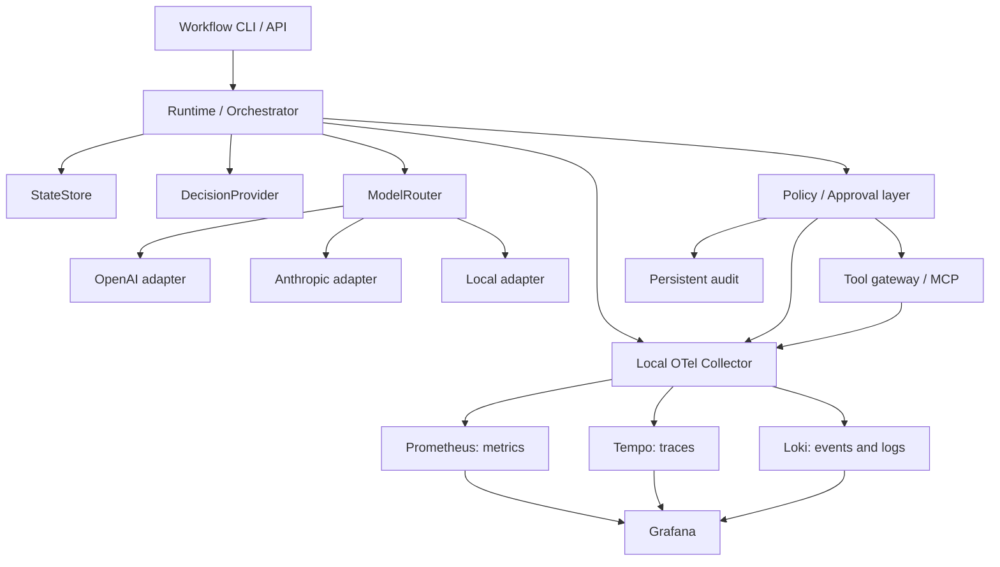

# Implementation Plan — Model-Agnostic Local Agent Platform

## Current delivery checkpoint — October 28, 2026

Implemented and partially accepted: separate bounded household instances, private
model relays, Caddy HTTPS and Authentik invitations/MFA. Alejandro completed a
browser login; Kimberly's account and phone/browser acceptance remain pending.
After restart, core services and synthetic observability checks passed. Local
Qwen profiles were tuned to disable reasoning through the correct API field;
new-conversation agent completion remains to be measured.

Do not interpret earlier dated proposals below as the current deployment state.
The root CA was created in the explicitly accepted connected ceremony and its USB
was removed; this is not an offline-host integrity guarantee. The complete SEC
matrix remains pending. The family path bypasses LiteLLM, and the Internet switch
is still a design. See [publication review](release_review.md) for the current
scope, operational gaps and validation limits.


New requirement — October 26, 2026: provide owner-controlled public web access
for agent tools, default off, per user with a global off override and a visible
switch preferably in OpenHands. Enforce outside the agent through a mandatory
proxy, including active connection cutoff and DNS/IPv4/IPv6 bypass tests. Tool
visibility or environment variables alone do not satisfy the requirement.
This is planned, not enabled. Complete current backend/model connection first;
then implement and accept the control plane and UI. See
[Internet switch design and acceptance matrix](internet_access.md).

Priority correction — October 25, 2026: deliver alejandro and kimberly accounts,
mandatory TOTP, separate personal instances and actual phone-to-OpenHands access
in the same installation sequence. Login-only is insufficient. Prepared changes
include fixed-size user storage, per-user authenticated Caddy origins, native
Canvas session bootstrap and local model defaults. Owner execution and both
browser/real-agent acceptances are still required. [Runbook and architecture](household_access.md).


Active delivery — October 25, 2026: owner confirmed root media removal and selected
Caddy. Prioritize HTTPS Authentik login from another device through a private IP
SAN, followed by DNS and per-user access. Gateway sources/operations/native tests
are prepared; real leaf signing, deployment and device login are owner-run and
pending. Initial leaf renewal is supervised; step-ca/ACME remains later work.
[Execution](gateway_login.md) · [Architecture](architecture/household_gateway.md).


Current CA status — October 25, 2026: owner-run connected root/intermediate
creation passed, and both public certificate fingerprints were independently
matched. Owner confirmed safe USB removal. Next: restricted issuer/gateway
configuration, DNS/client trust and authenticated per-user routing acceptance.
Do not regenerate existing CA material. Full identity application recovery
rehearsal remains deferred. [Accepted public evidence](pki_ceremony.md#accepted-creation-evidence).


Date: October 4, 2026
Status as of October 11, 2026: GPU, Docker and Ollama/Qwen3 are validated on the
host. OpenHands Canvas 1.26.0 / SDK 1.53.0 is applied; all 14 selected runtime
checks, a reported read-only terminal exercise and the existing three-test demo
acceptance passed. Observability services recovered, Collector log mounts were
refreshed and synthetic streamed usage matched counter increments. The six
specialized dashboards and overview remain provisioned. Broader agent behavior,
this conversation's effective proxy usage, household identity/storage/network
isolation and the complete agnostic platform remain pending.

## 1. Objective

Build a reproducible agent platform on Linux, initially with Docker Compose, that allows replacing the runtime, models, decision engine and tools without redesigning the entire application. Security, auditing and observability will form part of the design from the first executable flow.

The first milestone will be a local implementation that executes an end-to-end workflow, applies policies before using tools, requests approval when appropriate, persists its state and generates metrics, traces and events visible in Grafana.

This document collects the content from «IA Local Project #1». Statements from the chat about products, licenses, performance and calibration of decision engines will be verified before choosing dependencies.

## 2. Principles and Scope

- **Model Agnosticism:** adapters for OpenAI, Anthropic and local models; the workflow will not depend on their SDKs or particular formats.
- **Decoupled Runtime:** an orchestrator will coordinate components through contracts. OpenHands can be integrated later as runtime, without becoming a mandatory dependency.
- **Interchangeable Decisions:** `DecisionProvider` will allow local rules, classifiers and models. Jev will be optional and never necessary to start.
- **Local and Open Priority:** start with deterministic rules and evaluate open alternatives on representative data before adopting them.
- **Security Outside the Model:** a layer of authorization will control tools, scope, destination and approvals. Model responses will not grant permissions.
- **Privacy by Default:** do not save prompts, responses, tool arguments, PII or secrets in telemetry. Any storage of content will require an explicit access and retention design.
- **Reproducibility:** pinned versions, declarative configuration, synthetic data, documented commands and significant tests.
- **Evolution to Enterprise:** maintain portable contracts and services; address Kubernetes, corporate identity and high availability when the MVP is validated.

A production multi-user platform, an agent with arbitrary system access, and automations over real external accounts are not part of the MVP. A small household LAN deployment with separate spaces is now an explicit near-term extension, gated by the controls and acceptance below; it is not an enterprise multi-tenant service.

## 3. Target Architecture



Persistent auditing will retain the necessary decisions and approvals to reconstruct an execution. Loki will allow operational querying, but will not be the only source of auditing. A `DecisionProvider` will choose among workflow options; the authorization will remain the responsibility of the security layer.

## 4. Phases

### Phase 0 — Agree on the first use case and constraints

**Work**

- Define the contract of the first workflow: input, output, decisions, tools and expected result.
- Initial proposal: synthetic message triage from local files, with classification, summary and routing to human review. Integration with real email will come later.
- Identify available Linux hardware, capacity to run Docker, availability of GPU and memory/disk limits.
- Agree on whether cloud providers will be allowed, a maximum budget and the data categories that can leave the device.
- Define actors, trust limits and actions that will require approval.

**Deliverables:** MVP specification, synthetic examples and initial threat model.

**Closure Criteria:** The workflow has verifiable results, limited permissions and defined cost and data limits. It can be developed initially without GPU or cloud keys.

### Phase 1 — Architecture, Contracts and Repository

**Work**

- Create a separate work repository from the synchronized material under `sources/`, which will be maintained as a read-only reference.
- Document architectural decisions and responsibilities of each component.
- Define interfaces `Runtime`, `ModelProvider`, `ModelRouter`, `DecisionProvider`, `StateStore`, `ToolGateway`, `PolicyEngine` and `ApprovalStore`.
- Normalize requests and results: execution identifiers, errors, token usage, capabilities, decisions and states.
- Design the state machine: pending, executing, waiting for approval, completed, failed and canceled.
- Define timeouts, cancellation, limited retries and idempotency of actions with external effects.

**Deliverables:** Initial structure, contracts, diagrams and architectural decision records.

**Closure Criteria:** A runtime and simulated adapters execute the same contract regardless of provider SDKs in the workflow logic.

### Phase 2 — Local environment and observability contract

**Work**

- Prepare Docker Compose with OTel Collector, Prometheus, Tempo, Loki, and Grafana. In the existing local platform, add LiteLLM Proxy via its OTel callback; reuse native OpenHands tracing and filelog before proposing custom adapters. PostgreSQL will come with the state store, when the runtime exists.
- Document effective coverage, risks of capture at source, pending context propagation, and future metrics; see [observability](observability.md), [ADR 001](architecture/adr-001-observability.md) and [diagrams](architecture/observability_diagrams.md).
- Add persistence, health checks, pinned versions, and an example configuration file without credentials.
- Expose only necessary ports in localhost; keep backends in internal networks and separate outgoing access to providers.
- Define metrics, attributes, and events of low cardinality before instrumenting the components.
- Create spans `agent.run`, `decision.route`, `llm.request`, `policy.evaluate`, and `tool.call`.
- Emit metrics, traces, and logs via OpenTelemetry. Configure batching, memory limits, and a second filtering barrier in the Collector.
- Avoid sensitive content at source and check that it is also excluded from the persistent state when not necessary.
- Define initial retention and procedures for startup, shutdown, and explicit deletion of local data.

**Deliverables:** Compose, observability configurations, and documented telemetry contract.

**Closure criterion:** a synthetic execution reaches the three backends and can be located by its trace identifier. The execution identifiers do not appear as metric labels.

### Household LAN access — immediate extension, agreed October 8, 2026

This takes priority over the next runtime expansion. Existing service settings are
not changed by this plan. Agreed entry point: `https://portal.home.arpa`, local
Authentik accounts, mandatory MFA and one persistent OpenHands space per identity.
Detailed design: [LAN access and private-key custody](lan_access.md).

**Validation foundation — implemented October 8, 2026**

- Version all fifteen evidence requirements in `config/security/controls.yaml`.
- Preserve the current source baseline with eight automated Compose guards and
  negative regression tests; run them in the local commit hook.
- Run explicit SEC readiness/secret checks and optional verified-root TLS checks
  through Task. Missing deployed/physical evidence remains pending.
- Add actual host/client probes alongside phases A–C; passing source checks is
  not the household milestone's closure criterion. See [check commands and limits](security_checks.md).

**Phase A — Boundaries and key custody — in progress**

Read-only host inventory and a reproducible mise command now exist. The owner
selected host containers, so KVM/tool availability no longer gates this path.
Router/client inventory and offline custody remain pending. No VM, identity
service, CA or LAN exposure has been created. See [ADR 003](architecture/adr-003-household-isolation.md).

- Host containers selected: KVM is not a prerequisite. Implement effective
  non-root/kernel-filter/mount/resource restrictions and record kernel-sharing risk.
  [Hardening profile and runtime checks](container_isolation.md) are implemented.
  Owner baseline results passed 13 of 14 selected checks before hardening.
  The owner then applied the profile on October 9; UI/model startup checks passed.
  The activation record is valid with UID/GID 10001:10001 and mode 0600.
  The owner post-apply report passed all 14 selected runtime checks, including
  readonly-root and effective cgroup/filter restrictions. Synthetic agent
  compatibility remains pending. The owner applied the locked Python-module
  launcher; live module preflight, authenticated backend/proxy and Ollama checks
  passed, recovering the earlier HTTP 502. The owner then applied the bounded
  noexec configuration tmpfs; backend checks passed and the reviewed log tail had
  no recognized error indicators. Grafana health HTTP 200 and a fresh streamed
  proxy report with matching usage/counter increments 23/8 were observed.
  Post-recreation runtime restrictions and a real synthetic agent task remain
  pending; full agent functionality is not established by API health alone.
  The owner subsequently reported the SDK cache-write AttributeError. A
  version/source-guarded backport of upstream PR #5327 was applied by the owner
  on October 10; installed SDK self-tests and backend/proxy checks passed. The
  requested Canvas 1.26.0 / SDK 1.53.0 upgrade was applied by the owner on
  October 11. Isolated candidate identity/native cache-usage tests, private
  stopped-state/project backups, authenticated backend/proxy and model checks
  passed. Independent archive hashes and restrictive permissions were verified.
  Collector log refresh and synthetic streamed proxy usage passed.
  The corrected live runtime check passed all 14 selected conditions.
  Owner-reported read-only agent terminal execution passed in /projects/demo.
  Existing demo acceptance passed: three generated tests and additional
  arithmetic checks. Broader tool behavior and household acceptance
  remain pending.
  Later October 11 checks found OpenHands and LiteLLM stopped with exit code 0
  and no OOM flag. Existing startup operations recovered the services, refreshed
  three selected log mounts and passed a streamed proxy call with usage/counter
  increments 23/8. Docker restarted after the upgrade; correlation with container
  stop timestamps remains pending. The subsequent runtime check passed 13 controls
  but the image check retained the old release digest. It now reads the deployment
  lock and rejects old/unrelated/mutable images. The owner reran the corrected
  checker at 14:57 UTC and all 14 conditions passed; its saved report matches
  the current checker hash. Exit 2 preserves pending household acceptance.
  Persistent quotas, tenant/egress separation and full household
  acceptance remain pending.
- Initial household size: 2–3 people. The owner applied the two-identity
  synthetic storage pilot on October 11: separate 128 MiB workspace/state
  filesystems (512 MiB total). All four live probes passed UID/access checks,
  foreign-access denial, ENOSPC and cleanup. Saved reports match the checker
  and use mode 0600. Existing agent mounts/data are unchanged; real-user
  application isolation, final budgets and restart/restore acceptance remain
  pending. See [storage isolation procedure and diagram](storage_isolation.md).
- Complete router/DNS, trusted/guest network and family-device inventory.
- Enforce persistent workspace/state disk limits outside CloudDrive, separate
  per-user networks/instances and prove denied cross-user and LAN/admin access.
- Implement SEC-01 (LAN exposure), SEC-02 (HTTPS/DNS/trust), SEC-07 (host protection)
  and SEC-09 (offline encrypted root and restricted online keys).
- Generate no private key until offline custody, passphrase storage and two
  encrypted removable backups have a concrete, reviewable procedure.

**Phase B — Identity and separate spaces**

The owner applied and accepted the two-instance synthetic offline pilot on
October 12. It uses accepted per-UID bounded storage, native distinct session/
encryption keys and separate localhost ingress/internal networks. Recovery,
running-runtime/API health and all six synthetic filesystem/authentication/
secret/idle-conversation categories passed for both identities. Saved reports
match source fingerprints and mode 0600. Current OpenHands/model/telemetry
configuration is unchanged. See [instance procedure and diagram](instance_isolation.md).
Household identity, WebSocket/egress, restart/restore, model access and final
budgets remain pending.

October 18: selected IPv4 peer-network probes, native session WebSocket checks
and synthetic process-restart/application-import recovery checks are prepared.
They reuse the accepted two-instance pilot without changing its Compose or
provider connections. Code validation is separate from pending owner execution.
Full-state encrypted restoration, host/LAN/internet/IPv6 egress, legacy sockets,
Origin policy and family login remain open. See the
[extended acceptance procedure](instance_isolation.md).

- Configure Authentik with SEC-03 (individual accounts/admin separation), SEC-04
  (mandatory MFA/recovery) and SEC-10 (sessions/revocation/throttling).
- Prepare per-user instances, volumes, workspaces and networks under SEC-05
  (default-deny application authorization), SEC-06 (tenant separation), SEC-08
  (egress/tools) and SEC-11 (resource limits).
- Protect the whole application origin including API/WebSockets; no direct bypass.

**Phase C — Operations and acceptance**

- Apply SEC-12 (pins/patching/scans), SEC-13 (private security audit), SEC-14
  (encrypted backups/restoration) and SEC-15 (renewal/incident response).
- Test two identities from another LAN device: allowed own-space access, denied
  cross-user/unauthenticated access, mandatory MFA, network restrictions and
  removal of old CA trust in a controlled recovery exercise.
- Keep installation/environment checks in mise and operations/acceptance in Task,
  implemented in categorized scripts. Version public configuration only.

**Closure criterion:** all [15 security controls](security.md) have host/client
evidence with failures and limitations recorded. Personal-host isolation and
key custody are explicitly accepted; a successful login alone does not close this
milestone. No Internet forwarding/tunnel or Google integration is required.

### Phase 3 — Model providers and basic routing

**Work**

- Implement adapters for OpenAI, Anthropic, and a local server, choosing initially an option between Ollama, vLLM, or llama.cpp after verifying resources and compatibility.
- Maintain a simulated provider for development and tests without network or cost.
- Normalize responses, token consumption, errors, and capabilities; make explicit the functions not supported by each provider.
- Incorporate timeouts, bounded retries, and handling of transient errors and API limits.
- Create a router based on configuration, capabilities, data sensitivity, and budget.
- Register estimated cost only when tariffs are configured; show unknown cost if data is missing. Separate API cost from local operational cost.
- Prevent fallback to cloud when the data policy does not allow it.

**Deliverables:** adapters, model catalog configuration, and initial router.

**Closure criterion:** the same workflow functions with the simulated provider and a local one. The cloud adapters pass contract tests with simulated responses; their real validation will require authorized credentials and budget.

### Phase 4 — Local and interchangeable DecisionProvider

**Work**

- Implement first a local, deterministic, and explainable rule-based engine for the initial use case.
- Define typed output: valid option, bounded reason, abstention, and optional confidence. Do not present a model score as a calibrated probability without evaluation.
- Implement a second interchangeable strategy, for example a local classifier or a small model with structured output validated.
- Verify mentioned candidates in the chat, including Laya, Kev, and other alternatives, reviewing existence, license, maintenance, hardware, and quality before selecting any.
- Measure accuracy, false positives/negatives, latency, cost, and abstention rate. Measure calibration only if the strategy produces evaluable probabilities.
- Define escalation to another model or human review with explicit limits.

**Deliverables:** two implementations of the contract and a labeled synthetic evaluation set.

**Closure criterion:** the engine changes by configuration; an invalid or insufficient output does not trigger an action and is recorded as abstention or scaling.

### Phase 5 — State, audit, and resumption

**Work**

- Implement the state store with PostgreSQL and versioned migrations.
- Persist executions, steps, references to results, decisions, approvals, and idempotency keys.
- Save only necessary content, with defined retention and access; never API keys.
- Add audit with actor, action, policy/version, result, date, and correlation identifiers, avoiding sensitive arguments.
- Design recovery after interruptions and separation between safe retry and result uncertain action.
- Postpone Redis and vector storage until a concrete need justifies them.

**Deliverables:** schema, migrations, store implementation, and local backup/restoration procedure.

**Closure criterion:** a pending execution awaiting approval survives a restart. Tests verify that resuming does not duplicate an action and that terminal states are consistent.

### Phase 6 — Tools, MCP, policies, and approvals

**Work**

- Create a tool catalog with schemas, capabilities, allowed destinations, and risk level defined by trust configuration.
- Implement first a local read tool and a limited write over a working directory.
- Add an MCP client compatible with the chosen protocol version, connected to a local server under control; test negotiation, calls, errors, and disconnection.
- Apply default denial and authorization before each call, both for local tools and MCP.
- Link approvals to a specific action, its arguments, the actor, policy version, and expiration; validate again before execution and avoid reuse.
- Separate unreliable data, workflow instructions, and permissions to limit prompt injection attacks.
- Design worker isolation without access to Docker socket, with limited filesystem and network. A container, by itself, will not be considered a sufficient sandbox.
- Emit permission, denial, approval, expiration, and tool failure events.

**Deliverables:** tool gateway, local MCP integration, declarative policies, and CLI/API approval mechanism.

**Closure criterion:** tests demonstrate that a denied action does not execute, that a modification invalidates the approval, and that the model cannot elevate its own permissions.

### Phase 7 — First complete workflow

**Work**

- Integrate runtime, routing, decisions, state, tools, and security controls.
- Execute synthetic triage: read message, decide, generate summary if applicable, and record the result or wait for approval.
- Implement limits per step execution, time, tokens, and estimated cost, with controlled cancellation.
- Emit workflow results and record quality through verified tags or human feedback, avoiding confusing technical success with result correctness.
- Test success, abstention, denial, approval, expiration, provider failure, timeout, and restart.

**Deliverables:** reproducible workflow, demo fixtures, and execution command.

**Closure criterion:** the complete flow can execute without cloud services and be reconstructed from the state, audit, and its trace.

### Phase 8 — Provisioned Grafana dashboards

The dashboards and data sources will be automatically loaded from versioned files. Each panel will have a real source, clear units, and a description; the absence of data will not be presented as zero.

| Dashboard | Initial Content |
| --- | --- |
| Agent operations | Executions, success/failure, duration p50/p95/p99, activity, approval wait, timeouts, and retries. |
| LLM cost / routing | Tokens, estimated cost in the selected interval, unknown costs, latency, distribution by provider/model, fallbacks, and cost per completed task. |
| Model quality / escalations | Labeled evaluations, errors by category, abstentions, escalations, and human corrections; calibration when there is sufficient data. |
| Security | Policy decisions, denials, pending/approved/expired approvals, and limited reasons, without PII or identities as high cardinality labels. |
| Tools / MCP | Calls, duration, errors, timeouts, and MCP server availability from real checks. |
| Workflow / business KPIs | Processed inputs, verified results, human review, and corrections. Time saved only as an estimate with an explicit method. |

**Additional work**

- Correlate metrics, traces, and events where supported by instrumentation.
- Add workflow/provider/model variables without allowing free-text labels.
- Define initial alerts for failures, latency, telemetry loss, and accumulation of approvals. External notifications will be configured later.
- Produce a controlled demo that feeds the panels and allows comparing their results with the persisted state.

**Deliverables:** overview view and six specialized JSON dashboards, provisioning, alert rules, and metric catalog.

**Closure criterion:** the seven dashboards appear on Grafana startup and their queries return the expected demo results, including treatment of zero denominators and missing data.

### Phase 9 — Validation, hardening, and documentation of the MVP

**Work**

- Execute contract, security, recovery, and workflow tests; add real integration of Compose services.
- Validate Compose configuration and backend settings, health, persistence, and provisioning.
- Inject provider, MCP, and Collector failures; check that telemetry loss does not eliminate persistent audit.
- Introduce synthetic PII and secrets to verify that they do not appear in logs, traces, metrics, or state fields that should exclude them.
- Review credentials, permissions, dependencies, port exposure, and resource limits.
- Document Linux installation, configuration, local models, demo, policies, approvals, backup, troubleshooting, and limitations.
- Configure CI without secrets for tests and static validations; reserve real API tests for explicit execution.

**Deliverables:** validation report, operations guide, and limitations registry.

**Closure criterion:** another person can reproduce the MVP from the documentation and execute the checks. Any validation that the environment does not allow is registered as pending, without declaring it approved.

### Phase 10 — Real integrations and evolution to Kubernetes / enterprise

This phase will begin after validating the local MVP.

**Work**

- Choose a first external integration and define its permissions, data, and approvals before activating real actions.
- Evaluate OpenHands or another runtime through existing contracts and compare its utility over the workflow.
- Incorporate specialized classifiers or local decision engines that surpass the agreed evaluation.
- Prepare Kubernetes deployment: workloads, services, probes, limits, volumes, secrets, and NetworkPolicies.
- Evolve to agent/gateway collectors, service-to-service authentication, TLS, OIDC identity, RBAC, and user/tenant isolation.
- Design high availability, recovery, tamper-resistant auditing, and retention according to real requirements.
- Consider policy engines like OPA or Cedar and additional storage only when they provide a necessary capability.
- Validate licenses and operational costs, assess load, and set availability and latency targets before production.

**Deliverables:** migration plan, test deployment, and production requirements.

**Closure criterion:** the same workflow and the same contracts function in the new environment; security, isolation, and recovery have their own validation evidence.

## 5. Proposed repository structure

```text
agent-platform/
├── README.md
├── plan.md
├── compose.yaml
├── .env.example
├── apps/
│   ├── api/
│   └── worker/
├── packages/
│   ├── contracts/
│   ├── runtime/
│   ├── providers/
│   ├── routing/
│   ├── decisions/
│   ├── state/
│   ├── tools/
│   ├── security/
│   └── telemetry/
├── workflows/
│   └── synthetic-triage/
├── config/
│   ├── models/
│   └── policies/
├── migrations/
├── observability/
│   ├── otel/
│   ├── prometheus/
│   ├── tempo/
│   ├── loki/
│   └── grafana/
│       ├── provisioning/
│       └── dashboards/
├── tests/
│   ├── unit/
│   ├── contracts/
│   ├── integration/
│   ├── security/
│   └── fixtures/
├── scripts/
│   ├── bootstrap
│   ├── demo
│   └── verify
└── docs/
    ├── architecture.md
    ├── decisions/
    ├── telemetry.md
    ├── security.md
    ├── operations.md
    └── kubernetes-roadmap.md
```

The packages represent logical boundaries, not a commitment to create a microservice per component. The MVP will maintain few processes to simplify its operation. The language and dependencies will be chosen in the phase 1 according to the contracts and the necessary integrations.

## 6. Execution order and milestones

1. **Approved design:** phases 0–1, with use case, boundaries, and contracts defined.
2. **Local observable base:** phase 2, with Compose and synthetic telemetry functioning.
3. **Interchangeable components:** phases 3–5, with models, decisions, and persistence tested. The security design of phase 6 will be considered from phase 1.
4. **End-to-end protected flow:** phases 6–7, with approvals and recovery.
5. **Reproducible MVP:** phases 8–9, with seven dashboards and validated documentation.
6. **Post-expansion:** phase 10, guided by needs and MVP results.

Security will be implemented before enabling tools with effects; instrumentation will be added to each component as it is built. The dashboards will be completed when their metrics have real producers.

No deadlines are set yet: they depend on available hardware, chosen runtime, and integrations. Once phase 1 is closed, each milestone can be estimated with greater precision.

## 7. Definition of completion of the first MVP

- Starts on Linux with a documented Compose procedure and pinned versions.
- Executes the synthetic workflow without Jev, mandatory GPU, or cloud keys.
- Allows substitution of a model provider and a DecisionProvider via configuration.
- Persists executions and approvals, and resumes without duplicating verified actions in tests.
- Authorizes all tools through policies and blocks actions without valid approval.
- Exports metrics, traces, and events through the local Collector.
- Provides the overview and six specialized dashboards and shows verifiable data from the demo.
- Excludes sensitive content from telemetry and passes tests with synthetic PII/secrets.
- Includes tests, validation commands, operation guide, and known limitations.
- Maintains documentation of the path toward Kubernetes without requiring it for local operation.

## 8. Initial situation

The work folder contains the project instructions and this plan; there is no implementation yet. Python is available in the reviewed environment and Docker is not installed. The startup and full testing of Compose must be done on a Linux host with Docker available. This limitation does not prevent starting with contracts, structure, tests, and configurations.

**Next planned work:** execute phases 0 and 1, concretize the synthetic workflow, and create the initial repository following this plan.

## Agreed work tools

- `mise.toml` and `mise.lock`: versions and development tool environment.
- `Taskfile.yml`: task coordination and preparation/check sequences.
- `scripts/bootstrap/`, `scripts/host/`, `scripts/repo/`, `scripts/llm/`, and `scripts/openhands/`: command implementation by responsibility.
- `infra/`: declarative configuration and infrastructure versions.
- `docs/`: detailed documentation and reviewed diagnostics.

The first GPU/Docker environment is validated on the host. The migration of tasks mise to go-task passed the plan and syntax validation; its full GPU check will be executed on the host. See [environment](environment.md).

## Observability progress — October 5, 2026

The proposal is concretized with existing integrations, without a proprietary conversation adapter: LiteLLM → OTLP → Collector; filelog for selected Docker logs; native OpenHands tracing as an optional and synthetic step. Compose with digests, filters, Grafana sources, an overview, six specialized dashboards, and tasks in `scripts/observability/`. mise retains environment management and go-task coordinates.

Configurations are validated with pinned binaries and a Collector test that attempts to filter sensitive content. Docker execution of the stack, the real path of the new profile, and span correlation remain pending verification on the host. Quality panels, policies/MCP, and business explicitly state what is still not instrumented; the phase 2 is not declared closed.

The principle of not capturing content at the source is applied to the LLM proxy. Native SDK tracing can capture inputs/results before the Collector; that is why it is not activated on normal startup. Before using personal data, this difference must be resolved and local state/logs, as well as backends, must be reviewed.

The overview adds nine HTTP probes with Blackbox Exporter, internal metrics of the Collector and two local alerts verified with activation/recovery scenarios. GPU/host metrics, quality, policies and business metrics continue pending. See [dashboards](dashboards.md).

Acceptance of October 6: `observability:up` and `observability:check` successfully completed on the host. Nine healthy probes confirmed, model response authenticated, native LLM trace/metrics and sanitized canaries; Grafana shows real-time data. Pending OpenHands conversation via LiteLLM and full agent correlation. Evidence: [diagnosis](diagnostics/observability-2026-10-06.md).

Dashboards updated with explicit reach golden signals and totals of requests/errors/tokens: current accumulated and estimates per period. Rates preserved. Reload and 43 queries verified in Grafana; GPU/LLM server saturation and durable usage history remain pending.

### Cache observability tuning — October 6, 2026

Real reutilization of prefix in Ollama was verified and cache-read/write panels were prepared via the native LiteLLM Prometheus callback and authenticated Collector receiver. Configuration, privacy and absence of double summation verified separately. Applied to the host: `observability:cache:check` passed October 6 at 09:57 Europe/Berlin, with 1,623 tokens reutilized verified. Pending confirmation of a new conversation call reported after reselecting its profile. The historical OpenHands/proxy verification is not considered resolved until that evidence is available. Details in `docs/diagnostics/tokens-2026-10-06.md`.

Configuration migration, October 6: Collector/manifests sources in YAML; Python/PyYAML environment pinned with mise, venv and hashes. The dashboards and generated artifacts retain JSON. Next platform local closure: confirm real use of an OpenHands conversation by the proxy (including streaming), before expanding the runtime and the first synthetic triage workflow.

Path finding: the host diagnosis confirmed `direct Ollama` in the affected conversation. Repair via API and streaming test prepared with validation tests. The API repair was successfully applied on the host: conversation/default via LiteLLM and streaming active. The SSE test verified exactly 23 input tokens and 8 output tokens; afterward Grafana showed input 16,646, output 2,243 and three additional calls, including the test. The path failure is closed. Detailed conversation correlation remains pending; the next step in the plan is the first synthetic workflow with decisions and explicit approvals.


October 7, 2026: fixed the separation of responsibilities of the environment. mise declares installation and validation of the environment, Task declares operation of services/test code and categorized scripts contain the implementation. This reorganization does not reinstall Docker nor restart services.


Python dependencies centralized in pyproject.toml/uv.lock with uv pinned by mise. The separation of environment/operation and document names in lowercase are preserved.

## Runtime contract slice — October 7, 2026

The first offline synthetic triage workflow implements typed runtime/provider/router/
decision/state/policy/approval/tool interfaces with two interchangeable model test
substitutes. Read-only preview completes, synthetic recording waits for explicit
approval, disallowed tools are denied and ambiguous input abstains. See
[workflow guide](synthetic_workflow.md) and [ADR 002](architecture/adr-002-runtime-contracts.md).

This is a reference contract slice, not closure of phases 3–7. The in-memory store
is deliberately temporary; PostgreSQL persistence/restart recovery, real local model
integration, OTel export, authenticated approvals and worker isolation remain pending.


October 12 separate-instance startup: the owner passed mounted storage and native
preflight (16.21 GiB available); startup reached authenticated health before the
process inspector failed. A source comparison defect between equivalent AppArmor
option forms was corrected, with read-only diagnosis and precise failures added.
Live recovery/process validation and secret/conversation isolation remain pending.
See [instance diagnosis and recovery](instance_isolation.md).


October 12 at 22:39 Europe/Berlin: owner stopped-container diagnosis passed all
60 process-declaration checks across the four synthetic pilot containers; all
four are stopped. Saved report permissions and source fingerprint match. Existing
guarded down/up/check/accept is the recovery step; running-runtime and API
isolation acceptance remain pending. No code or service configuration changed
in this evidence update.


October 12 at 22:57 Europe/Berlin: guarded instance down/up/check/accept completed.
Both identities passed filesystem, own authentication, anonymous/foreign-key
rejection, secret-store separation and idle-conversation separation. The four
saved private reports match the current checker. Pilot startup recovery and
these selected synthetic API isolation checks are complete; family login and
the broader Phase-B/C security requirements remain open.


October 18 at 11:31 Europe/Berlin: owner-run guarded down/up, runtime/API check,
HTTP/filesystem acceptance, selected peer IPv4 TCP probes, native session
WebSocket isolation and synthetic process-restart/record-import checks passed
for both pilots. Native keys survived restart; generated canaries and manifest
were cleaned up. All extended source fingerprints match the current code.
See [recorded instance acceptance](instance_isolation.md#owner-run-extended-acceptance--october-18-2026).
Household readiness remains pending: login/MFA, broader egress and socket
coverage, inference fairness and full encrypted backup/restore are still open.


October 18 identity preparation: a native Authentik candidate blueprint now defines
password plus mandatory WebAuthn/TOTP MFA, separate per-application proxy providers
and group bindings for the two synthetic pilots. No users, memberships, secrets,
certificates or listeners were provisioned. Source validation belongs to
`mise run env:identity:check`; code regressions belong to
`task security:identity:test`. [Identity configuration and deployment sequence](identity_access.md)
records mixed-client compatibility and the native-validation/CA/gateway gates.
Identity deployment, browser MFA and household readiness remain pending.


October 18 native identity validation preparation: Authentik 2026.8.4 and PostgreSQL
18.6-alpine are pinned by digest. A unique, no-ports, internal-network Compose
check uses temporary credentials and bounded tmpfs storage, native migration/import,
ORM readback and repeat import. Task owns the operational native check;
mise validates its environment source. [Procedure and scope](identity_access.md#disposable-native-validation-candidate).
Owner execution is pending because Docker requires interactive sudo. Browser MFA,
CA/gateway deployment and household readiness remain pending.


October 18 native identity acceptance: the owner completed the disposable check
with native blueprint validation, import/ORM readback, repeat import and cleanup
all passed. Report `identity-native-QLUmr7yU.json` has five fingerprints matching
the current source. [Recorded acceptance](identity_access.md#owner-run-native-acceptance--october-18-2026)
supersedes the earlier pending native execution status. The next stage is a
persistent loopback identity candidate and certificate/gateway integration, then
real-browser MFA and per-application HTTP/WebSocket authorization tests with two
synthetic accounts. Household readiness and LAN publication remain pending.


October 18 persistent identity UI preparation: source now defines a separate
PostgreSQL/server/worker project on `127.0.0.1:9000` with root-private persistent
state and file-delivered credentials outside Git/CloudDrive. Environment setup
belongs to mise; lifecycle operations belong to Task. No accounts, household
blueprint import, LAN routing or CA trust changes are automatic. Source tests and
Compose parsing passed; actual owner deployment/native admin setup and browser
MFA remain pending. [Local UI procedure](identity_local.md).


October 20 owner-reported administrator acceptance: password recovery, TOTP
enrollment and private-window invalid/valid TOTP login checks succeeded. This
closes the single administrator browser check only; it does not establish MFA
requirements for users without a factor or deploy the household blueprint.
Next: inspect the active brand/flow and MFA stage, prepare verified recovery and
backup/restore, then validate no-factor enforcement with synthetic accounts.
Continue with trusted HTTPS, gateway integration and per-user authorization before
LAN publication. [Recorded evidence and recovery runbook](identity_local.md#owner-reported-administrator-acceptance--october-20-2026).


October 20 backup preparation: owner browser evidence confirms forced TOTP
enrollment for a synthetic user and rejection of an incorrect code on subsequent
login. Prepared age-encrypted database/files/key snapshots and a networkless
PostgreSQL restore check, with environment tooling in mise and operations in Task.
Owner key custody, actual snapshot/SQL restore and full isolated Authentik
startup/decryption/browser recovery remain pending. No HTTPS, gateway or LAN
publication is implied. [Backup execution and scope](identity_backup.md).


October 24 repeat instance acceptance: the owner's complete guarded down/up,
runtime, filesystem/HTTP, selected peer IPv4 TCP, native session WebSocket and
synthetic process-restart/API/file recovery checks passed for both pilots.
All six extended source fingerprints match. The earlier missing-mount error was
followed by a successful chain; its original cause is not established. Record
this as repeat bounded acceptance, not full recovery or household readiness.
[Report references and mount prerequisites](instance_isolation.md#owner-run-repeat-acceptance--october-24-2026).
The next open identity gate remains real encrypted backup and isolated restoration.


October 24 live identity backup evidence: owner-created encrypted snapshot and
local restore report `identity-backup-VDgZaO9W.json` passed archive integrity,
isolated SQL restore and cleanup. Application startup/decryption/browser recovery
remain pending. Address exposed terminal input before continuing: a private-PTY
crypto path and verified same-key passphrase rewrap are prepared; owner rewrap and
revalidation under sudo remain pending. No sensitive input is recorded in docs.
[Acceptance, scope and recovery phrase replacement](identity_backup.md#owner-run-sql-restore-acceptance--october-24-2026).


October 24 terminal boundary follow-up: owner same-key rewrap succeeded with hidden
input. The subsequent SQL retry was safely blocked before phrase entry by the
foreground check under sudo. Prepared owner-side crypto with noninteractive
privileged ciphertext-read/SQL helpers; keep the foreground guard intact. The
same restore task needs another live owner run. The earlier SQL success remains
bounded evidence, not acceptance of this revised path or full application recovery.


October 24 revised restore acceptance: owner report
`identity-backup-JD09hAso.json` passed encrypted archive integrity, isolated SQL
restore and cleanup through owner-side hidden input and noninteractive privileged
helpers. This closes the pending revised-path live execution above. It does not
establish full application/browser recovery or confirm offline-copy refresh.
Next: prepare a separate loopback-only full Authentik restore rehearsal and verify
native startup, required secret use and snapshot-valid administrator/TOTP login.
[Accepted boundary and next rehearsal](identity_backup.md#owner-run-privilege-separated-acceptance--october-24-2026).


October 24 full identity rehearsal preparation: Task operations now derive a
separate internal-network, 768 MiB RAM-backed clone on `127.0.0.2:19000` from the
accepted encrypted archive, using owner-side decryption and noninteractive root
restoration. Native checks load the restored signing secret and confirmed TOTP
material; manual browser login and aggregate event/step evidence remain separate.
Guarded cleanup removes only the rehearsal. Source/synthetic tests are not live
native/browser acceptance. [Execution, diagram and limits](identity_rehearsal.md).


October 25 execution priority: at the owner's request, defer the remaining
full-application backup rehearsal to the end. Retain the accepted encrypted SQL
restore and do not claim browser/native application recovery is complete.
Advance household setup through HTTPS gateway/CA preparation, DNS/client trust
and per-user authenticated routing. Do not make deferred recovery a blocker to
source preparation or local setup; retain its acceptance as open before claiming
complete household readiness.

The owner has one computer and a storage USB. Prepare an offline maintenance
session on that computer, preserving the USB without formatting. Prefer an
encrypted root file on disconnected USB with its phrase separately retained in
the owner's password manager; an optional encrypted cloud attachment is online
recovery storage, not a second offline copy. Root generation/signing, custody,
issuer restrictions, actual TLS and client trust remain unexecuted/pending.
[Single-computer custody and its limits](lan_access.md#single-computer-custody-choice--october-25-2026).


October 25 offline CA preparation: locked Smallstep tools, a strict YAML profile
and owner-run guard/signing operations are prepared. Temporary native tests
verify encrypted PKCS#8, key/certificate matching, chain and negative guards.
Real USB/root creation, safe removal, issuer deployment, DNS/client trust and
household authorization acceptance remain pending. The remaining backup
application rehearsal stays deferred. [Procedure and custody limits](pki_ceremony.md).


October 25 owner decision: initial CA creation may run with networking enabled
through explicit `pki:online:check` / `pki:root:create:online` operations. Keep
USB, encryption, distinct-phrase, stopped-container and no-overwrite guards.
Record the connected mode without claiming offline generation; normal root
custody remains disconnected. Real creation and gateway/client acceptance remain
pending. [Connected procedure](pki_ceremony.md#owner-approved-connected-ceremony--october-25-2026).


October 26 invitation enrollment replaces terminal-managed household passwords.
Owner evidence confirms cached hardened Caddy, mounted personal storage, issued
leaf certificate and healthy identity/model startup. The prior household setup
stopped at password confirmation before personal account creation; it is now
replaced by infrastructure preparation plus explicit invitation operations.
Next: run `household:setup`, issue separate `household:invite` links, enroll
password/TOTP from trusted LAN HTTPS and verify own/cross-user application access
and a real phone agent task. No CA regeneration, root USB reconnection or public
Internet exposure is required. Native import/readback occurs during setup;
source policy tests do not certify browser completion. Remaining full application
backup rehearsal stays deferred as requested.


October 26 live enrollment follow-up: the owner reached the password screen,
but account creation did not occur and error-level logs were quiet. Prepare
explicit policy rejection messages, preserving all password and MFA requirements,
and the requested light minimal household branding. Apply with the dedicated
identity-only Task operation, then retry the existing tab and verify the displayed
outcome, TOTP setup and own/cross-user access. These source changes do not require
new TLS issuance or agent restarts; native/browser acceptance stays pending.
