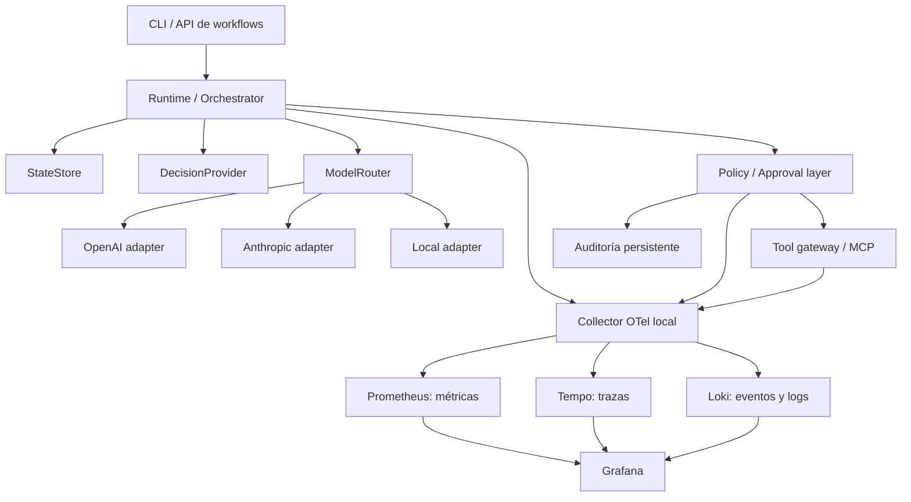

# Plan de trabajo — Plataforma local agnóstica de agentes

Fecha: 4 de octubre de 2026
Estado al 6 de octubre de 2026: GPU, Docker, Ollama/Qwen3 y dos ejercicios de OpenHands validados en el host; el bugfix requirió guía humana. Pila de observabilidad desplegada y vista general más seis dashboards especializados provisionados; las nueve sondas, callback LLM, ingestión y canarias de privacidad pasaron en el host; falta validar la primera conversación observada de OpenHands. La plataforma agnóstica completa y sus políticas siguen pendientes.

## 1. Objetivo

Construir una plataforma de agentes reproducible en Linux, inicialmente con Docker Compose, que permita sustituir el runtime, los modelos, el motor de decisiones y las herramientas sin rediseñar toda la aplicación. La seguridad, la auditoría y la observabilidad formarán parte del diseño desde el primer flujo ejecutable.

El primer hito será una implementación local que ejecute un workflow de extremo a extremo, aplique políticas antes de usar herramientas, solicite aprobación cuando corresponda, persista su estado y genere métricas, trazas y eventos visibles en Grafana.

Este documento recoge lo planteado en «Proyecto IA Local #1». Las afirmaciones del chat sobre productos, licencias, rendimiento y calibración de motores de decisiones se verificarán antes de elegir dependencias.

## 2. Principios y alcance

- **Agnóstico de modelos:** adapters para OpenAI, Anthropic y modelos locales; el workflow no dependerá de sus SDK ni de sus formatos particulares.
- **Runtime desacoplado:** un orchestrator coordinará los componentes mediante contratos. OpenHands podrá integrarse más adelante como runtime, sin convertirse en una dependencia obligatoria.
- **Decisiones intercambiables:** `DecisionProvider` permitirá reglas locales, clasificadores y modelos. Jev será opcional y nunca necesario para arrancar.
- **Prioridad local y abierta:** empezar con reglas deterministas y evaluar alternativas abiertas sobre datos representativos antes de adoptarlas.
- **Seguridad fuera del modelo:** una capa de autorización controlará herramientas, alcance, destino y aprobaciones. Las respuestas del modelo no otorgarán permisos.
- **Privacidad por defecto:** no guardar prompts, respuestas, argumentos de herramientas, PII ni secretos en telemetría. Cualquier almacenamiento de contenido requerirá un diseño explícito de acceso y retención.
- **Reproducibilidad:** versiones fijadas, configuración declarativa, datos sintéticos, comandos documentados y tests significativos.
- **Evolución a enterprise:** mantener contratos y servicios portables; abordar Kubernetes, identidad corporativa y alta disponibilidad cuando el MVP esté validado.

No forman parte del MVP una plataforma multiusuario de producción, un agente con acceso arbitrario al sistema ni automatizaciones sobre cuentas externas reales.

## 3. Arquitectura objetivo



La auditoría persistente conservará las decisiones y aprobaciones necesarias para reconstruir una ejecución. Loki permitirá consultarlas operativamente, pero no será la única fuente de auditoría. Un `DecisionProvider` elegirá entre opciones del workflow; la autorización seguirá siendo responsabilidad de la capa de seguridad.

## 4. Fases

### Fase 0 — Acordar el primer caso de uso y las restricciones

**Trabajo**

- Definir el contrato del primer workflow: entrada, salida, decisiones, herramientas y resultado esperado.
- Propuesta inicial: triage de mensajes sintéticos desde archivos locales, con clasificación, resumen y derivación a revisión humana. La integración con correo real llegará después.
- Identificar hardware Linux disponible, capacidad de ejecutar Docker, disponibilidad de GPU y límites de memoria/disco.
- Acordar si se permitirán proveedores cloud, un presupuesto máximo y las categorías de datos que podrán salir del equipo.
- Definir actores, límites de confianza y acciones que exigirán aprobación.

**Entregables:** especificación del MVP, ejemplos sintéticos y modelo de amenazas inicial.

**Criterio de cierre:** el workflow tiene resultados verificables, permisos acotados y límites de coste y datos definidos. Puede desarrollarse inicialmente sin GPU ni claves cloud.

### Fase 1 — Arquitectura, contratos y repositorio

**Trabajo**

- Crear un repositorio de trabajo separado del material sincronizado bajo `sources/`, que se mantendrá como referencia de solo lectura.
- Documentar decisiones de arquitectura y responsabilidades de cada componente.
- Definir interfaces `Runtime`, `ModelProvider`, `ModelRouter`, `DecisionProvider`, `StateStore`, `ToolGateway`, `PolicyEngine` y `ApprovalStore`.
- Normalizar solicitudes y resultados: identificadores de ejecución, errores, uso de tokens, capacidades, decisiones y estados.
- Diseñar la máquina de estados: pendiente, ejecutando, esperando aprobación, completado, fallido y cancelado.
- Definir timeouts, cancelación, reintentos limitados e idempotencia de acciones con efectos externos.

**Entregables:** estructura inicial, contratos, diagramas y registros de decisiones de arquitectura.

**Criterio de cierre:** un runtime y adapters simulados ejecutan el mismo contrato sin importar SDKs de proveedores en la lógica del workflow.

### Fase 2 — Entorno local y contrato de observabilidad

**Trabajo**

- Preparar Docker Compose con OTel Collector, Prometheus, Tempo, Loki y Grafana. En el laboratorio existente, añadir LiteLLM Proxy mediante su callback OTel; reutilizar tracing nativo de OpenHands y filelog antes de plantear adaptadores propios. PostgreSQL llegará con el state store, cuando exista el runtime.
- Documentar cobertura efectiva, riesgos de captura en origen, propagación de contexto pendiente y métricas futuras; ver [observabilidad](observability.md), [ADR 001](architecture/adr-001-observability.md) y [diagramas](architecture/observability_diagrams.md).
- Añadir persistencia, health checks, versiones fijadas y un archivo de ejemplo de configuración sin credenciales.
- Exponer en localhost solo los puertos necesarios; mantener los backends en redes internas y separar el acceso saliente a proveedores.
- Definir métricas, atributos y eventos de baja cardinalidad antes de instrumentar los componentes.
- Crear spans `agent.run`, `decision.route`, `llm.request`, `policy.evaluate` y `tool.call`.
- Emitir métricas, trazas y logs mediante OpenTelemetry. Configurar batching, límites de memoria y una segunda barrera de filtrado en el Collector.
- Evitar contenido sensible en origen y comprobar que también se excluye del estado persistente cuando no sea necesario.
- Definir retención inicial y procedimientos de arranque, parada y eliminación explícita de datos locales.

**Entregables:** Compose, configuraciones de observabilidad y contrato de telemetría documentado.

**Criterio de cierre:** una ejecución sintética llega a los tres backends y puede localizarse por su identificador de traza. Los identificadores de ejecución no aparecen como etiquetas de métricas.

### Fase 3 — Providers de modelos y routing básico

**Trabajo**

- Implementar adapters para OpenAI, Anthropic y un servidor local, escogiendo inicialmente una opción entre Ollama, vLLM o llama.cpp tras verificar recursos y compatibilidad.
- Mantener un provider simulado para desarrollo y tests sin red ni coste.
- Normalizar respuestas, consumo de tokens, errores y capacidades; hacer explícitas las funciones no soportadas por cada provider.
- Incorporar timeouts, reintentos acotados y tratamiento de errores transitorios y límites de API.
- Crear un router basado en configuración, capacidades, sensibilidad de datos y presupuesto.
- Registrar coste estimado solo cuando existan tarifas configuradas; mostrar coste desconocido si faltan datos. Separar coste de API de coste operativo local.
- Impedir fallback cloud cuando la política de datos no lo permita.

**Entregables:** adapters, configuración del catálogo de modelos y router inicial.

**Criterio de cierre:** el mismo workflow funciona con el provider simulado y uno local. Los adapters cloud pasan tests de contrato con respuestas simuladas; su validación real requerirá credenciales y presupuesto autorizados.

### Fase 4 — DecisionProvider local e intercambiable

**Trabajo**

- Implementar primero un motor de reglas local, determinista y explicable para el caso de uso inicial.
- Definir salida tipada: opción válida, motivo acotado, abstención y confianza opcional. No presentar una puntuación del modelo como probabilidad calibrada sin evaluación.
- Implementar una segunda estrategia intercambiable, por ejemplo un clasificador local o un pequeño modelo con salida estructurada validada.
- Verificar candidatos mencionados en el chat, incluidos Laya, Kev y otras alternativas, revisando existencia, licencia, mantenimiento, hardware y calidad antes de seleccionar alguno.
- Medir exactitud, falsos positivos/negativos, latencia, coste y tasa de abstención. Medir calibración solo si la estrategia produce probabilidades evaluables.
- Definir escalación a otro modelo o a revisión humana con límites explícitos.

**Entregables:** dos implementaciones del contrato y un conjunto de evaluación sintético etiquetado.

**Criterio de cierre:** se cambia de motor por configuración; una salida inválida o insuficiente no desencadena una acción y queda registrada como abstención o escalación.

### Fase 5 — Estado, auditoría y reanudación

**Trabajo**

- Implementar el state store con PostgreSQL y migraciones versionadas.
- Persistir ejecuciones, pasos, referencias a resultados, decisiones, aprobaciones y claves de idempotencia.
- Guardar solo contenido necesario, con retención y acceso definidos; nunca claves de API.
- Añadir auditoría con actor, acción, política/version, resultado, fecha e identificadores de correlación, evitando argumentos sensibles.
- Diseñar recuperación tras interrupciones y separación entre reintento seguro y acción de resultado incierto.
- Posponer Redis y almacenamiento vectorial hasta que una necesidad concreta los justifique.

**Entregables:** esquema, migraciones, implementación del store y procedimiento de backup/restauración local.

**Criterio de cierre:** una ejecución pendiente de aprobación sobrevive a un reinicio. Los tests comprueban que reanudar no duplica una acción y que los estados terminales son coherentes.

### Fase 6 — Herramientas, MCP, políticas y aprobaciones

**Trabajo**

- Crear un catálogo de herramientas con esquemas, capacidades, destinos permitidos y nivel de riesgo definido por configuración de confianza.
- Implementar primero una herramienta local de lectura y una escritura acotada sobre un directorio de trabajo.
- Añadir un cliente MCP compatible con la versión elegida del protocolo, conectado a un servidor local controlado; probar negociación, llamadas, errores y desconexión.
- Aplicar denegación por defecto y autorización antes de cada llamada, tanto para herramientas locales como MCP.
- Vincular las aprobaciones a una acción concreta, sus argumentos, el actor, la versión de política y una caducidad; validar de nuevo antes de ejecutar y evitar reutilización.
- Separar datos no confiables, instrucciones del workflow y permisos para limitar ataques de prompt injection.
- Diseñar aislamiento de workers sin acceso al socket de Docker, con filesystem y red acotados. Un contenedor, por sí solo, no será considerado un sandbox suficiente.
- Emitir eventos de permiso, denegación, aprobación, expiración y fallo de herramienta.

**Entregables:** tool gateway, integración MCP local, políticas declarativas y mecanismo CLI/API de aprobación.

**Criterio de cierre:** los tests demuestran que una acción denegada no se ejecuta, que una modificación invalida la aprobación y que el modelo no puede elevar sus propios permisos.

### Fase 7 — Primer workflow completo

**Trabajo**

- Integrar runtime, routing, decisiones, estado, herramientas y controles de seguridad.
- Ejecutar el triage sintético: leer mensaje, decidir, generar resumen si corresponde y registrar el resultado o esperar aprobación.
- Implementar límites por ejecución de pasos, tiempo, tokens y coste estimado, con cancelación controlada.
- Emitir resultados del workflow y registrar calidad mediante etiquetas verificadas o feedback humano, evitando confundir éxito técnico con corrección del resultado.
- Probar éxito, abstención, denegación, aprobación, expiración, fallo de provider, timeout y reinicio.

**Entregables:** workflow reproducible, fixtures de demo y comando de ejecución.

**Criterio de cierre:** el flujo completo puede ejecutarse sin servicios cloud y reconstruirse a partir del estado, la auditoría y su traza.

### Fase 8 — Dashboards Grafana provisionados

Los dashboards y datasources se cargarán automáticamente desde archivos versionados. Cada panel tendrá una fuente real, unidades claras y una descripción; la ausencia de datos no se presentará como cero.

| Dashboard | Contenido inicial |
| --- | --- |
| Agent operations | Ejecuciones, éxito/fallo, duración p50/p95/p99, actividad, espera de aprobación, timeouts y reintentos. |
| LLM cost / routing | Tokens, coste estimado en el intervalo seleccionado, costes desconocidos, latencia, distribución por provider/modelo, fallbacks y coste por tarea completada. |
| Model quality / escalations | Evaluaciones etiquetadas, errores por categoría, abstenciones, escalaciones y correcciones humanas; calibración cuando haya datos suficientes. |
| Security | Decisiones de políticas, denegaciones, aprobaciones pendientes/concedidas/expiradas y motivos acotados, sin PII ni identidades como etiquetas de alta cardinalidad. |
| Tools / MCP | Llamadas, duración, errores, timeouts y disponibilidad del servidor MCP a partir de comprobaciones reales. |
| Workflow / business KPIs | Entradas procesadas, resultados verificados, revisión humana y correcciones. Tiempo ahorrado solo como estimación con método explícito. |

**Trabajo adicional**

- Correlacionar métricas, trazas y eventos donde lo soporte la instrumentación.
- Añadir variables de workflow/provider/modelo sin permitir etiquetas de texto libre.
- Definir alertas iniciales para fallos, latencia, pérdida de telemetría y acumulación de aprobaciones. Las notificaciones externas se configurarán más adelante.
- Producir una demo controlada que alimente los paneles y permita comparar sus resultados con el estado persistido.

**Entregables:** vista general y seis dashboards especializados JSON, provisioning, reglas de alerta y catálogo de métricas.

**Criterio de cierre:** los siete dashboards aparecen al arrancar Grafana y sus consultas devuelven los resultados esperados para la demo, incluido el tratamiento de denominadores cero y datos ausentes.

### Fase 9 — Validación, endurecimiento y documentación del MVP

**Trabajo**

- Ejecutar tests de contratos, seguridad, recuperación y workflow; añadir integración real de servicios Compose.
- Validar configuración Compose y de los backends, salud, persistencia y provisioning.
- Inyectar fallos de provider, MCP y Collector; comprobar que la pérdida de telemetría no elimina la auditoría persistente.
- Introducir PII y secretos sintéticos para comprobar que no aparecen en logs, trazas, métricas o campos de estado que deban excluirlos.
- Revisar credenciales, permisos, dependencias, exposición de puertos y límites de recursos.
- Documentar instalación Linux, configuración, modelos locales, demo, políticas, aprobaciones, backup, troubleshooting y limitaciones.
- Configurar CI sin secretos para tests y validaciones estáticas; reservar los tests con APIs reales para una ejecución explícita.

**Entregables:** informe de validación, guía de operación y registro de limitaciones.

**Criterio de cierre:** otra persona puede reproducir el MVP desde la documentación y ejecutar los checks. Cualquier validación que el entorno no permita se registra como pendiente, sin declararla aprobada.

### Fase 10 — Integraciones reales y evolución a Kubernetes / enterprise

Esta fase comenzará después de validar el MVP local.

**Trabajo**

- Elegir una primera integración externa y definir sus permisos, datos y aprobaciones antes de activar acciones reales.
- Evaluar OpenHands u otro runtime mediante los contratos existentes y comparar su utilidad sobre el workflow.
- Incorporar clasificadores especializados o motores locales de decisión que superen la evaluación acordada.
- Preparar despliegue Kubernetes: workloads, servicios, probes, límites, volúmenes, secretos y NetworkPolicies.
- Evolucionar a collectors agent/gateway, autenticación entre servicios, TLS, identidad OIDC, RBAC y aislamiento por usuario/tenant.
- Diseñar alta disponibilidad, recuperación, auditoría resistente a alteraciones y retención por requisitos reales.
- Considerar motores de políticas como OPA o Cedar y almacenamiento adicional únicamente cuando aporten una capacidad necesaria.
- Validar licencias y costes operativos, evaluar carga y fijar objetivos de disponibilidad y latencia antes de producción.

**Entregables:** plan de migración, despliegue de prueba y requisitos de producción.

**Criterio de cierre:** el mismo workflow y los mismos contratos funcionan en el entorno nuevo; seguridad, aislamiento y recuperación tienen evidencia de validación propia.

## 5. Estructura propuesta del repositorio

```text
agent-platform/
├── README.md
├── plan.md
├── compose.yaml
├── .env.example
├── apps/
│   ├── api/
│   └── worker/
├── packages/
│   ├── contracts/
│   ├── runtime/
│   ├── providers/
│   ├── routing/
│   ├── decisions/
│   ├── state/
│   ├── tools/
│   ├── security/
│   └── telemetry/
├── workflows/
│   └── synthetic-triage/
├── config/
│   ├── models/
│   └── policies/
├── migrations/
├── observability/
│   ├── otel/
│   ├── prometheus/
│   ├── tempo/
│   ├── loki/
│   └── grafana/
│       ├── provisioning/
│       └── dashboards/
├── tests/
│   ├── unit/
│   ├── contracts/
│   ├── integration/
│   ├── security/
│   └── fixtures/
├── scripts/
│   ├── bootstrap
│   ├── demo
│   └── verify
└── docs/
    ├── architecture.md
    ├── decisions/
    ├── telemetry.md
    ├── security.md
    ├── operations.md
    └── kubernetes-roadmap.md
```

Los paquetes representan límites lógicos, no un compromiso de crear un microservicio por componente. El MVP mantendrá pocos procesos para simplificar su operación. El lenguaje y las dependencias se escogerán en la fase 1 según los contratos y las integraciones necesarias.

## 6. Orden de ejecución e hitos

1. **Diseño aprobado:** fases 0–1, con caso de uso, límites y contratos definidos.
2. **Base local observable:** fase 2, con Compose y telemetría sintética funcionando.
3. **Componentes intercambiables:** fases 3–5, con modelos, decisiones y persistencia probados. El diseño de seguridad de la fase 6 se tendrá en cuenta desde la fase 1.
4. **Flujo protegido de extremo a extremo:** fases 6–7, con aprobaciones y recuperación.
5. **MVP reproducible:** fases 8–9, con siete dashboards y documentación validada.
6. **Ampliación posterior:** fase 10, guiada por necesidades y resultados del MVP.

La seguridad se implementará antes de habilitar herramientas con efectos; la instrumentación se añadirá a cada componente conforme se construya. Los dashboards se completarán cuando sus métricas tengan productores reales.

No se fijan plazos todavía: dependen del hardware disponible, del runtime elegido y de las integraciones. Al cerrar la fase 1 se podrá estimar cada hito con mayor precisión.

## 7. Definición de terminado del primer MVP

- Arranca en Linux con un procedimiento Compose documentado y versiones fijadas.
- Ejecuta el workflow sintético sin Jev, GPU obligatoria ni claves cloud.
- Permite sustituir un provider de modelos y un DecisionProvider por configuración.
- Persiste ejecuciones y aprobaciones, y reanuda sin duplicar las acciones verificadas en tests.
- Autoriza todas las herramientas mediante políticas y bloquea acciones sin aprobación válida.
- Exporta métricas, trazas y eventos a través del Collector local.
- Provisiona la vista general y los seis dashboards especializados y muestra datos verificables de la demo.
- Excluye contenido sensible de la telemetría y supera los tests con PII/secretos sintéticos.
- Incluye tests, comandos de validación, guía de operación y limitaciones conocidas.
- Mantiene documentada la ruta hacia Kubernetes sin exigirlo para operar localmente.

## 8. Situación inicial

La carpeta de trabajo contiene las instrucciones del proyecto y este plan; no hay implementación todavía. Python está disponible en el entorno revisado y Docker no está instalado. El arranque y las pruebas completas de Compose deberán hacerse en un host Linux con Docker disponible. Esta limitación no impide empezar por contratos, estructura, tests y configuraciones.

**Siguiente trabajo previsto:** ejecutar las fases 0 y 1, concretar el workflow sintético y crear el repositorio inicial siguiendo este plan.

## Herramientas de trabajo acordadas

- `mise.toml` y `mise.lock`: versiones y entorno de herramientas de desarrollo.
- `Taskfile.yml`: coordinación de tareas y secuencias de preparación/comprobación.
- `scripts/bootstrap/`, `scripts/host/`, `scripts/repo/`, `scripts/llm/` y `scripts/openhands/`: implementación de comandos por responsabilidad.
- `infra/`: configuración declarativa y versiones de infraestructura.
- `docs/`: documentación detallada y diagnósticos revisados.

El primer entorno GPU/Docker está validado en el host. La migración de tareas mise a go-task pasó la validación de plan y sintaxis; su comprobación GPU completa se ejecutará en el host. Ver [entorno](environment.md).

## Avance de observabilidad — 5 de octubre de 2026

La propuesta se concreta con integraciones existentes, sin adaptador propio de conversaciones: LiteLLM → OTLP → Collector; filelog para los logs Docker seleccionados; tracing nativo de OpenHands como paso optativo y sintético. Se prepararon Compose con digests, filtros, fuentes Grafana, una vista general y seis dashboards especializados y tareas en `scripts/observability/`. mise conserva la gestión del entorno y go-task coordina.

Se validan configuraciones con los binarios fijados y una prueba del Collector que intenta filtrar contenido sensible. La ejecución Docker de la pila, la ruta real del nuevo perfil y la correlación de spans siguen pendientes de comprobar en el host. Los paneles de calidad, políticas/MCP y negocio explicitan lo que aún no está instrumentado; no se declara cerrada la fase 2.

El principio de no capturar contenido en origen se aplica al proxy LLM. El tracing nativo del SDK puede capturar entradas/resultados antes del Collector; por eso no se activa en el arranque normal. Antes de usar datos personales hay que resolver esa diferencia y revisar estado/logs locales, además de los backends.

La vista general añade nueve sondas HTTP con Blackbox Exporter, métricas internas del Collector y dos alertas locales comprobadas con escenarios de activación/recuperación. Las métricas de GPU/host, calidad, políticas y negocio continúan pendientes. Ver [dashboards](dashboards.md).

Aceptación del 6 de octubre: `observability:up` y `observability:check` completaron con éxito en el host. Confirmadas nueve sondas sanas, respuesta del modelo autenticada, traza/métricas nativas LLM y canarias sanitizadas; Grafana muestra datos reales. Pendiente conversación OpenHands por LiteLLM y correlación completa del agente. Evidencia: [diagnóstico](diagnostics/observability-2026-10-06.md).

Dashboards actualizados con golden signals de alcance explícito y totales de solicitudes/errores/tokens: acumulados actuales y estimaciones por período. Tasas conservadas. Recarga y 43 consultas verificadas en Grafana; saturación de GPU/servidor LLM e histórico durable de uso siguen pendientes.

### Ajuste de observabilidad de caché — 6 de octubre de 2026

Se comprobó reutilización real de prefijo en Ollama y se prepararon paneles de cache-read/write mediante el callback Prometheus nativo LiteLLM y receiver autenticado del Collector. Configuración, privacidad y ausencia de doble suma verificadas aisladamente. Aplicado al host: `observability:cache:check` pasó el 6 de octubre a las 09:57 Europe/Berlin, con 1.623 tokens reutilizados cotejados. Pendiente confirmar una nueva llamada de la conversación reportada después de volver a seleccionar su perfil. No se considera resuelto el cotejo histórico OpenHands/proxy hasta disponer de esa evidencia. Detalle en `docs/diagnostics/tokens-2026-10-06.md`.

Migración de configuración, 6 de octubre: fuentes Collector/manifiestos de versiones en YAML; entorno Python/PyYAML fijado con mise, venv y hashes. Los dashboards y artefactos generados conservan JSON. Próximo cierre del laboratorio: confirmar uso real de una conversación OpenHands por el proxy (incluido streaming), antes de ampliar el runtime y el primer workflow de triage sintético.

Hallazgo de ruta: el diagnóstico del host confirmó `direct Ollama` en la conversación afectada. Preparadas reparación por API y prueba de streaming, con tests de validación. La reparación por API fue aplicada con éxito en el host: conversación/default por LiteLLM y streaming activo. La prueba SSE cotejó exactamente 23 tokens de entrada y 8 de salida; después Grafana mostró entrada 16.646, salida 2.243 y tres llamadas adicionales, incluyendo la prueba. El fallo de ruta queda cerrado. La correlación detallada por conversación sigue pendiente; el siguiente paso del plan es el primer workflow sintético con decisiones y aprobación explícitas.


7 de octubre de 2026: corregida la separación de responsabilidades del ambiente. mise declara instalación y validación del entorno, Task declara operación de servicios/tests de código y scripts categorizados contienen la implementación. Esta reorganización no reinstala Docker ni reinicia servicios.


Dependencias Python centralizadas en pyproject.toml/uv.lock con uv fijado por mise. Se conserva la separación ambiente/operación y los nombres de documentos en minúsculas.
