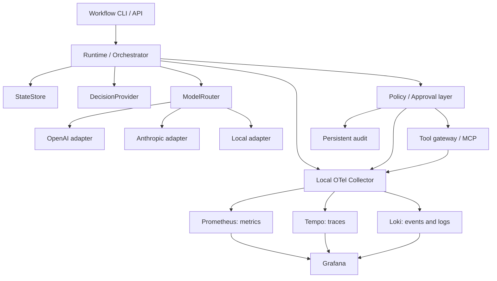

# Implementation Plan — Model-Agnostic Local Agent Platform

Date: October 4, 2026
Status as of October 7, 2026: GPU, Docker, Ollama/Qwen3 and two OpenHands exercises validated on the host; the bugfix required human guidance. Observability stack deployed and general overview plus six specialized dashboards provisioned; the nine probes, callback LLM, ingestion and privacy canaries passed on the host; validation of the first observed OpenHands conversation is pending. The complete agnostic platform and its policies remain pending.

## 1. Objective

Build a reproducible agent platform on Linux, initially with Docker Compose, that allows replacing the runtime, models, decision engine and tools without redesigning the entire application. Security, auditing and observability will form part of the design from the first executable flow.

The first milestone will be a local implementation that executes an end-to-end workflow, applies policies before using tools, requests approval when appropriate, persists its state and generates metrics, traces and events visible in Grafana.

This document collects the content from «IA Local Project #1». Statements from the chat about products, licenses, performance and calibration of decision engines will be verified before choosing dependencies.

## 2. Principles and Scope

- **Model Agnosticism:** adapters for OpenAI, Anthropic and local models; the workflow will not depend on their SDKs or particular formats.
- **Decoupled Runtime:** an orchestrator will coordinate components through contracts. OpenHands can be integrated later as runtime, without becoming a mandatory dependency.
- **Interchangeable Decisions:** `DecisionProvider` will allow local rules, classifiers and models. Jev will be optional and never necessary to start.
- **Local and Open Priority:** start with deterministic rules and evaluate open alternatives on representative data before adopting them.
- **Security Outside the Model:** a layer of authorization will control tools, scope, destination and approvals. Model responses will not grant permissions.
- **Privacy by Default:** do not save prompts, responses, tool arguments, PII or secrets in telemetry. Any storage of content will require an explicit access and retention design.
- **Reproducibility:** pinned versions, declarative configuration, synthetic data, documented commands and significant tests.
- **Evolution to Enterprise:** maintain portable contracts and services; address Kubernetes, corporate identity and high availability when the MVP is validated.

A production multi-user platform, an agent with arbitrary system access, and automations over real external accounts are not part of the MVP.

## 3. Target Architecture



Persistent auditing will retain the necessary decisions and approvals to reconstruct an execution. Loki will allow operational querying, but will not be the only source of auditing. A `DecisionProvider` will choose among workflow options; the authorization will remain the responsibility of the security layer.

## 4. Phases

### Phase 0 — Agree on the first use case and constraints

**Work**

- Define the contract of the first workflow: input, output, decisions, tools and expected result.
- Initial proposal: synthetic message triage from local files, with classification, summary and routing to human review. Integration with real email will come later.
- Identify available Linux hardware, capacity to run Docker, availability of GPU and memory/disk limits.
- Agree on whether cloud providers will be allowed, a maximum budget and the data categories that can leave the device.
- Define actors, trust limits and actions that will require approval.

**Deliverables:** MVP specification, synthetic examples and initial threat model.

**Closure Criteria:** The workflow has verifiable results, limited permissions and defined cost and data limits. It can be developed initially without GPU or cloud keys.

### Phase 1 — Architecture, Contracts and Repository

**Work**

- Create a separate work repository from the synchronized material under `sources/`, which will be maintained as a read-only reference.
- Document architectural decisions and responsibilities of each component.
- Define interfaces `Runtime`, `ModelProvider`, `ModelRouter`, `DecisionProvider`, `StateStore`, `ToolGateway`, `PolicyEngine` and `ApprovalStore`.
- Normalize requests and results: execution identifiers, errors, token usage, capabilities, decisions and states.
- Design the state machine: pending, executing, waiting for approval, completed, failed and canceled.
- Define timeouts, cancellation, limited retries and idempotency of actions with external effects.

**Deliverables:** Initial structure, contracts, diagrams and architectural decision records.

**Closure Criteria:** A runtime and simulated adapters execute the same contract regardless of provider SDKs in the workflow logic.

### Phase 2 — Local environment and observability contract

**Work**

- Prepare Docker Compose with OTel Collector, Prometheus, Tempo, Loki, and Grafana. In the existing local platform, add LiteLLM Proxy via its OTel callback; reuse native OpenHands tracing and filelog before proposing custom adapters. PostgreSQL will come with the state store, when the runtime exists.
- Document effective coverage, risks of capture at source, pending context propagation, and future metrics; see [observability](observability.md), [ADR 001](architecture/adr-001-observability.md) and [diagrams](architecture/observability_diagrams.md).
- Add persistence, health checks, pinned versions, and an example configuration file without credentials.
- Expose only necessary ports in localhost; keep backends in internal networks and separate outgoing access to providers.
- Define metrics, attributes, and events of low cardinality before instrumenting the components.
- Create spans `agent.run`, `decision.route`, `llm.request`, `policy.evaluate`, and `tool.call`.
- Emit metrics, traces, and logs via OpenTelemetry. Configure batching, memory limits, and a second filtering barrier in the Collector.
- Avoid sensitive content at source and check that it is also excluded from the persistent state when not necessary.
- Define initial retention and procedures for startup, shutdown, and explicit deletion of local data.

**Deliverables:** Compose, observability configurations, and documented telemetry contract.

**Closure criterion:** a synthetic execution reaches the three backends and can be located by its trace identifier. The execution identifiers do not appear as metric labels.

### Phase 3 — Model providers and basic routing

**Work**

- Implement adapters for OpenAI, Anthropic, and a local server, choosing initially an option between Ollama, vLLM, or llama.cpp after verifying resources and compatibility.
- Maintain a simulated provider for development and tests without network or cost.
- Normalize responses, token consumption, errors, and capabilities; make explicit the functions not supported by each provider.
- Incorporate timeouts, bounded retries, and handling of transient errors and API limits.
- Create a router based on configuration, capabilities, data sensitivity, and budget.
- Register estimated cost only when tariffs are configured; show unknown cost if data is missing. Separate API cost from local operational cost.
- Prevent fallback to cloud when the data policy does not allow it.

**Deliverables:** adapters, model catalog configuration, and initial router.

**Closure criterion:** the same workflow functions with the simulated provider and a local one. The cloud adapters pass contract tests with simulated responses; their real validation will require authorized credentials and budget.

### Phase 4 — Local and interchangeable DecisionProvider

**Work**

- Implement first a local, deterministic, and explainable rule-based engine for the initial use case.
- Define typed output: valid option, bounded reason, abstention, and optional confidence. Do not present a model score as a calibrated probability without evaluation.
- Implement a second interchangeable strategy, for example a local classifier or a small model with structured output validated.
- Verify mentioned candidates in the chat, including Laya, Kev, and other alternatives, reviewing existence, license, maintenance, hardware, and quality before selecting any.
- Measure accuracy, false positives/negatives, latency, cost, and abstention rate. Measure calibration only if the strategy produces evaluable probabilities.
- Define escalation to another model or human review with explicit limits.

**Deliverables:** two implementations of the contract and a labeled synthetic evaluation set.

**Closure criterion:** the engine changes by configuration; an invalid or insufficient output does not trigger an action and is recorded as abstention or scaling.

### Phase 5 — State, audit, and resumption

**Work**

- Implement the state store with PostgreSQL and versioned migrations.
- Persist executions, steps, references to results, decisions, approvals, and idempotency keys.
- Save only necessary content, with defined retention and access; never API keys.
- Add audit with actor, action, policy/version, result, date, and correlation identifiers, avoiding sensitive arguments.
- Design recovery after interruptions and separation between safe retry and result uncertain action.
- Postpone Redis and vector storage until a concrete need justifies them.

**Deliverables:** schema, migrations, store implementation, and local backup/restoration procedure.

**Closure criterion:** a pending execution awaiting approval survives a restart. Tests verify that resuming does not duplicate an action and that terminal states are consistent.

### Phase 6 — Tools, MCP, policies, and approvals

**Work**

- Create a tool catalog with schemas, capabilities, allowed destinations, and risk level defined by trust configuration.
- Implement first a local read tool and a limited write over a working directory.
- Add an MCP client compatible with the chosen protocol version, connected to a local server under control; test negotiation, calls, errors, and disconnection.
- Apply default denial and authorization before each call, both for local tools and MCP.
- Link approvals to a specific action, its arguments, the actor, policy version, and expiration; validate again before execution and avoid reuse.
- Separate unreliable data, workflow instructions, and permissions to limit prompt injection attacks.
- Design worker isolation without access to Docker socket, with limited filesystem and network. A container, by itself, will not be considered a sufficient sandbox.
- Emit permission, denial, approval, expiration, and tool failure events.

**Deliverables:** tool gateway, local MCP integration, declarative policies, and CLI/API approval mechanism.

**Closure criterion:** tests demonstrate that a denied action does not execute, that a modification invalidates the approval, and that the model cannot elevate its own permissions.

### Phase 7 — First complete workflow

**Work**

- Integrate runtime, routing, decisions, state, tools, and security controls.
- Execute synthetic triage: read message, decide, generate summary if applicable, and record the result or wait for approval.
- Implement limits per step execution, time, tokens, and estimated cost, with controlled cancellation.
- Emit workflow results and record quality through verified tags or human feedback, avoiding confusing technical success with result correctness.
- Test success, abstention, denial, approval, expiration, provider failure, timeout, and restart.

**Deliverables:** reproducible workflow, demo fixtures, and execution command.

**Closure criterion:** the complete flow can execute without cloud services and be reconstructed from the state, audit, and its trace.

### Phase 8 — Provisioned Grafana dashboards

The dashboards and data sources will be automatically loaded from versioned files. Each panel will have a real source, clear units, and a description; the absence of data will not be presented as zero.

| Dashboard | Initial Content |
| --- | --- |
| Agent operations | Executions, success/failure, duration p50/p95/p99, activity, approval wait, timeouts, and retries. |
| LLM cost / routing | Tokens, estimated cost in the selected interval, unknown costs, latency, distribution by provider/model, fallbacks, and cost per completed task. |
| Model quality / escalations | Labeled evaluations, errors by category, abstentions, escalations, and human corrections; calibration when there is sufficient data. |
| Security | Policy decisions, denials, pending/approved/expired approvals, and limited reasons, without PII or identities as high cardinality labels. |
| Tools / MCP | Calls, duration, errors, timeouts, and MCP server availability from real checks. |
| Workflow / business KPIs | Processed inputs, verified results, human review, and corrections. Time saved only as an estimate with an explicit method. |

**Additional work**

- Correlate metrics, traces, and events where supported by instrumentation.
- Add workflow/provider/model variables without allowing free-text labels.
- Define initial alerts for failures, latency, telemetry loss, and accumulation of approvals. External notifications will be configured later.
- Produce a controlled demo that feeds the panels and allows comparing their results with the persisted state.

**Deliverables:** overview view and six specialized JSON dashboards, provisioning, alert rules, and metric catalog.

**Closure criterion:** the seven dashboards appear on Grafana startup and their queries return the expected demo results, including treatment of zero denominators and missing data.

### Phase 9 — Validation, hardening, and documentation of the MVP

**Work**

- Execute contract, security, recovery, and workflow tests; add real integration of Compose services.
- Validate Compose configuration and backend settings, health, persistence, and provisioning.
- Inject provider, MCP, and Collector failures; check that telemetry loss does not eliminate persistent audit.
- Introduce synthetic PII and secrets to verify that they do not appear in logs, traces, metrics, or state fields that should exclude them.
- Review credentials, permissions, dependencies, port exposure, and resource limits.
- Document Linux installation, configuration, local models, demo, policies, approvals, backup, troubleshooting, and limitations.
- Configure CI without secrets for tests and static validations; reserve real API tests for explicit execution.

**Deliverables:** validation report, operations guide, and limitations registry.

**Closure criterion:** another person can reproduce the MVP from the documentation and execute the checks. Any validation that the environment does not allow is registered as pending, without declaring it approved.

### Phase 10 — Real integrations and evolution to Kubernetes / enterprise

This phase will begin after validating the local MVP.

**Work**

- Choose a first external integration and define its permissions, data, and approvals before activating real actions.
- Evaluate OpenHands or another runtime through existing contracts and compare its utility over the workflow.
- Incorporate specialized classifiers or local decision engines that surpass the agreed evaluation.
- Prepare Kubernetes deployment: workloads, services, probes, limits, volumes, secrets, and NetworkPolicies.
- Evolve to agent/gateway collectors, service-to-service authentication, TLS, OIDC identity, RBAC, and user/tenant isolation.
- Design high availability, recovery, tamper-resistant auditing, and retention according to real requirements.
- Consider policy engines like OPA or Cedar and additional storage only when they provide a necessary capability.
- Validate licenses and operational costs, assess load, and set availability and latency targets before production.

**Deliverables:** migration plan, test deployment, and production requirements.

**Closure criterion:** the same workflow and the same contracts function in the new environment; security, isolation, and recovery have their own validation evidence.

## 5. Proposed repository structure

```text
agent-platform/
├── README.md
├── plan.md
├── compose.yaml
├── .env.example
├── apps/
│   ├── api/
│   └── worker/
├── packages/
│   ├── contracts/
│   ├── runtime/
│   ├── providers/
│   ├── routing/
│   ├── decisions/
│   ├── state/
│   ├── tools/
│   ├── security/
│   └── telemetry/
├── workflows/
│   └── synthetic-triage/
├── config/
│   ├── models/
│   └── policies/
├── migrations/
├── observability/
│   ├── otel/
│   ├── prometheus/
│   ├── tempo/
│   ├── loki/
│   └── grafana/
│       ├── provisioning/
│       └── dashboards/
├── tests/
│   ├── unit/
│   ├── contracts/
│   ├── integration/
│   ├── security/
│   └── fixtures/
├── scripts/
│   ├── bootstrap
│   ├── demo
│   └── verify
└── docs/
    ├── architecture.md
    ├── decisions/
    ├── telemetry.md
    ├── security.md
    ├── operations.md
    └── kubernetes-roadmap.md
```

The packages represent logical boundaries, not a commitment to create a microservice per component. The MVP will maintain few processes to simplify its operation. The language and dependencies will be chosen in the phase 1 according to the contracts and the necessary integrations.

## 6. Execution order and milestones

1. **Approved design:** phases 0–1, with use case, boundaries, and contracts defined.
2. **Local observable base:** phase 2, with Compose and synthetic telemetry functioning.
3. **Interchangeable components:** phases 3–5, with models, decisions, and persistence tested. The security design of phase 6 will be considered from phase 1.
4. **End-to-end protected flow:** phases 6–7, with approvals and recovery.
5. **Reproducible MVP:** phases 8–9, with seven dashboards and validated documentation.
6. **Post-expansion:** phase 10, guided by needs and MVP results.

Security will be implemented before enabling tools with effects; instrumentation will be added to each component as it is built. The dashboards will be completed when their metrics have real producers.

No deadlines are set yet: they depend on available hardware, chosen runtime, and integrations. Once phase 1 is closed, each milestone can be estimated with greater precision.

## 7. Definition of completion of the first MVP

- Starts on Linux with a documented Compose procedure and pinned versions.
- Executes the synthetic workflow without Jev, mandatory GPU, or cloud keys.
- Allows substitution of a model provider and a DecisionProvider via configuration.
- Persists executions and approvals, and resumes without duplicating verified actions in tests.
- Authorizes all tools through policies and blocks actions without valid approval.
- Exports metrics, traces, and events through the local Collector.
- Provides the overview and six specialized dashboards and shows verifiable data from the demo.
- Excludes sensitive content from telemetry and passes tests with synthetic PII/secrets.
- Includes tests, validation commands, operation guide, and known limitations.
- Maintains documentation of the path toward Kubernetes without requiring it for local operation.

## 8. Initial situation

The work folder contains the project instructions and this plan; there is no implementation yet. Python is available in the reviewed environment and Docker is not installed. The startup and full testing of Compose must be done on a Linux host with Docker available. This limitation does not prevent starting with contracts, structure, tests, and configurations.

**Next planned work:** execute phases 0 and 1, concretize the synthetic workflow, and create the initial repository following this plan.

## Agreed work tools

- `mise.toml` and `mise.lock`: versions and development tool environment.
- `Taskfile.yml`: task coordination and preparation/check sequences.
- `scripts/bootstrap/`, `scripts/host/`, `scripts/repo/`, `scripts/llm/`, and `scripts/openhands/`: command implementation by responsibility.
- `infra/`: declarative configuration and infrastructure versions.
- `docs/`: detailed documentation and reviewed diagnostics.

The first GPU/Docker environment is validated on the host. The migration of tasks mise to go-task passed the plan and syntax validation; its full GPU check will be executed on the host. See [environment](environment.md).

## Observability progress — October 5, 2026

The proposal is concretized with existing integrations, without a proprietary conversation adapter: LiteLLM → OTLP → Collector; filelog for selected Docker logs; native OpenHands tracing as an optional and synthetic step. Compose with digests, filters, Grafana sources, an overview, six specialized dashboards, and tasks in `scripts/observability/`. mise retains environment management and go-task coordinates.

Configurations are validated with pinned binaries and a Collector test that attempts to filter sensitive content. Docker execution of the stack, the real path of the new profile, and span correlation remain pending verification on the host. Quality panels, policies/MCP, and business explicitly state what is still not instrumented; the phase 2 is not declared closed.

The principle of not capturing content at the source is applied to the LLM proxy. Native SDK tracing can capture inputs/results before the Collector; that is why it is not activated on normal startup. Before using personal data, this difference must be resolved and local state/logs, as well as backends, must be reviewed.

The overview adds nine HTTP probes with Blackbox Exporter, internal metrics of the Collector and two local alerts verified with activation/recovery scenarios. GPU/host metrics, quality, policies and business metrics continue pending. See [dashboards](dashboards.md).

Acceptance of October 6: `observability:up` and `observability:check` successfully completed on the host. Nine healthy probes confirmed, model response authenticated, native LLM trace/metrics and sanitized canaries; Grafana shows real-time data. Pending OpenHands conversation via LiteLLM and full agent correlation. Evidence: [diagnosis](diagnostics/observability-2026-10-06.md).

Dashboards updated with explicit reach golden signals and totals of requests/errors/tokens: current accumulated and estimates per period. Rates preserved. Reload and 43 queries verified in Grafana; GPU/LLM server saturation and durable usage history remain pending.

### Cache observability tuning — October 6, 2026

Real reutilization of prefix in Ollama was verified and cache-read/write panels were prepared via the native LiteLLM Prometheus callback and authenticated Collector receiver. Configuration, privacy and absence of double summation verified separately. Applied to the host: `observability:cache:check` passed October 6 at 09:57 Europe/Berlin, with 1,623 tokens reutilized verified. Pending confirmation of a new conversation call reported after reselecting its profile. The historical OpenHands/proxy verification is not considered resolved until that evidence is available. Details in `docs/diagnostics/tokens-2026-10-06.md`.

Configuration migration, October 6: Collector/manifests sources in YAML; Python/PyYAML environment pinned with mise, venv and hashes. The dashboards and generated artifacts retain JSON. Next platform local closure: confirm real use of an OpenHands conversation by the proxy (including streaming), before expanding the runtime and the first synthetic triage workflow.

Path finding: the host diagnosis confirmed `direct Ollama` in the affected conversation. Repair via API and streaming test prepared with validation tests. The API repair was successfully applied on the host: conversation/default via LiteLLM and streaming active. The SSE test verified exactly 23 input tokens and 8 output tokens; afterward Grafana showed input 16,646, output 2,243 and three additional calls, including the test. The path failure is closed. Detailed conversation correlation remains pending; the next step in the plan is the first synthetic workflow with decisions and explicit approvals.


October 7, 2026: fixed the separation of responsibilities of the environment. mise declares installation and validation of the environment, Task declares operation of services/test code and categorized scripts contain the implementation. This reorganization does not reinstall Docker nor restart services.


Python dependencies centralized in pyproject.toml/uv.lock with uv pinned by mise. The separation of environment/operation and document names in lowercase are preserved.

## Runtime contract slice — October 7, 2026

The first offline synthetic triage workflow implements typed runtime/provider/router/
decision/state/policy/approval/tool interfaces with two interchangeable model test
substitutes. Read-only preview completes, synthetic recording waits for explicit
approval, disallowed tools are denied and ambiguous input abstains. See
[workflow guide](synthetic_workflow.md) and [ADR 002](architecture/adr-002-runtime-contracts.md).

This is a reference contract slice, not closure of phases 3–7. The in-memory store
is deliberately temporary; PostgreSQL persistence/restart recovery, real local model
integration, OTel export, authenticated approvals and worker isolation remain pending.
