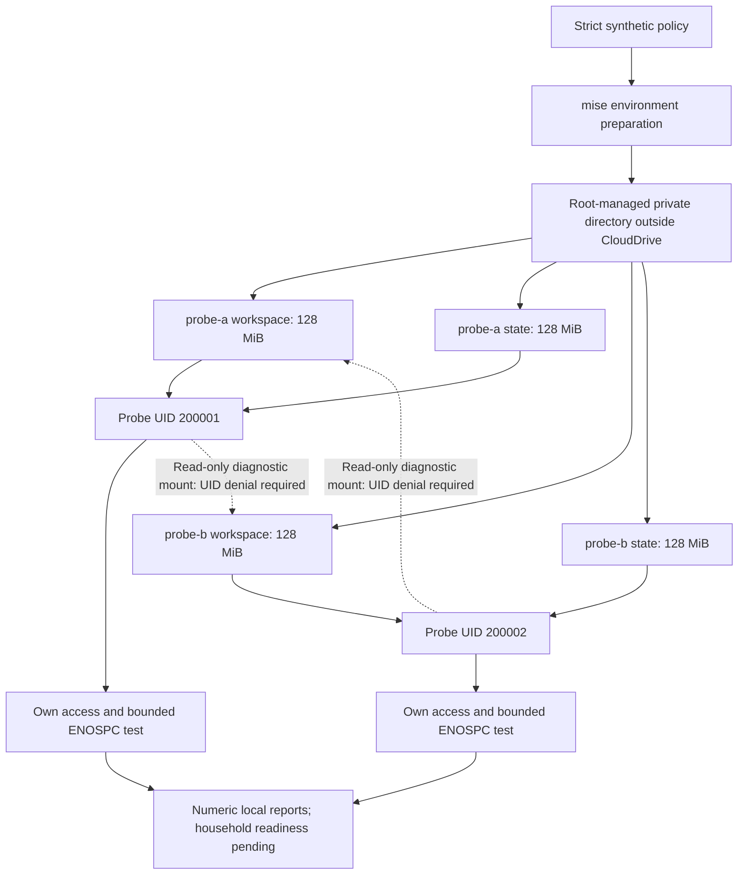

# Synthetic storage isolation pilot

## Status and household sizing

The initial household target is **2–3 people**. Peak simultaneous jobs still need
confirmation; retain the current single-inference concurrency while measuring
capacity. This pilot uses two synthetic identities, not family accounts or logins.
It prepares storage boundaries before application identity integration.

The owner applied setup and passed mounted storage acceptance on October 11,
2026: all four volume probes verified their UID, own access, denied foreign
access, actual ENOSPC and scratch cleanup. Saved report permissions and checker
fingerprints match the current source. Existing OpenHands data, mounts and
services are unchanged. These pilot results do not close SEC-05, SEC-07 or
household readiness; application identity integration remains pending.

## Boundary and capacity

`config/storage/pilot.yaml` fixes identities `probe-a` (UID/GID 200001) and
`probe-b` (200002). Host passwd/group collisions block setup; no host accounts are
created. Each identity receives separate **128 MiB workspace and 128 MiB state**
filesystems: four images, **512 MiB total**. These deliberately small capacities
are test budgets, not final family allocations. Filesystem metadata consumes some
of each allocation; acceptance reports usable capacity and bytes actually written.

The observed host filesystem is ext4, without enabled project-quota options.
Use fixed-size ext4 filesystems backed by fully reserved regular files for this
pilot. The scripts do not remount or reconfigure the host filesystem, edit fstab,
or enable quotas on a desktop partition. They reject other backing filesystems.
Preparation requires enough free space for all four images plus **20 GiB left
free**. That is a point-in-time gate, not a reservation against other host writers.



The foreign read-only mount exists only in the negative diagnostic test. Future
real user containers must receive only their own mounts; this diagram does not
implement an application tenant router or authenticated spaces.

## Paths and permissions

All privileged paths are fixed in `scripts/storage/storage.py`, with no CLI root
path override:

```text
/var/lib/agent-platform/storage-pilot/
  images/probe-a-workspace.ext4
  images/probe-a-state.ext4
  images/probe-b-workspace.ext4
  images/probe-b-state.ext4
  mounts/probe-a/workspace
  mounts/probe-a/state
  mounts/probe-b/workspace
  mounts/probe-b/state
  record.yaml
```

Managed directories are root-controlled; newly created parents use mode 0700.
Backing files and the policy-fingerprint record are root-owned mode 0600. Mounted
filesystem roots are mode 0700 and owned by their distinct synthetic UID/GID.
Root/admin access remains trusted; this pilot does not encrypt backing files.
Use synthetic data only. It neither creates nor stores CA private keys.

Images are exclusively created and preallocated before formatting. A disposable
real-file test found that formatting can release extents even with `nodiscard`;
new images are reserved again after formatting, then checked for full allocation.
Existing images are never reformatted or expanded. Symlinks, hard links, sparse
images, unsafe ancestor permissions, policy mismatch and partial setups fail closed.

Mount options are `loop,rw,nodev,nosuid,noexec,nodiscard`. Verification checks the
exact mountpoint, loop backing file, ext4, required restrictions, owner/mode and
capacity. An ordinary directory on the parent filesystem cannot substitute for
an absent mount. `noexec` does not prevent an interpreter from reading source
code: authorization and container boundaries remain necessary.

## Prepare and validate from the host terminal

The existing uv environment supplies Python/PyYAML. Required host tools are
`findmnt`, `losetup`, `mkfs.ext4`, `mount` and `umount`; these were already present
on the reviewed host. No package installation or new Python dependency is added.

```bash
cd /home/alejandro/CloudDrive/Engineering/agent-platform
mise run env:storage:plan
mise run env:storage:setup
mise run env:storage:check
mise exec -- task storage:accept
```

- **Plan:** inspect tools, unused IDs, backing filesystem and free-space budget;
  no allocation or mounts.
- **Setup:** authenticate sudo, create and format only new synthetic regular
  images, mount them and apply ownership. Completed existing pilots are checked
  before remounting; an incomplete tree is preserved and requires manual review.
- **Check:** verify actual backing files and active mounts. It writes a private
  diagnostic report, but no data inside the pilot filesystems.
- **Accept:** run four bounded probes, one per UID and role, using the cached
  immutable OpenHands image from its deployment lock. No agent, model call,
  network, GPU, port or Docker socket is provided to the probe container.

Each probe runs non-root with a read-only container root, no capabilities,
no-new-privileges, Docker AppArmor, 256 MiB memory, one CPU and 64 PIDs. It must read
its own synthetic canary, fail to read the foreign host/UID canaries, reach
`ENOSPC` while writing within the fixed volume budget, and remove its scratch file.
An unrelated write error does not count as successful quota enforcement.
Any unexpected existing pilot data blocks acceptance before filling the volumes.
Only generated canaries/scratch files and the unique probe containers are cleaned.
A killed/timed-out probe may leave its scratch file; review it locally before
another acceptance attempt rather than deleting an unknown file automatically.

Sudo uses a clean environment; raw command output and credential values are not
printed. Reports are mode 0600 under ignored `artifacts/security/storage-*.json`.
They contain numeric checks and source fingerprints, not trusted authorization
for household access. Success returns 0 for the specific pilot operation;
failure returns 1. `household_readiness` remains pending even after pilot acceptance.

## Unmounting, reboot and future integration

```bash
mise exec -- task storage:unmount
```

This validates active mounts, uses normal unmount, and preserves all images/data.
It does not force or lazily detach busy mounts. There is no automatic image
removal, resize, fstab modification or reboot persistence. After reboot,
`env:storage:check` fails until `env:storage:setup` verifies and remounts the
completed pilot. Current OpenHands is independent of these pilot mounts.

Before migrating real user work, implement required-mount startup guards, backups
and restore acceptance, per-user application state/network routing, and agreed
storage budgets. A missing bounded mount must stop startup, never fall back to a
host directory. Logs, identity database and backups also need separate capacity
budgets. Login/MFA, authenticated cross-user access denial, effective network
isolation, model fairness and broader host protection remain pending.

## Code tests and evidence limits

```bash
mise exec -- task security:storage:test
mise exec -- task repo:commit:check
```

The 31 storage tests cover strict policy, unsafe paths/mounts/IDs, capacity gates,
existing-data preservation, cleanup and acceptance failure behavior. One test
formats only a new disposable regular file and checks post-format reservation.
Mount/ENOSPC/container orchestration tests otherwise use controlled substitutes;
they do not prove live host-mounted isolation. The normal commit gate includes
these tests without sudo, mounting filesystems or starting real agents.

Implementation: `scripts/storage/storage.py`, `acceptance.py` and `run.sh`.
Environment entry points stay in mise; code tests, live probes and unmount
operations stay in Task. Related: [container controls](container_isolation.md),
[SEC checks](security_checks.md), [household plan](plan.md).

Primary references: [util-linux allocation behavior](https://github.com/util-linux/util-linux/blob/master/sys-utils/fallocate.1.adoc),
[util-linux mount options](https://github.com/util-linux/util-linux/blob/master/sys-utils/mount.8.adoc),
[Linux ext4 documentation](https://docs.kernel.org/admin-guide/ext4.html),
[e2fsprogs formatting options](https://github.com/tytso/e2fsprogs/blob/master/misc/mke2fs.8.in).


## Recorded preparation validation — October 11, 2026

The actual host plan passed: ext4, all five required tools present, 63.96 GiB
free, 512 MiB planned allocation and a 20 GiB host free-space gate. Report:
`artifacts/security/storage-mNgqOry1.json`; checker SHA-256
`4aef758838ca0a65d8c10f3de6135ef3eac17b021a8a2f16c30df37d1363b415`.
This plan made no allocation or mounts.

The complete commit gate passed 204 tests, including 31 storage tests; Gitleaks
found no findings across 195 candidate files, staged content or local refs and
passed its canary. Documentation verification resolved 95 local links; whitespace
checks passed. Live privileged setup and mounted acceptance remain pending.


## Owner-applied storage acceptance — October 11, 2026

At 21:35 Europe/Berlin the owner ran plan, setup, check and acceptance successfully.
The plan observed ext4 and 63.52 GiB free. All four 128 MiB images were prepared
and checked, each reporting 103.93 MiB filesystem capacity. Each probe wrote
101.0 MiB before ENOSPC and passed all six checks: expected UID, own canary read,
foreign host-path denial, foreign UID canary denial, disk-full denial and cleanup.

Saved reports independently reviewed:

- Setup: `artifacts/security/storage-pBDdoMuU.json`.
- Mounted check: `artifacts/security/storage-o3IFLHbx.json`.
- Acceptance: `artifacts/security/storage-3MGxvoNk.json`.

All three use mode 0600 and match checker SHA-256
`4aef758838ca0a65d8c10f3de6135ef3eac17b021a8a2f16c30df37d1363b415`.
They document owner-applied pilot results, not signed SEC authorization. Filesystem
structures account for image capacity unavailable to ordinary file contents;
image size, filesystem capacity and bytes written are distinct measurements.

Application tenancy, final family quotas, network isolation, authenticated
HTTP/WebSocket access denial and restart/restore acceptance remain pending.
Existing OpenHands does not use the pilot volumes. No login accounts, CA keys or
LAN exposure were created by these commands. The next step is separate synthetic
application instances with mount and state/credential boundaries before connecting
household authentication.


## Next consumer — prepared October 12, 2026

The [separate-instance pilot](instance_isolation.md) reuses these two synthetic
UIDs and state/workspace filesystems. It verifies required mounts before starting
and explicitly overrides the image's automatic state volume. Deployment and
secret/idle-conversation API isolation acceptance remain pending. Stop the
instances before unmounting; once application state exists, the earlier empty-
volume fill test must not be rerun on it.
