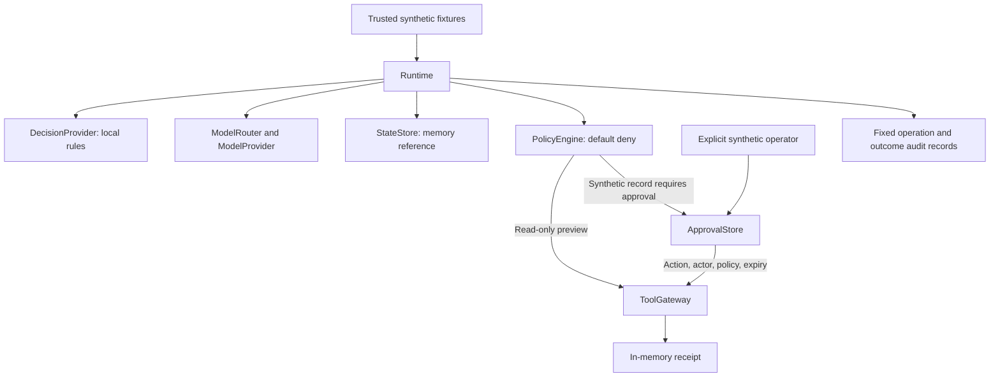

# Synthetic triage: first runtime contract slice

This offline reference implementation starts the decoupled runtime from the
implementation plan. It uses existing Python/PyYAML tooling and no additional
dependencies. It does not replace the running OpenHands/Ollama stack.

## Run with Task

```bash
mise exec -- task workflow:demo
mise exec -- task workflow:demo:approved
mise exec -- task workflow:test
```

`workflow:demo` leaves the access case waiting for approval. The explicitly named
`workflow:demo:approved` grants approval as a synthetic operator inside the same
process and executes the in-memory record. It has no real account, filesystem,
network or shell tool effects. Each invocation creates fresh state.

To select the second offline model substitute directly:

```bash
mise exec -- bash scripts/workflows/demo.sh --provider subject --approve
```

Both providers implement the same `ModelProvider` contract and generate different
summaries. Neither is an LLM; these runs consume no inference tokens.

## Components and responsibilities

| File under `packages/agent_platform/` | Responsibility |
| --- | --- |
| `contracts.py` | Typed messages, results, actions, states and component protocols |
| `runtime.py` | Coordinate dependencies; stop on abstention, denial, approval or failure |
| `providers.py` | Two offline model substitutes and injected static model routing |
| `decisions.py` | Deterministic rules; ambiguous input abstains |
| `security.py` | Default-deny policy and expiring, action-bound one-use approvals |
| `tools.py` | Recheck authorization; preview or record a synthetic receipt in memory |
| `state.py` | In-process state transitions and content-free audit records |
| `demo.py` | Trusted synthetic fixtures and structural acceptance output |



## Acceptance cases

| Fixture | Expected without explicit approval | Expected with approval |
| --- | --- | --- |
| Support | Completed read-only preview | Same |
| Access | Waiting for approval, no receipt | Completed, one receipt |
| Security | Denied before calling the model | Still denied |
| Unknown or ambiguous | Abstained | Still abstained |

Expected outcomes in `workflows/synthetic-triage/cases.yaml` are test assertions,
not permissions. Routing proposes a tool; the policy independently permits a
preview, requires approval for every record, and denies everything else. A model
result has only a bounded summary; an `approved` field is not accepted.

Approval binds the complete action (including summary, case and run) using a
SHA-256 fingerprint, the actor, policy version and expiry. Changing arguments,
using another actor, expiry, policy-version changes or reuse fail validation.
The gateway rechecks policy immediately before execution. Completed runs can be
resumed without executing again. Resuming a valid request before it is granted keeps
it waiting; it does not silently grant approval. Failures after consuming approval become terminal
and are not blindly retried; this is not an exactly-once external-effects guarantee.

## Evidence and limits

Tests cover both provider substitutes, fixture outcomes, approval binding and
expiry, default denial, malicious model permission claims, redaction of provider
errors, output/input bounds and terminal states. `workflow:test` participates in
the existing pre-commit sequence.

State, approvals, receipts and audit live only in memory in a synchronous single
process. They do not survive restart and have no concurrency guarantee. Actor
strings are not authenticated identities; the CLI is a synthetic acceptance
driver, not a multi-user approval service. Python protocols define interfaces,
not isolation from malicious code. All inputs in this phase are synthetic.

Audit stores only run identifiers and fixed operation/outcome values. It is not
immutable, persistent or exported through OpenTelemetry. There are no new Grafana
metrics in this step, no cloud calls and no MCP execution.

The next slices add a persistent PostgreSQL adapter and restart-safe approvals,
then an existing OTel SDK exporter and real local model adapter through LiteLLM.
Collector allowlists and dashboards must be extended and tested before claiming
runtime signals are visible. Human identity, resource/time/token budgets and
worker isolation remain separate requirements in the [plan](plan.md).

Validation on October 7, 2026: both offline provider variants passed all four fixture outcomes; unapproved execution produced zero record receipts and explicit approval produced one. Workflow unit/acceptance tests and the repository commit checks are recorded separately in the changelog. No tokens were consumed or services restarted for these tests.
